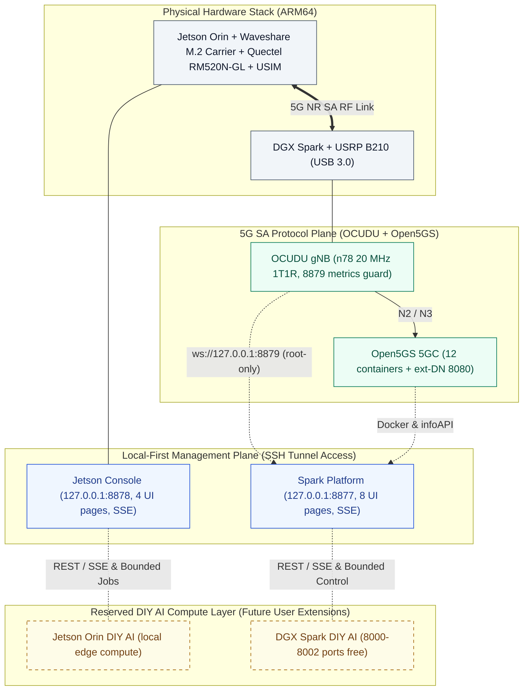

<!-- ASSET_SLOT: docs/assets/brand/logo-light.svg & docs/assets/brand/logo-dark.svg (<picture> dark/light hero banner) -->

# Agentic-OCUDU

**Reproducible End-to-End 5G SA Setup and Dual-End Management Platform**

[English](README.md) | [简体中文](README.zh-CN.md) | [Quickstart](docs/quickstart.md) | [Hardware & Topology](docs/hardware-and-topology.md) | [Documentation Map](docs/README.md)


**Agentic-OCUDU** builds a reproducible, end-to-end **5G Standalone (SA)** data
network on **OCUDU** (RAN) and **Open5GS** (5GC) for the **DGX Spark + USRP B210 +
Jetson Orin + Waveshare M.2 5G Carrier + Quectel RM520N-GL** hardware stack.

<!-- ASSET_SLOT: docs/assets/hardware/kit-overview.jpg | 16:9 full hardware kit & benchtop wiring overview photo -->

## Core Capabilities

1. **Rapid end-to-end bring-up**: Follow a deterministic path from hardware
   wiring and Open5GS container builds to programmable USIM provisioning and
   verified UE user-plane connectivity.
2. **Unified local-first management**: Operate both ends independently through
   **Spark Platform** (`127.0.0.1:8877`) and **Jetson Console** (`127.0.0.1:8878`)
   with live SSE telemetry, evidence-quality checks, automatic Wi-Fi/cellular
   route protection, and bounded recovery.
3. **Reserved dual-end compute for DIY AI**: **DGX Spark** (gNB/core side) and
   **Jetson Orin** (UE side) deliberately reserve local GPU/edge compute headroom,
   free local inference ports (`127.0.0.1:8000–8002` untouched on Spark), and
   authenticated REST/SSE APIs for user-built AI extensions.

> [!NOTE]
> Built-in gNB or UE AI modules are **not** yet shipped in this repository.
> Choosing DGX Spark and Jetson Orin reserves local compute capacity at both
> ends so you can DIY and deploy custom AI modules without altering the 5G
> stack. See [DIY AI Customization](docs/ai-customization.md).

## Four-Layer Architecture



## Hardware and Software Baseline

| Layer | Hardware / Software Stack | Runtime & Endpoint | Baseline / Policy |
| --- | --- | --- | --- |
| Base station & core host | **DGX Spark** (ARM64) + **USRP B210** (USB 3.0) | Ubuntu 24.04, Python 3.12, Docker, systemd | Band `n78`, `20 MHz`, `1T1R` (`tx_gain=80`, `rx_gain=54`) |
| 5G RAN & 5GC | **OCUDU** + **Open5GS** (12 containers + `ext-DN`) | Single IPv4 PDU, `DNN=oai`, pool `10.0.0.0/24` | PLMN `460/03`, `SST=1`, `5QI=9` (no IMS/voice) |
| Base-station console | **Spark Platform** (`apps/spark-platform/`) | `127.0.0.1:8877` (`8879` gNB metrics, root-only) | `0.2.1` |
| UE host & modem | **Jetson Orin** + **[Waveshare M.2 5G Carrier](https://www.waveshare.net/shop/SIM8262E-M2-5G-for-Jetson-Orin.htm)** + **Quectel RM520N-GL** + programmable 5G USIM | Ubuntu 22.04, Python 3.10, RNDIS (`00/01` -> AT `04`) / ECM (`04`/`0a` -> AT `02`) | Independent subscriber identity per UE |
| UE console | **Jetson Console** (`apps/jetson-console/`) | `127.0.0.1:8878` | `0.6.2` |

Both consoles consume the shared Astryx Core, Charts and Neutral theme package
(`packages/console-ui/`), track strictly local host state without a global
fleet controller, and leave services disabled at boot unless an administrator
explicitly enables them.

## Documentation Map

| Goal | Start Here |
| --- | --- |
| Review hardware BOM, wiring topology, ports & OS prerequisites | [Hardware & Topology](docs/hardware-and-topology.md) |
| Deploy Spark, subscriber/SIM and Jetson from zero to connected | [End-to-End Quickstart](docs/quickstart.md) |
| Detailed base-station & core setup | [Spark Setup](docs/setup-bs-spark.md) & [Stack Deployment](deploy/spark/stack/README.md) |
| Detailed UE setup & optional cold-boot coordination | [Jetson Setup](docs/setup-ue-jetson.md) |
| Open5GS subscriber & programmable USIM guide (including TB01) | [SIM Provisioning & TB01 Reference](docs/sim-programming-tb01.md) |
| Web consoles, REST/SSE APIs & daily lifecycle management | [Spark Operations](docs/spark-operations.md) & [Jetson Operations](docs/jetson-operations.md) |
| Dual-end DIY AI boundaries & telemetry/control integration | [DIY AI Customization](docs/ai-customization.md) |
| System architecture, access contract & troubleshooting | [Architecture](docs/architecture.md), [UE Access Policy](docs/ue-access-policy.md), [Full Index](docs/README.md) |

## Repository Map

- `apps/spark-platform/`: Spark collector, FastAPI backend and React/TypeScript web application.
- `apps/jetson-console/`: Jetson device executor, FastAPI backend and React/TypeScript web application.
- `packages/console-ui/`: Shared Astryx Core, Charts and Neutral theme components (`@aoc/console-ui`).
- `stacks/ocudu/`: OCUDU radio build and runtime inputs.
- `stacks/open5gs/`: Open5GS core image build, verification, Compose rendering and subscriber tools.
- `deploy/`: Stack controller (`aoc-v2ctl`), platform installers, restricted maintenance (`aoc-maintain`) and optional Jetson boot coordinator (`boot_connect.py`).
- `scripts/`: Offline ARM64 release builders, Spark metrics guard (`enable_radio_json_metrics.py`) and repository audits.
- `config/`: Versioned network contract (`network-contract.json`), upstream revisions and dependency metadata.
- `docs/`: Paired English and Simplified Chinese documentation, visual asset specs (`docs/assets/README.md`) and hardware verification baselines (`docs/acceptance/`).

Retired implementations and site-migration material live under `archive/` and
are excluded from builds, audits and releases.

## Build and Verify from Source

Requires Python `3.10–3.12` and Node.js `22` (target runtimes: Python `3.10`
for Jetson, Python `3.12` for Spark).

```sh
make install-dev BOOTSTRAP_PYTHON=python3.12
make check
```

If an existing `.venv` uses another Python version, pass `VENV=local/dev-venv`
on both commands. `make check` runs frontend behavior checks, TypeScript checks,
unit tests and repository audits (`docs-audit`, `release-audit`,
`license-audit`, `shell-check`).

See [Contributing](CONTRIBUTING.md), [Security Policy](SECURITY.md) and
[Releasing](docs/releasing.md) before opening pull requests or building offline
ARM64 release archives.
