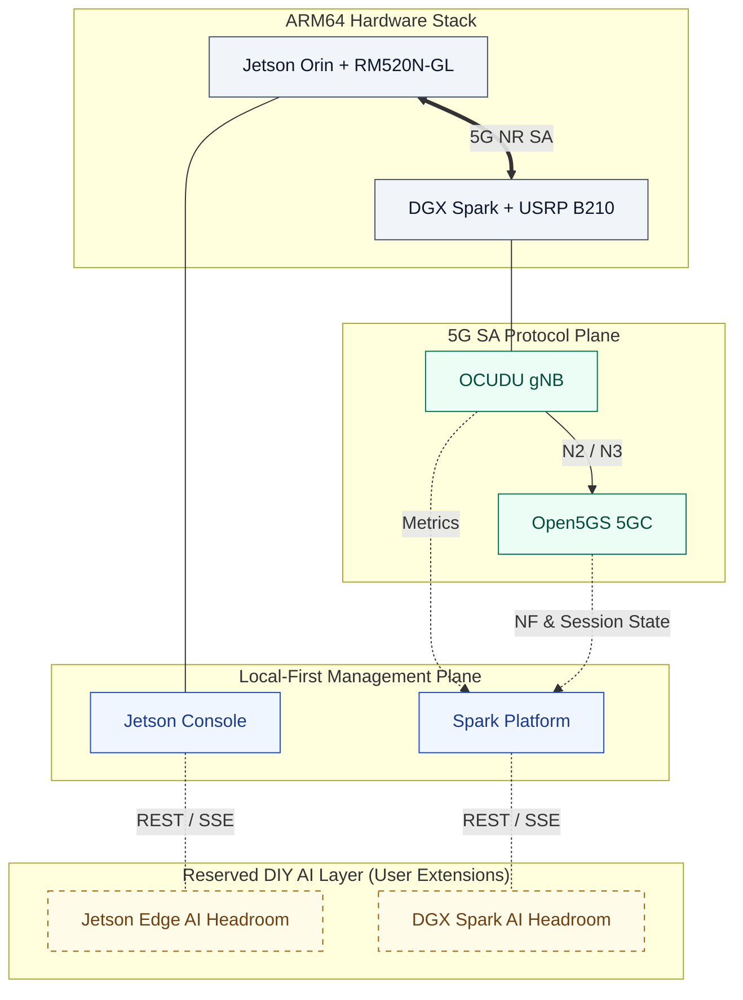

<!-- ASSET_SLOT: docs/assets/brand/logo-light.svg & docs/assets/brand/logo-dark.svg (<picture> dark/light hero banner) -->

# OpenAirKit

**Open-Source End-to-End 5G SA & AI-RAN Hardware-Software Platform**

[English](README.md) | [简体中文](README.zh-CN.md) | [Quickstart](docs/quickstart.md) | [Hardware & Topology](docs/hardware-and-topology.md) | [Documentation Map](docs/README.md)


**OpenAirKit** turns a standardized hardware kit—**DGX Spark + USRP B210 +
Jetson Orin + Waveshare M.2 5G Carrier + Quectel RM520N-GL**—into a
reproducible **5G Standalone (SA)** IPv4 data network built on **OCUDU** (RAN)
and **Open5GS** (5GC), with decoupled local management consoles at both ends.

<!-- ASSET_SLOT: docs/assets/hardware/kit-overview.jpg | 16:9 full hardware kit & benchtop wiring overview photo -->

## Core Capabilities

- **Rapid end-to-end bring-up**: Move cleanly from hardware wiring and core
  image builds to USIM provisioning and verified UE user-plane connectivity.
- **Unified local-first management**: Operate the base station (**Spark
  Platform**) and UE (**Jetson Console**) independently with live SSE
  telemetry, evidence-quality tracking, automatic Wi-Fi/cellular route failover,
  and bounded self-recovery.
- **Reserved dual-end compute for DIY AI**: Choosing **DGX Spark** and
  **Jetson Orin** intentionally reserves GPU and edge AI headroom at both ends
  of the link, paired with isolated inference ports and authenticated REST/SSE
  APIs for future custom AI modules. *(Built-in AI modules are planned for a
  future milestone; see [DIY AI Customization](docs/ai-customization.md).)*

## System Architecture



## Platform Overview

| Component | Hardware / Software Role | Local Access | Reference |
| --- | --- | --- | --- |
| **Base Station & Core** | **DGX Spark** + **USRP B210** running **OCUDU** & **Open5GS** | `aoc-v2ctl` / `systemctl` | [Network & RF Profile](docs/reference/network-and-rf-profile.md) |
| **Spark Platform** | Base-station collector, Web UI & bounded executor (`apps/spark-platform/`) | `127.0.0.1:8877` | [Spark Operations](docs/spark-operations.md) |
| **UE Host & Modem** | **Jetson Orin** + **[Waveshare M.2 5G Carrier](https://www.waveshare.net/shop/SIM8262E-M2-5G-for-Jetson-Orin.htm)** + **Quectel RM520N-GL** + 5G USIM | USB 3.0 + Wi-Fi management | [Hardware & Topology](docs/hardware-and-topology.md) |
| **Jetson Console** | UE modem supervision, routing failover & recovery (`apps/jetson-console/`) | `127.0.0.1:8878` | [Jetson Operations](docs/jetson-operations.md) |

Both consoles share `@aoc/console-ui` (`packages/console-ui/`), operate strictly
on local host state, and remain disabled at boot unless explicitly configured.

## Documentation Map

| Category | Guides |
| --- | --- |
| **Start Here** | [Hardware & Topology](docs/hardware-and-topology.md) · [End-to-End Quickstart](docs/quickstart.md) · [Architecture](docs/architecture.md) |
| **Deployment & Provisioning** | [Spark Setup](docs/setup-bs-spark.md) · [Stack Deployment](deploy/spark/stack/README.md) · [SIM Provisioning](docs/sim-provisioning.md) · [Jetson Setup](docs/setup-ue-jetson.md) |
| **Operations & AI Extensions** | [Spark Operations](docs/spark-operations.md) · [Jetson Operations](docs/jetson-operations.md) · [DIY AI Customization](docs/ai-customization.md) |
| **Troubleshooting** | [Spark Troubleshooting](docs/troubleshooting-bs-spark.md) · [Jetson Troubleshooting](docs/troubleshooting-ue-jetson.md) |
| **Technical Reference (`L3`)** | [Network & RF Profile](docs/reference/network-and-rf-profile.md) · [Ports & Runtime](docs/reference/ports-and-runtime.md) · [API Reference](docs/reference/api-reference.md) · [Hardware & TB01 Notes](docs/reference/hardware-notes.md) · [Glossary](docs/reference/glossary.md) |

See the [full documentation index](docs/README.md) for releasing, roadmap, and visual asset guidelines.

## Repository Layout

- `apps/spark-platform/`: Spark telemetry collector, FastAPI backend, and React UI.
- `apps/jetson-console/`: Jetson device executor, FastAPI backend, and React UI.
- `packages/console-ui/`: Shared Astryx Core, Charts, and Neutral theme components.
- `stacks/ocudu/` & `stacks/open5gs/`: RAN build inputs, Open5GS container builds, Compose rendering, and subscriber tools.
- `deploy/`: Stack controller, platform installers, restricted maintenance helper, and optional Jetson boot coordinator.
- `scripts/` & `config/`: Release builders, metrics guard tooling, repository audits, and network contracts.
- `docs/`: Layered English and Simplified Chinese documentation, reference appendices, and verified baselines.

## Build and Verify from Source

Requires Python `3.10–3.12` and Node.js `22`.

```sh
make install-dev BOOTSTRAP_PYTHON=python3.12
make check
```

Pass `VENV=local/dev-venv` to both commands if using a custom virtual
environment path. See [Contributing](CONTRIBUTING.md), [Security Policy](SECURITY.md),
and [Releasing](docs/releasing.md).
