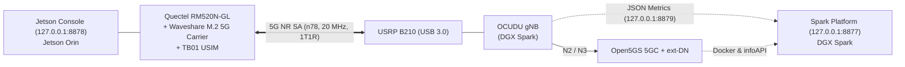

# Agentic-OCUDU

[简体中文](README.zh-CN.md)

**Agentic-OCUDU** is a reproducible, end-to-end **5G SA communication setup and
management platform** built on **OCUDU** (RAN) and **Open5GS** (5GC) for the
**DGX Spark + USRP B210 + Jetson Orin + Quectel RM520N-GL** hardware stack.

It is designed for developers and researchers who own (or plan to assemble) this
hardware stack and want to:

1. **Bring up fast**: deploy and validate a complete 5G SA core, gNB,
   programmable TB01 USIM and UE data path with repeatable steps.
2. **Operate cleanly**: observe live RAN/core/UE telemetry, verify evidence
   quality, manage routing failover and run bounded lifecycle/recovery
   workflows through two decoupled local-first consoles.
3. **Reserve dual-end compute for DIY AI**: **DGX Spark** (gNB/core side) and
   **Jetson Orin** (UE side) were intentionally chosen to leave local GPU/edge
   compute capacity, isolated ports (`127.0.0.1:8000–8002` free on Spark), and
   structured REST/SSE APIs available for custom AI development.

> [!NOTE]
> Built-in gNB or UE AI modules are **not** yet shipped in this repository.
> Selecting DGX Spark and Jetson Orin reserves local compute headroom at both
> ends so you can build and deploy DIY AI capabilities later without reworking
> the 5G stack. See [DIY AI Customization](docs/ai-customization.md).

## System Overview



| Layer | Hardware / Software Stack | Runtime & Endpoint | Version / Baseline |
| --- | --- | --- | --- |
| Base station & core host | **DGX Spark** (ARM64) + **USRP B210** (USB 3.0) | Ubuntu 24.04, Python 3.12, Docker, systemd | `n78`, `20 MHz`, `1T1R` (`tx=80`, `rx=54`) |
| 5G RAN & 5GC | **OCUDU** + **Open5GS** (12 containers + `ext-DN`) | Single IPv4 PDU, `DNN=oai`, pool `10.0.0.0/24` | PLMN `460/03`, `SST=1`, `5QI=9` (no IMS/voice) |
| Base-station console | **Spark Platform** (`apps/spark-platform/`) | `127.0.0.1:8877` (`8879` gNB metrics, root-only) | `0.2.1` |
| UE host & modem | **Jetson Orin** + **[Waveshare M.2 5G Carrier](https://www.waveshare.net/shop/SIM8262E-M2-5G-for-Jetson-Orin.htm)** + **Quectel RM520N-GL** + **TB01 USIM** | Ubuntu 22.04, Python 3.10, RNDIS (`00/01` -> AT `04`) / ECM (`04`/`0a` -> AT `02`) | Independent subscriber per UE |
| UE console | **Jetson Console** (`apps/jetson-console/`) | `127.0.0.1:8878` | `0.6.2` |

Both applications share the same Astryx Core, Charts and Neutral theme component
package (`packages/console-ui/`), operate strictly on local host state without
a global fleet controller, and leave services disabled at boot unless an
administrator explicitly opts in.

## Quick Navigation

| Goal | Start Here |
| --- | --- |
| Check hardware BOM, wiring, ports and software prerequisites | [Hardware & Topology](docs/hardware-and-topology.md) |
| Deploy and bring up Spark, SIM and Jetson end-to-end | [End-to-End Quickstart](docs/quickstart.md) |
| Detailed base-station & core installation | [Spark Setup](docs/setup-bs-spark.md) & [Stack Deployment](deploy/spark/stack/README.md) |
| Detailed UE installation & optional cold-boot coordination | [Jetson Setup](docs/setup-ue-jetson.md) |
| Provision an Open5GS subscriber & program TB01 USIM cards | [TB01 SIM Programming](docs/sim-programming-tb01.md) |
| Use the Web consoles, REST/SSE APIs & lifecycle tools | [Spark Operations](docs/spark-operations.md) & [Jetson Operations](docs/jetson-operations.md) |
| Understand dual-end DIY AI boundaries & telemetry/control APIs | [DIY AI Customization](docs/ai-customization.md) |
| Read system architecture & access contracts | [Architecture](docs/architecture.md) & [UE Access Policy](docs/ue-access-policy.md) |
| Browse the full documentation index | [Documentation Map](docs/README.md) |

## Repository Map

- `apps/spark-platform/`: Spark collector, FastAPI backend and React/TypeScript web application.
- `apps/jetson-console/`: Jetson device executor, FastAPI backend and React/TypeScript web application.
- `packages/console-ui/`: Shared Astryx Core, Charts and Neutral theme components (`@aoc/console-ui`).
- `stacks/ocudu/`: OCUDU radio build and runtime inputs.
- `stacks/open5gs/`: Open5GS core network, subscriber provisioning and user-plane inputs.
- `deploy/`: Stack lifecycle (`aoc-v2ctl`), platform installers, restricted maintenance (`aoc-maintain`) and optional Jetson boot coordinator (`boot_connect.py`).
- `scripts/`: Release builders, Spark metrics guard transaction (`enable_radio_json_metrics.py`) and CI audits.
- `config/`: Shared, versioned network, upstream and dependency contracts.
- `docs/`: Current architecture, setup, operations, AI extension guides and acceptance evidence.

Retired implementations and migration records live outside the current source
tree and are excluded from builds and releases.

## Local Development and Verification

Use Python `3.10–3.12` and Node.js `22` (device targets are Python `3.10` for
Jetson and Python `3.12` for Spark; CI tests both).

```sh
make install-dev BOOTSTRAP_PYTHON=python3.12
make check
```

`make install-dev` creates `.venv` (use `VENV=local/dev-venv` on both commands
if an older `.venv` exists), installs development dependencies for both
backends, runs `npm ci` and builds both UIs. `make check` runs frontend behavior
tests, TypeScript checks, application/stack unit tests and repository audits
(`docs-audit`, `release-audit`, `license-audit`, `shell-check`).

For Spark browser checks, build the frontend, install Playwright Chromium
(`npm --prefix apps/spark-platform/frontend exec -- playwright install chromium`),
and run `make e2e-spark`. When `.codegraph/` exists at the repository root,
follow the [CodeGraph workflow](docs/coding-agent-codegraph.md) before
searching source.

See also the [Contribution Guide](CONTRIBUTING.md), [Security Policy](SECURITY.md)
and [Release Guide](docs/releasing.md).
