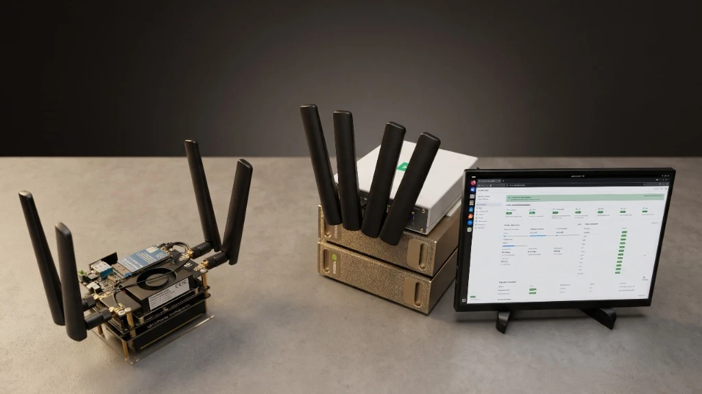
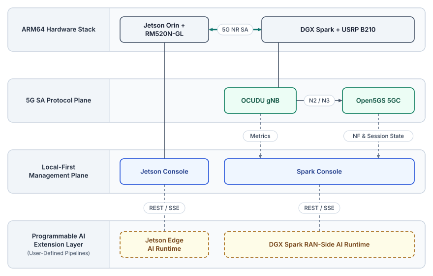

<div align="center">

<picture>
  <source media="(prefers-color-scheme: dark)" srcset="docs/assets/brand/logo-dark.png">
  <source media="(prefers-color-scheme: light)" srcset="docs/assets/brand/logo-light.png">
  
</picture>

<p><strong>Open-Source End-to-End 5G SA &amp; AI-RAN Experimental Platform</strong></p>

<p>
  <a href="CHANGELOG.md"></a>
  <a href="LICENSE"></a>
  <a href="docs/architecture.md"></a>
  <a href="docs/ai-customization.md"></a>
  <a href="https://github.com/HKUOpenSource/OpenAirKit/actions/workflows/ci.yml"></a>
</p>

<p>
  <a href="README.md">English</a> ·
  <a href="README.zh-CN.md">简体中文</a> ·
  <a href="docs/quickstart.md">Quickstart</a> ·
  <a href="docs/architecture.md">Architecture</a> ·
  <a href="docs/hardware-and-topology.md">Hardware</a> ·
  <a href="CONTRIBUTING.md">Contributing</a> ·
  <a href="docs/README.md">Docs</a> ·
  <a href="LICENSE">License</a>
</p>

</div>

**OpenAirKit** integrates a standardized ARM64 hardware testbed—**DGX Spark +
USRP B210 + Jetson Orin + Waveshare M.2 5G Carrier + Quectel RM520N-GL**—into a
reproducible **5G Standalone (SA)** IPv4 data network powered by **OCUDU**
(RAN) and **Open5GS** (5GC), paired with decoupled local management consoles at
both endpoints.

<p align="center">
  
</p>

## Core Capabilities

- **Reproducible end-to-end bring-up**: Progress systematically from physical
  cabling and Open5GS container builds to 5G USIM provisioning and verified UE
  user-plane connectivity.
- **Decoupled local-first management**: Operate the base station (**Spark
  Console**) and UE (**Jetson Console**) independently with live SSE
  telemetry, telemetry freshness gating, automated Wi-Fi/cellular route
  failover, and bounded self-recovery.
- **Programmable AI extensibility at both ends**: Selecting **DGX Spark** and
  **Jetson Orin** allocates dedicated AI compute capacity at both the RAN and UE
  endpoints, complemented by reserved inference ports and authenticated REST/SSE
  APIs for **custom AI workloads** and **user-defined AI pipelines**. See the
  [AI Extensibility Guide](docs/ai-customization.md) and [Roadmap](docs/roadmap.md).

## System Architecture

<div align="center">

<picture>
  <source media="(prefers-color-scheme: dark)" srcset="docs/assets/diagrams/system-architecture-en-dark.svg">
  <source media="(prefers-color-scheme: light)" srcset="docs/assets/diagrams/system-architecture-en-light.svg">
  
</picture>

</div>

## Platform Overview

<table>
  <tr>
    <td align="center" valign="middle" width="14%"></td>
    <td align="center" valign="middle" width="14%"></td>
    <td align="center" valign="middle" width="14%"></td>
    <td align="center" valign="middle" width="14%"></td>
    <td align="center" valign="middle" width="14%"></td>
    <td align="center" valign="middle" width="14%"></td>
    <td align="center" valign="middle" width="14%"></td>
  </tr>
  <tr>
    <td align="center" valign="top"><sub><b>DGX Spark</b></sub></td>
    <td align="center" valign="top"><sub><b>USRP B210</b></sub></td>
    <td align="center" valign="top"><sub><b>Jetson Orin</b></sub></td>
    <td align="center" valign="top"><sub><b>M.2 Carrier</b></sub></td>
    <td align="center" valign="top"><sub><b>RM520N-GL</b></sub></td>
    <td align="center" valign="top"><sub><b>5G USIM</b></sub></td>
    <td align="center" valign="top"><sub><b>PC/SC Reader</b></sub></td>
  </tr>
</table>

| Component | Hardware / Software Role | Local Access | Reference |
| --- | --- | --- | --- |
| **Base Station & Core** | **DGX Spark** + **USRP B210** running **OCUDU** & **Open5GS** | `aoc-v2ctl` / `systemctl` | [Network & RF Profile](docs/reference/network-and-rf-profile.md) |
| **Spark Console** | Base-station telemetry collector, Web UI & bounded executor (`apps/spark-console/`) | `127.0.0.1:8877` | [Spark Operations](docs/spark-operations.md) |
| **UE Host & Modem** | **Jetson Orin** + **Waveshare M.2 5G Carrier** + **Quectel RM520N-GL** + 5G USIM | USB 3.0 + Wi-Fi management | [Hardware & Topology](docs/hardware-and-topology.md) |
| **Jetson Console** | UE modem supervision, route failover & bounded recovery (`apps/jetson-console/`) | `127.0.0.1:8878` | [Jetson Operations](docs/jetson-operations.md) |

Both consoles share `@agentic-ocudu/console-ui` (`packages/console-ui/`), maintain
strictly local host state, and remain disabled at boot unless explicitly
configured.

## Documentation Map

| Category | Guides |
| --- | --- |
| **Start Here** | [Hardware & Topology](docs/hardware-and-topology.md) · [End-to-End Quickstart](docs/quickstart.md) · [Architecture](docs/architecture.md) · [Architecture Decisions](docs/adr/README.md) |
| **Deployment & Provisioning** | [Spark Setup](docs/setup-bs-spark.md) · [Stack Deployment](deploy/spark/stack/README.md) · [SIM Provisioning](docs/sim-provisioning.md) · [Jetson Setup](docs/setup-ue-jetson.md) |
| **Operations & AI Extensibility** | [Spark Operations](docs/spark-operations.md) · [Jetson Operations](docs/jetson-operations.md) · [AI Extensibility Guide](docs/ai-customization.md) |
| **Troubleshooting** | [Spark Troubleshooting](docs/troubleshooting-bs-spark.md) · [Jetson Troubleshooting](docs/troubleshooting-ue-jetson.md) |
| **Development & Releases** | [Developer Guide](docs/development.md) · [Releasing](docs/releasing.md) · [Changelog](CHANGELOG.md) |
| **Technical Reference** | [Network & RF Profile](docs/reference/network-and-rf-profile.md) · [Ports & Runtime](docs/reference/ports-and-runtime.md) · [API Reference](docs/reference/api-reference.md) · [Hardware & TB01 Notes](docs/reference/hardware-notes.md) · [Glossary](docs/reference/glossary.md) |

See the [full documentation index](docs/README.md) for release engineering and
roadmap milestones.

## Repository Layout

- `apps/spark-console/`: Spark telemetry collector, FastAPI backend, and React UI.
- `apps/jetson-console/`: Jetson device executor, FastAPI backend, and React UI.
- `packages/console-ui/`: Shared Astryx Core, Charts, and Neutral theme components.
- `stacks/ocudu/` & `stacks/open5gs/`: RAN build inputs, Open5GS container builds, Compose rendering, and subscriber provisioning CLI.
- `deploy/`: Stack controller, platform installers, restricted maintenance helper, and optional Jetson boot coordinator.
- `scripts/` & `config/`: Release builders, metrics firewall guard, repository audits, and site network contracts.
- `docs/`: Paired English and Simplified Chinese documentation, reference appendices, and verified acceptance baselines.

## Build and Verify from Source

Requires Python `3.10–3.12` and Node.js `22`.

```sh
make install-dev BOOTSTRAP_PYTHON=python3.12
make check
```

Pass `VENV=local/dev-venv` to both targets when using a custom virtual
environment path. Review the [Developer Guide](docs/development.md),
[Contributing](CONTRIBUTING.md), [Security Policy](SECURITY.md), and
[Releasing](docs/releasing.md) before submitting changes or cutting release
artifacts.

## Citation

If OpenAirKit supports your research or testbed work, please cite:

> Wang, Z. (2026). OpenAirKit (Version 1.0.0) [Computer software]. https://github.com/HKUOpenSource/OpenAirKit/releases/tag/v1.0.0

```bibtex
@software{wang2026openairkit,
  author  = {Wang, Zhaolin},
  title   = {OpenAirKit},
  version = {1.0.0},
  year    = {2026},
  url     = {https://github.com/HKUOpenSource/OpenAirKit/releases/tag/v1.0.0},
  license = {Apache-2.0}
}
```

Machine-readable citation metadata is available in [`CITATION.cff`](CITATION.cff).

## License

OpenAirKit repository code is released under the **Apache License 2.0**. See
[`LICENSE`](LICENSE) for the full license text and
[`THIRD_PARTY_NOTICES.md`](THIRD_PARTY_NOTICES.md) for third-party dependency
notices and upstream RAN/5GC component boundaries.
