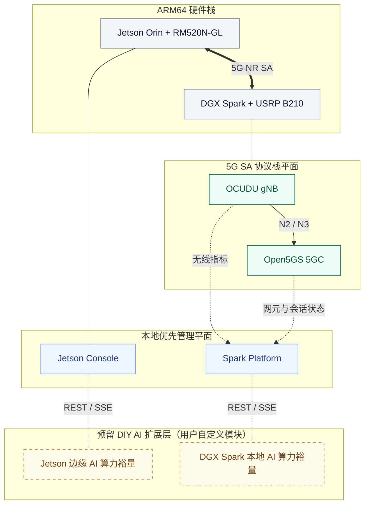

<div align="center">

<picture>
  <source media="(prefers-color-scheme: dark)" srcset="docs/assets/brand/logo-dark.png">
  <source media="(prefers-color-scheme: light)" srcset="docs/assets/brand/logo-light.png">
  
</picture>

<p><strong>面向 AI-RAN 的开源端到端 5G SA 通信搭建与双端管理平台</strong></p>

<p>
  
  
  
  
</p>

<p>
  <a href="README.md">English</a> ·
  <a href="README.zh-CN.md">简体中文</a> ·
  <a href="docs/quickstart.zh-CN.md">快速搭建</a> ·
  <a href="docs/architecture.zh-CN.md">系统架构</a> ·
  <a href="docs/hardware-and-topology.zh-CN.md">硬件清单</a> ·
  <a href="CONTRIBUTING.zh-CN.md">贡献指南</a> ·
  <a href="docs/README.zh-CN.md">文档总览</a>
</p>

</div>

**OpenAirKit** 基于 **OCUDU**（RAN）与 **Open5GS**（5GC），将 **DGX Spark +
USRP B210 + Jetson Orin + Waveshare M.2 5G 扩展载板 + Quectel RM520N-GL** 标准化
硬件套件快速整合为可复现的 **5G 独立组网（SA）** IPv4 数据通信系统，并提供双端解耦的本地管理平台。

<!-- ASSET_SLOT: docs/assets/hardware/kit-overview.jpg | 16:9 整套硬件设备全家福与桌面连线实拍图 -->

## 核心能力

- **快速拉起**：提供从硬件连线、Open5GS 镜像构建、USIM 开户配卡到 UE 用户面验通的端到端标准化主线。
- **统一本地管控**：通过 **Spark Platform** 与 **Jetson Console** 分别管理基站与终端侧，具备 SSE 实时观测、证据新鲜度判定、Wi-Fi/蜂窝路由自动切换与有界自愈能力。
- **双端预留 DIY AI 算力**：硬件选型采用 **DGX Spark**（基站/核心网侧）与 **Jetson Orin**（UE 侧），在通信两端保留本地 GPU/边缘算力裕量、独立推理端口及鉴权 REST/SSE 接口，便于后续自主开发自定义 AI 模块。*（双端内置 AI 模块规划于后续阶段交付，详见[双端 AI 定制指南](docs/ai-customization.zh-CN.md)。）*

## 系统架构



## 平台组成总览

<table>
  <tr>
    <td align="center"><br/><sub><b>DGX Spark</b></sub></td>
    <td align="center"><br/><sub><b>USRP B210</b></sub></td>
    <td align="center"><br/><sub><b>Jetson Orin</b></sub></td>
    <td align="center"><br/><sub><b>M.2 5G 载板</b></sub></td>
    <td align="center"><br/><sub><b>RM520N-GL</b></sub></td>
  </tr>
</table>

| 组件层级 | 软硬件角色 | 本地访问入口 | 技术参考 |
| --- | --- | --- | --- |
| **基站与核心网** | **DGX Spark** + **USRP B210** 运行 **OCUDU** 与 **Open5GS** | `aoc-v2ctl` / `systemctl` | [网络契约与射频基线](docs/reference/network-and-rf-profile.zh-CN.md) |
| **Spark Platform** | 基站侧采集器、Web 控制台与受限执行器（`apps/spark-platform/`） | `127.0.0.1:8877` | [Spark 运维](docs/spark-operations.zh-CN.md) |
| **UE 主机与模组** | **Jetson Orin** + **Waveshare M.2 5G 扩展载板** + **Quectel RM520N-GL** + 5G USIM | USB 3.0 + Wi-Fi 管理网 | [硬件清单与拓扑](docs/hardware-and-topology.zh-CN.md) |
| **Jetson Console** | UE 模组监管、路由自动切换与有界恢复（`apps/jetson-console/`） | `127.0.0.1:8878` | [Jetson 运维](docs/jetson-operations.zh-CN.md) |

两个控制台共用 `@aoc/console-ui`（`packages/console-ui/`），各自仅维护本地主机状态，
且默认不在开机时自动启动。

## 文档导航

| 分类 | 文档入口 |
| --- | --- |
| **快速了解** | [硬件清单与拓扑](docs/hardware-and-topology.zh-CN.md) · [端到端快速搭建指南](docs/quickstart.zh-CN.md) · [系统架构](docs/architecture.zh-CN.md) |
| **部署与开户** | [Spark 安装](docs/setup-bs-spark.zh-CN.md) · [协议栈部署](deploy/spark/stack/README.zh-CN.md) · [SIM 开户与配卡](docs/sim-provisioning.zh-CN.md) · [Jetson 安装](docs/setup-ue-jetson.zh-CN.md) |
| **运维与 AI 定制** | [Spark 运维](docs/spark-operations.zh-CN.md) · [Jetson 运维](docs/jetson-operations.zh-CN.md) · [双端 AI 定制指南](docs/ai-customization.zh-CN.md) |
| **故障排查** | [Spark 故障排查](docs/troubleshooting-bs-spark.zh-CN.md) · [Jetson 故障排查](docs/troubleshooting-ue-jetson.zh-CN.md) |
| **技术参考与附录（`L3`）** | [网络与射频基线](docs/reference/network-and-rf-profile.zh-CN.md) · [端口与运行时参考](docs/reference/ports-and-runtime.zh-CN.md) · [REST 与 SSE 接口](docs/reference/api-reference.zh-CN.md) · [硬件与 TB01 附录](docs/reference/hardware-notes.zh-CN.md) · [核心术语表](docs/reference/glossary.zh-CN.md) |

发布流程、产品路线图与素材规范请查阅[完整文档目录](docs/README.zh-CN.md)。

## 仓库目录结构

- `apps/spark-platform/`：Spark 采集器、FastAPI 后端与 React Web 应用。
- `apps/jetson-console/`：Jetson 设备执行器、FastAPI 后端与 React Web 应用。
- `packages/console-ui/`：共享的 Astryx Core、Charts 与 Neutral 主题组件包。
- `stacks/ocudu/` 与 `stacks/open5gs/`：无线编译输入、Open5GS 镜像构建、Compose 渲染与开户工具。
- `deploy/`：协议栈控制器、平台安装器、受限维护助手与可选 Jetson 开机协调器。
- `scripts/` 与 `config/`：离线 ARM64 发布脚本、指标守护工具、仓库审计与网络契约。
- `docs/`：中英文配对文档、技术参考附录（`docs/reference/`）与实机基线档案（`docs/acceptance/`）。

## 从源码构建与验证

需准备 Python `3.10–3.12` 与 Node.js `22`。

```sh
make install-dev BOOTSTRAP_PYTHON=python3.12
make check
```

若使用自定义虚拟环境路径，请在两条命令中同时传入 `VENV=local/dev-venv`。提交代码或构建
发布包前请参阅[贡献指南](CONTRIBUTING.zh-CN.md)、[安全策略](SECURITY.md)与[发布指南](docs/releasing.zh-CN.md)。
