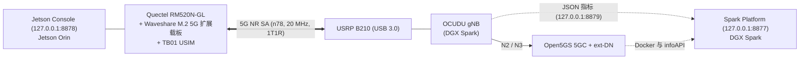

# Agentic-OCUDU

[English](README.md)

**Agentic-OCUDU** 是一个基于 **OCUDU**（无线接入网）与 **Open5GS**（5G 核心网），
面向 **DGX Spark + USRP B210 + Jetson Orin + Quectel RM520N-GL** 硬件栈构建的
**可复现端到端 5G SA 通信搭建与管理平台**。

项目面向已经具备（或计划采购）同套硬件的开发者与研究者，核心价值在于：

1. **快速拉起**：按标准化流程低门槛完成 5G SA 核心网、基站、TB01 白卡与 UE 数据通路的端到端部署和联调。
2. **统一管理**：通过基站侧（Spark Platform）与终端侧（Jetson Console）两个解耦控制台，完成实时观测、路由兜底、受限运维与故障自愈。
3. **预留双端 AI 定制空间**：硬件上选用 **DGX Spark**（gNB/核心网侧）与 **Jetson Orin**（UE 侧），刻意在通信两端预留本地算力、隔离端口（Spark `127.0.0.1:8000–8002` 保持空闲）及标准化 REST/SSE 接口，便于后续自主开发自定义 AI 模块。

> [!NOTE]
> 双端内置 AI 模型与智能体**目前尚未在本仓库实现**。当前选用 DGX Spark 与
> Jetson Orin 的核心意图是在双端预留算力底座，支持用户后续在可复现的 5G 通信栈之上
> DIY 自定义 AI 能力。详见[双端 AI 定制指南](docs/ai-customization.zh-CN.md)。

## 系统总览



| 层级 | 软硬件栈 | 运行时与端点 | 基线与规格 |
| --- | --- | --- | --- |
| 基站与核心网主机 | **DGX Spark**（ARM64）+ **USRP B210**（USB 3.0） | Ubuntu 24.04、Python 3.12、Docker、systemd | `n78`、`20 MHz`、`1T1R`（`tx=80`、`rx=54`） |
| 5G RAN 与 5GC | **OCUDU** + **Open5GS**（12 容器 + `ext-DN`） | 单 IPv4 PDU、`DNN=oai`、地址池 `10.0.0.0/24` | PLMN `460/03`、`SST=1`、`5QI=9`（不含 IMS/语音） |
| 基站侧管理平台 | **Spark Platform**（`apps/spark-platform/`） | `127.0.0.1:8877`（`8879` gNB 指标，仅 root 可访问） | `0.2.1` |
| UE 主机与模组 | **Jetson Orin** + **[Waveshare M.2 5G 扩展载板](https://www.waveshare.net/shop/SIM8262E-M2-5G-for-Jetson-Orin.htm)** + **Quectel RM520N-GL** + **TB01 USIM** | Ubuntu 22.04、Python 3.10、RNDIS（`00/01` -> AT `04`）/ ECM（`04`/`0a` -> AT `02`） | 每台 UE 独立开户与独立 SIM 卡 |
| UE 侧管理平台 | **Jetson Console**（`apps/jetson-console/`） | `127.0.0.1:8878` | `0.6.2` |

两个管理应用共用 `packages/console-ui/` 中的 Astryx Core、Charts 与 Neutral 主题组件，
各自仅管理本地设备状态，不引入全局集群控制面；安装器默认不开启开机自启。

## 快速导航

| 目标 | 推荐文档 |
| --- | --- |
| 查看硬件 BOM、物理接线、端口规划与软件前置条件 | [硬件清单与拓扑](docs/hardware-and-topology.zh-CN.md) |
| 按主线从零拉起 Spark、SIM 与 Jetson 全流程 | [端到端快速搭建指南](docs/quickstart.zh-CN.md) |
| 基站侧与核心网详细安装步骤 | [Spark 安装](docs/setup-bs-spark.zh-CN.md) 与 [协议栈部署](deploy/spark/stack/README.zh-CN.md) |
| UE 侧详细安装与可选冷重启自连配置 | [Jetson 安装](docs/setup-ue-jetson.zh-CN.md) |
| Open5GS 独立开户与 TB01 白卡烧录 | [TB01 SIM 烧录](docs/sim-programming-tb01.zh-CN.md) |
| Web 控制台页面导览、API 速查与日常启停运维 | [Spark 运维](docs/spark-operations.zh-CN.md) 与 [Jetson 运维](docs/jetson-operations.zh-CN.md) |
| 了解双端预留算力、隔离边界与 DIY AI 接入方式 | [双端 AI 定制指南](docs/ai-customization.zh-CN.md) |
| 深入理解三平面架构与 UE 接入策略 | [架构](docs/architecture.zh-CN.md) 与 [UE 接入策略](docs/ue-access-policy.zh-CN.md) |
| 浏览完整文档索引 | [文档导航](docs/README.zh-CN.md) |

## 仓库结构

- `apps/jetson-console/`：Jetson API、设备执行器与 React Web 应用。
- `apps/spark-platform/`：Spark 采集器、API 与 React Web 应用。
- `packages/console-ui/`：共享的 Astryx Core、Charts 与 Neutral 主题组件包（`@aoc/console-ui`）。
- `stacks/ocudu/`：OCUDU 无线栈构建与运行输入。
- `stacks/open5gs/`：Open5GS 核心网、订阅初始化与用户面输入。
- `deploy/`：协议栈生命周期（`aoc-v2ctl`）、平台安装器、受限维护助手（`aoc-maintain`）及可选开机协调器（`boot_connect.py`）。
- `scripts/`：发布包构建脚本、Spark 指标守护事务（`enable_radio_json_metrics.py`）与 CI 审计脚本。
- `config/`：共享且版本化的网络、上游版本与依赖契约。
- `docs/`：当前架构、安装、运维、AI 扩展指南与验收依据。

退役实现和迁移记录保存在当前源码树之外，不参与构建或发布。

## 本地开发与验证

使用 Python `3.10–3.12` 与 Node.js `22`（Jetson 目标为 Python `3.10`，Spark 为 Python `3.12`，CI 覆盖两者）。

```sh
make install-dev BOOTSTRAP_PYTHON=python3.12
make check
```

若已有使用旧版 Python 的 `.venv`，请在两条命令中同时传入 `VENV=local/dev-venv`。
`make check` 会执行前端行为测试、TypeScript 检查、应用及协议栈单元测试，以及仓库边界审计
（`docs-audit`、`release-audit`、`license-audit`、`shell-check`）。

如需运行 Spark 浏览器端验证，请先构建前端并执行
`npm --prefix apps/spark-platform/frontend exec -- playwright install chromium`，再运行 `make e2e-spark`。
若根目录存在 `.codegraph/`，搜索或阅读源码前请遵循 [CodeGraph 工作流](docs/coding-agent-codegraph.zh-CN.md)。

另请参阅[贡献指南](CONTRIBUTING.zh-CN.md)、[安全策略](SECURITY.md)与[发布指南](docs/releasing.zh-CN.md)。
