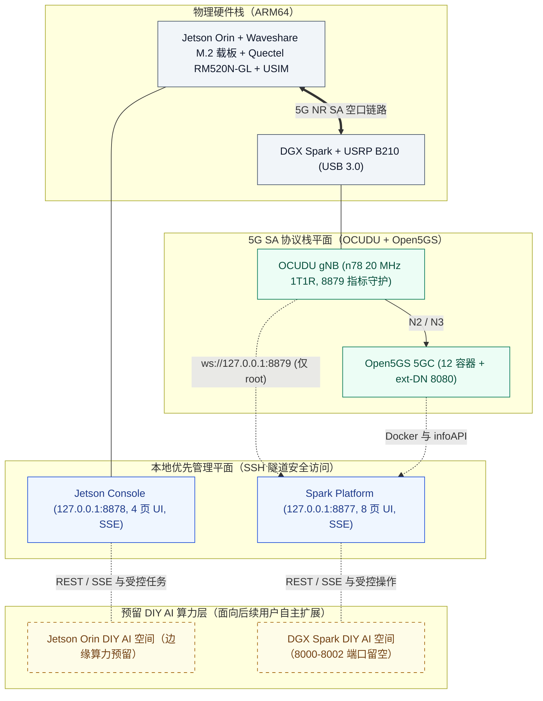

<!-- ASSET_SLOT: docs/assets/brand/logo-light.svg & docs/assets/brand/logo-dark.svg (<picture> dark/light hero banner) -->

# Agentic-OCUDU

**可复现的端到端 5G SA 通信搭建与双端管理平台**

[English](README.md) | [简体中文](README.zh-CN.md) | [快速搭建](docs/quickstart.zh-CN.md) | [硬件清单与拓扑](docs/hardware-and-topology.zh-CN.md) | [文档导航](docs/README.zh-CN.md)


**Agentic-OCUDU** 基于 **OCUDU**（RAN）与 **Open5GS**（5GC），面向
**DGX Spark + USRP B210 + Jetson Orin + Waveshare M.2 5G 扩展载板 + Quectel RM520N-GL**
硬件栈，提供一套可快速复现的端到端 **5G Standalone（SA）** 数据网络搭建与运维平台。

<!-- ASSET_SLOT: docs/assets/hardware/kit-overview.jpg | 16:9 整套硬件设备全家福与桌面连线实拍图 -->

## 核心能力

1. **快速拉起**：从硬件接线、Open5GS 镜像构建、可编程 USIM 开户到 UE 用户面验通，提供标准化可复现主线。
2. **统一本地管理**：通过解耦的 **Spark Platform**（`127.0.0.1:8877`）与 **Jetson Console**（`127.0.0.1:8878`）完成 SSE 实时观测、证据新鲜度判定、Wi-Fi/蜂窝路由保护与有界自愈。
3. **预留双端 AI 算力空间**：硬件上选用 **DGX Spark**（基站/核心网侧）与 **Jetson Orin**（UE 侧），刻意保留本地 GPU/边缘算力、隔离端口（Spark `127.0.0.1:8000–8002` 保持空闲）及鉴权 REST/SSE 接口，便于后续自主开发 DIY AI 模块。

> [!NOTE]
> 双端内置 AI 模型与智能体**目前尚未在本仓库实现**。选用 DGX Spark 与
> Jetson Orin 旨在通信两端预留计算裕量，帮助开发者在稳定 5G 通信底座之上
> DIY 自定义 AI 能力。详见[双端 AI 定制指南](docs/ai-customization.zh-CN.md)。

## 四层架构总览



## 软硬件基线

| 层级 | 软硬件栈 | 运行时与端点 | 基线与契约 |
| --- | --- | --- | --- |
| 基站与核心网主机 | **DGX Spark**（ARM64）+ **USRP B210**（USB 3.0） | Ubuntu 24.04、Python 3.12、Docker、systemd | `n78`、`20 MHz`、`1T1R`（`tx_gain=80`、`rx_gain=54`） |
| 5G RAN 与 5GC | **OCUDU** + **Open5GS**（12 容器 + `ext-DN`） | 单 IPv4 PDU、`DNN=oai`、地址池 `10.0.0.0/24` | PLMN `460/03`、`SST=1`、`5QI=9`（不含 IMS/语音） |
| 基站侧管理平台 | **Spark Platform**（`apps/spark-platform/`） | `127.0.0.1:8877`（`8879` gNB 指标，仅 root 可访问） | `0.2.1` |
| UE 主机与模组 | **Jetson Orin** + **[Waveshare M.2 5G 扩展载板](https://www.waveshare.net/shop/SIM8262E-M2-5G-for-Jetson-Orin.htm)** + **Quectel RM520N-GL** + 可编程 5G USIM | Ubuntu 22.04、Python 3.10、RNDIS（`00/01` -> AT `04`）/ ECM（`04`/`0a` -> AT `02`） | 每台 UE 独立订阅与独立 USIM |
| UE 侧管理平台 | **Jetson Console**（`apps/jetson-console/`） | `127.0.0.1:8878` | `0.6.2` |

两个管理应用共用 `packages/console-ui/` 中的 Astryx Core、Charts 与 Neutral 主题组件，
各自仅跟踪本地主机与设备状态，不引入全局控制面；安装器默认不开启开机自启。

## 文档导览

| 目标 | 推荐文档 |
| --- | --- |
| 核对硬件 BOM、接线拓扑、端口规划与软件前置条件 | [硬件清单与拓扑](docs/hardware-and-topology.zh-CN.md) |
| 从零拉起 Spark、开户写卡与 Jetson 端到端联调 | [端到端快速搭建指南](docs/quickstart.zh-CN.md) |
| 基站与核心网详细安装部署 | [Spark 安装](docs/setup-bs-spark.zh-CN.md) 与 [协议栈部署](deploy/spark/stack/README.zh-CN.md) |
| Jetson 终端安装、初始化与冷重启自连 | [Jetson 安装](docs/setup-ue-jetson.zh-CN.md) |
| Open5GS 开户与可编程 USIM 烧录（含 TB01 协议参考） | [SIM 开户与 TB01 参考](docs/sim-programming-tb01.zh-CN.md) |
| Web 控制台页面导览、REST/SSE API 与日常运维 | [Spark 运维](docs/spark-operations.zh-CN.md) 与 [Jetson 运维](docs/jetson-operations.zh-CN.md) |
| 了解双端预留算力、隔离边界与 DIY AI 接入方法 | [双端 AI 定制指南](docs/ai-customization.zh-CN.md) |
| 深入理解系统架构、接入契约与完整文档索引 | [架构](docs/architecture.zh-CN.md)、[UE 接入策略](docs/ue-access-policy.zh-CN.md)、[文档总目录](docs/README.zh-CN.md) |

## 仓库结构

- `apps/spark-platform/`：Spark 采集器、FastAPI 后端与 React/TypeScript Web 应用。
- `apps/jetson-console/`：Jetson 设备执行器、FastAPI 后端与 React/TypeScript Web 应用。
- `packages/console-ui/`：共享的 Astryx Core、Charts 与 Neutral 主题组件包（`@aoc/console-ui`）。
- `stacks/ocudu/`：OCUDU 无线栈构建与运行输入。
- `stacks/open5gs/`：Open5GS 核心网镜像构建、校验、Compose 渲染与开户工具。
- `deploy/`：协议栈控制器（`aoc-v2ctl`）、平台安装器、受限维护助手（`aoc-maintain`）及可选开机协调器（`boot_connect.py`）。
- `scripts/`：ARM64 离线发布构建脚本、Spark 指标守护事务（`enable_radio_json_metrics.py`）与仓库审计脚本。
- `config/`：版本化网络契约（`network-contract.json`）、上游修订与依赖元数据。
- `docs/`：中英文配对文档、素材规范（`docs/assets/README.md`）及实机验证基线档案（`docs/acceptance/`）。

退役实现与历史站点迁移脚本存放在 `archive/` 中，不参与构建或发布。

## 从源码构建与验证

需准备 Python `3.10–3.12` 与 Node.js `22`（设备运行目标：Jetson 为 Python `3.10`，
Spark 为 Python `3.12`）。

```sh
make install-dev BOOTSTRAP_PYTHON=python3.12
make check
```

若本机已有其他 Python 版本的 `.venv`，请在两条命令中同时指定 `VENV=local/dev-venv`。
`make check` 运行前端行为测试、TypeScript 检查、单元测试及全套仓库审计
（`docs-audit`、`release-audit`、`license-audit`、`shell-check`）。

提交代码或打包发布前请先阅读[贡献指南](CONTRIBUTING.zh-CN.md)、[安全策略](SECURITY.md)
与[发布指南](docs/releasing.zh-CN.md)。
