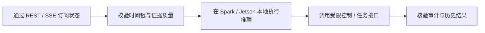

# 双端 AI 定制与扩展指南

[English](ai-customization.md)

本平台在硬件选型上采用 **DGX Spark**（gNB/核心网侧）与 **Jetson Orin**（UE 侧），
旨在通信链路两端预留充足的本地 GPU 与边缘算力。双端内置 AI 模块规划于后续阶段交付；
当前平台已具备独立的计算裕量、无线实时性隔离以及鉴权后的本地接口，方便开发者和研究者
在稳定 5G 底座之上自主 DIY 并部署自定义 AI 模块。

## 自定义 AI 模块设计原则

1. **双端本地自治**：**DGX Spark** 上的 AI 模块仅订阅基站/核心网遥测并触发本地受控动作
   （`127.0.0.1:8877`）；**Jetson Orin** 上的 AI 模块仅消费 UE 遥测并触发本地任务
   （`127.0.0.1:8878`），避免跨主机构建紧耦合控制面。
2. **先核验新鲜度再动作**：执行推理或触发动作前先校验来源时间戳与证据质量（`ok`、
   `stale`、`unavailable`、`unsupported`），仅基于 `ok` 状态的快照发起控制请求。
3. **受控执行与硬件互斥**：所有状态变更动作统一经过鉴权 REST 接口发起，不绕过串口锁直连
   RM520N-GL，也不直接对核心网容器执行无保护变更。

## 算力、端口与实时性隔离

- **DGX Spark（gNB / 核心网侧）**：
  - **推理端口预留（`8000–8002`）**：OCUDU JSON 指标绑定在 `127.0.0.1:8879` 并受 `aoc-v2-metrics-guard.service` 保护，将 `127.0.0.1:8000–8002` 区间完整留空给共驻本地推理服务（如 LLM/vLLM 容器）。非特权 AI 服务统一对接 **Spark Platform**（`127.0.0.1:8877`）。
  - **无线实时性保护**：在运行高负载推理任务时，保持启用 `aoc-v2-cpu-latency.service` 并配置 `realtime.conf` CPU 核芯隔离，确保 OCUDU 实时调度不受干扰。
- **Jetson Orin（UE 侧）**：
  - **串口锁与管理路由保护**：终端侧 AI 服务通过 Jetson Console API（`127.0.0.1:8878`）读取状态或发起任务，保持 `/var/lib/agentic-ocudu/v2-ue/serial.lock` 与协议 `186` Wi-Fi 管理兜底路由完整有效。

完整端口表、低时延服务与锁路径请参阅[端口与运行时参考](reference/ports-and-runtime.zh-CN.md)。

## 闭环集成模式与接口

全部实时遥测订阅端点（`GET /api/v1/stream`、`GET /api/v1/snapshot`、`GET /api/v1/status`、
`GET /api/v1/events/stream`）与受限控制端点（`POST /api/v1/control`、`POST /api/v1/jobs`、
`POST /api/v1/maintenance`）均定义在[REST 与 SSE 接口参考](reference/api-reference.zh-CN.md)。

### 典型 DIY 扩展方向

- **DGX Spark（基站 / 核心网侧）**：在 `8000–8002` 共驻部署 LLM 运维诊断助手，消费 Spark SSE、事件流与组件/设备时序 KPI（`devices/{id}/metrics`、`components/{id}/metrics`）；或研发无线异常检测与多 UE 调度分析模块。
- **Jetson Orin（UE 侧）**：基于 `/api/v1/status` 与 `/api/v1/events/stream` 实时感知 5G 链路质量，实现本地边缘推理与 5G 卸载至 Spark 推理之间的自适应调度，或构建贴合业务场景的恢复策略。
