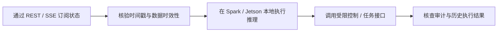

# 端网侧可编程 AI 能力扩展指南

[English](ai-customization.md)

**OpenAirKit** 在硬件架构上选用 **DGX Spark**（基站/核心网侧）与 **Jetson Orin**
（UE 端侧），旨在 5G SA 通信链路两端提供**预留 AI 算力资源**。双端内置 AI 智能体规划于
后续里程碑交付；当前版本已完成算力资源隔离、无线实时性保护及鉴权本地 API 建设，便于科研与
工程开发者在稳定的 5G 底座上开展**端网协同 AI 算法二次开发**，并独立部署**自定义 AI
服务**与推理流水线。

## 自定义 AI 服务设计原则

1. **端网本地自治**：部署于 **DGX Spark** 的 AI 服务仅订阅基站/核心网遥测并在本机触发
   受限控制（`127.0.0.1:8877`）；部署于 **Jetson Orin** 的 AI 服务仅消费终端侧遥测并
   提交本地任务（`127.0.0.1:8878`）。推理与决策闭环保持本机自治，避免跨主机强耦合。
2. **基于数据时效性门控**：消费状态快照前须核验来源时间戳与证据时效状态（`ok`、`stale`、
   `unavailable`、`unsupported`），仅在状态处于 `ok` 窗口内触发闭环运维动作。
3. **受控执行与互斥边界**：所有状态变更统一经由鉴权 REST API 下发，禁止绕过串口排他锁直连
   RM520N-GL，或对 Open5GS 容器执行未经审计的带外修改。

## 算力、端口与实时性隔离

- **DGX Spark（基站 / 核心网侧）**：
  - **独立预留推理端口段（`8000–8002`）**：OCUDU JSON 指标绑定在 `127.0.0.1:8879`
    并受 `aoc-v2-metrics-guard.service` 防火墙守护，将 `127.0.0.1:8000–8002` 完整保留给
    共驻本地 LLM/vLLM 或机器学习推理容器。非特权 AI 服务统一对接 **Spark Platform**
    （`127.0.0.1:8877`）。
  - **无线实时性保护**：运行高负载推理任务时，须保持 `aoc-v2-cpu-latency.service` 处于
    激活状态，并按 `realtime.conf` 配置 CPU 核芯隔离，确保 OCUDU 实时线程不发生 USB 3.0
    欠载（`underflow`）或超时帧（`late`）。
- **Jetson Orin（UE 端侧）**：
  - **串口锁与管理路由保护**：端侧推理服务通过 **Jetson Console**（`127.0.0.1:8878`）
    获取链路观测数据并触发任务，完整保留 `/var/lib/agentic-ocudu/v2-ue/serial.lock`
    串口锁与协议 `186` 带外 Wi-Fi 路由保护。

完整端口规划、低时延守护及串口锁路径见[端口与运行时参考](reference/ports-and-runtime.zh-CN.md)。

## 闭环集成模式与接口

所有实时遥测端点（`GET /api/v1/stream`、`GET /api/v1/snapshot`、`GET /api/v1/status`、
`GET /api/v1/events/stream`）及受限控制端点（`POST /api/v1/control`、`POST /api/v1/jobs`、
`POST /api/v1/maintenance`）均规范定义于[REST 与 SSE 接口参考](reference/api-reference.zh-CN.md)。

### 典型端网侧 AI 扩展方向

- **网侧 AI 模型集成（DGX Spark）**：在 `8000–8002` 部署面向运维诊断的本地大模型服务，
  消费 Spark SSE 流、事件总线及组件/设备时序 KPI（`devices/{identifier}/metrics`、
  `components/{identifier}/metrics`），或开发无线空口异常检测与多 UE 调度分析模块。
- **端侧 AI 算法二次开发（Jetson Orin）**：结合 `/api/v1/status` 与
  `/api/v1/events/stream` 实时感知 5G 链路质量，实现本地边缘推理与经由 5G 上行卸载至
  Spark 推理之间的动态协同，或基于 `/api/v1/jobs` 编排面向业务场景的链路恢复策略。
