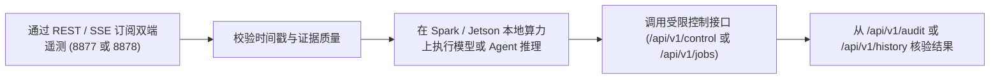

# 双端 AI 定制与扩展指南

[English](ai-customization.md)

## 当前能力边界与硬件预留意图

> [!IMPORTANT]
> **双端内置 AI 模型与智能体目前尚未在本仓库中实现。**
> 当前版本提供的是可复现的 5G SA 通信栈（OCUDU + Open5GS）、双端解耦的管控平台
> （**Spark Platform** 与 **Jetson Console**）、结构化实时遥测流、受限控制接口以及主机级资源隔离。
>
> 在硬件选型上之所以搭配 **DGX Spark**（gNB/核心网侧）与 **Jetson Orin**（UE 侧），
> 正是为了在通信两端预留充足的本地算力，方便开发者和研究者后续在稳定底座上 DIY 自主开发与部署自定义 AI 模块。

## 自定义 AI 模块的设计原则

在基站侧或终端侧自行接入推理服务、异常诊断模型或运维 Agent 时，建议遵守平台的原有边界：

1. **双端本地自治**：
   - **DGX Spark** 上的 AI 模块仅读取基站/核心网遥测并触发 Spark 本地受限控制。
   - **Jetson Orin** 上的 AI 模块仅读取 UE 本地遥测并触发 Jetson 本地任务，不跨主机构建强耦合的全局设备控制状态层。
2. **先校验新鲜度再决策**：
   - 两端快照均附带来源时间戳与证据质量（`ok`、`stale`、`unavailable`、`unsupported`）。严禁基于 `stale` 或 `unavailable` 状态发起自动动作。
3. **受控执行与硬件互斥**：
   - 所有变更动作统一经过鉴权后的控制台接口（Spark `/api/v1/control`、Jetson `/api/v1/jobs` 与 `/api/v1/maintenance`），不要绕过串口锁直接操作 RM520N-GL，也不要直接对 `aoc-v2-open5gs` 容器执行无保护修改。

## 算力、端口与实时性隔离

### gNB / 核心网侧（`DGX Spark`）

- **推理服务端口留空（`127.0.0.1:8000–8002`）**：
  OCUDU 回环 JSON 指标端口已从 `8001` 迁至 `127.0.0.1:8879`，刻意保留 `8000–8002` 区间给 Spark 上共驻的本地推理引擎（如 vLLM/LLM 容器）。
- **`8879` 端口守护**：
  `aoc-v2-metrics-guard.service` 通过 `table inet aoc_v2_metrics_guard` 限制仅 `uid == 0` 进程访问 `ws://127.0.0.1:8879`。普通权限的自定义 AI 模块应优先对接 **Spark Platform**（`127.0.0.1:8877`）。
- **无线实时性保护**：
  在 Spark 上运行较大规模的本地 GPU/CPU 推理任务前，请保留启用 `aoc-v2-cpu-latency.service`（固定 `/dev/cpu_dma_latency=0`）并按需启用 `systemd/aoc-v2-radio.service.d/realtime.conf.example`（`CPUAffinity`、`LimitRTPRIO=99`），避免计算负载抢占导致 USRP B210 出现采样欠载（underflow）或延迟（late）。

### UE 侧（`Jetson Orin`）

- **串口独占锁保护**：
  `aoc-v2-jetson-device.service` 通过 `/var/lib/agentic-ocudu/v2-ue/serial.lock` 串行化访问 AT 串口。终端侧 AI 程序如需读数或恢复连接，请调用 Jetson Console API（`127.0.0.1:8878`）；确需外部直连串口前必须先进入维护模式（`POST /api/v1/maintenance`）。
- **管理路由保护**：
  不要绕开 Jetson Console 修改协议 `186` 的默认路由（Wi-Fi 回退 metric `5`、蜂窝优先 metric `10`），确保 AI 实验触发无线波动时 SSH/Tailscale 管理通路依然畅通。

## 遥测与控制接入面

### gNB 与核心网侧 — Spark Platform（`127.0.0.1:8877`）

| 类别 | 接口端点 | DIY AI 模块用途 |
| --- | --- | --- |
| 会话鉴权 | `POST /api/v1/login`、`GET /api/v1/session`、`POST /api/v1/logout` | 获取会话 Cookie 与 CSRF Token |
| 实时状态订阅 | `GET /api/v1/snapshot`、`GET /api/v1/stream`（SSE） | 实时读取或订阅主机、B210、gNB、N2、Open5GS 网元、网桥及在线设备状态 |
| 指标与历史 | `GET /api/v1/devices`、`GET /api/v1/devices/{identifier}`、`GET /api/v1/devices/{identifier}/metrics`、`GET /api/v1/components/{identifier}/metrics`、`GET /api/v1/history`、`GET /api/v1/history/catalog` | 获取时序 KPI，用于异常检测、吞吐/MCS 预测或智能体上下文 |
| 事件与诊断 | `GET /api/v1/events`、`GET /api/v1/events/kinds`、`GET /api/v1/diagnostics` | 读取结构化故障事件与诊断明细 |
| 受控操作与审计 | `GET/POST /api/v1/control`、`GET /api/v1/control/{identifier}`、`POST /api/v1/control/{identifier}/cancel`、`GET /api/v1/audit` | 触发受白名单约束的生命周期操作并读取持久审计记录 |

### UE 侧 — Jetson Console（`127.0.0.1:8878`）

| 类别 | 接口端点 | DIY AI 模块用途 |
| --- | --- | --- |
| 会话鉴权 | `POST /api/v1/auth/login`、`GET /api/v1/auth/session`、`POST /api/v1/auth/logout` | 获取会话 Cookie 与 CSRF Token |
| 实时状态订阅 | `GET /api/v1/status`、`GET /api/v1/config`、`GET /api/v1/events/stream`（SSE） | 获取或订阅 SIM、驻留、5GS 注册、PDU、路由及自动恢复状态 |
| 指标与诊断 | `GET /api/v1/metrics`、`GET /api/v1/history`、`GET /api/v1/diagnostics` | 获取被动收发速率历史、绑定接口探测时延及任务历史 |
| 受控任务 | `GET/POST /api/v1/jobs`、`GET /api/v1/jobs/{identifier}`、`POST /api/v1/jobs/{identifier}/run`、`POST /api/v1/jobs/{identifier}/cancel`、`POST /api/v1/maintenance` | 安全发起 Device Setup、Recover 或切换维护模式 |

## 推荐 DIY 闭环集成模式

### 典型 DIY 扩展方向示例（仓库暂未内置）

在通过[端到端快速搭建指南](quickstart.zh-CN.md)验证 5G SA 通路稳定后，可在两端算力上自行探索以下方向：

- **DGX Spark（gNB / 核心网侧）**：
  - 在 `8000–8002` 运行本地 LLM 运维/诊断助手，消费 Spark SSE、事件与历史指标，辅助定位 N2/N3 异常或无线链路退化原因。
  - 基于 `/api/v1/devices/{identifier}/metrics` 与 `/api/v1/components/{identifier}/metrics` 构建无线 KPI 异常检测或频谱干扰分析模型。
- **Jetson Orin（UE 侧）**：
  - 根据 `/api/v1/status` 与 `/api/v1/events/stream` 实时感知 5G 链路状态，驱动边缘应用在本地推理、5G 回传至 Spark 推理以及 Wi-Fi 兜底之间动态决策。
  - 在遵守冷却期与管理保护边界的前提下，基于 `/api/v1/jobs` 编排面向特定业务场景的恢复策略。
