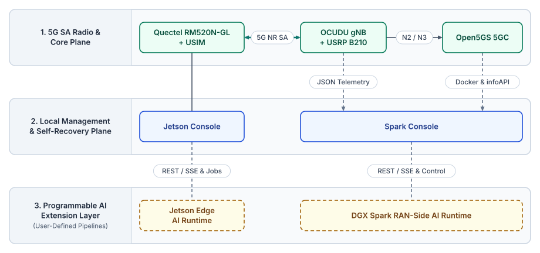

# Architecture

[简体中文](architecture.zh-CN.md)

## Design Overview

**OpenAirKit** delivers a self-contained **5G Standalone (SA)** IPv4 data
network paired with two decoupled, local-first operations consoles:

- **Base-station & core node (`DGX Spark` + `USRP B210`)**: hosts the
  **OCUDU** RAN, **Open5GS** 5G Core, and **Spark Console** for real-time
  telemetry aggregation and bounded lifecycle control.
- **UE edge node (`Jetson Orin` + `Quectel RM520N-GL`)**: hosts **Jetson
  Console** for exclusive modem supervision, dual-path Wi-Fi/cellular route
  failover, and bounded link recovery.

Each host maintains strictly local operational state and supports independent
installation, upgrade, rollback, and fault isolation without a central fleet
orchestrator.

## Three-Plane Model

<picture>
  <source media="(prefers-color-scheme: dark)" srcset="assets/diagrams/three-plane-architecture-en-dark.svg">
  <source media="(prefers-color-scheme: light)" srcset="assets/diagrams/three-plane-architecture-en-light.svg">
  
</picture>

1. **5G SA Radio & Core Plane**: Carries the single-PDU IPv4 user plane between
   the UE modem and Open5GS external data network (`ext-DN`). Authoritative RF
   and core baseline parameters are specified in
   [Network & RF Profile](reference/network-and-rf-profile.md).
2. **Local Management & Self-Recovery Plane**: Unprivileged web services expose
   loopback consoles (`8877` and `8878`) and SSE event streams while privileged
   system or modem mutations traverse serialized local executors or
   `/usr/local/sbin/aoc-maintain`.
3. **Programmable AI Extension Layer**: **DGX Spark** and **Jetson Orin**
   reserve dedicated edge and RAN-side AI compute resources at both endpoints.
   Port allocation reserves `8000–8002` on Spark for local inference,
   real-time CPU latency guards isolate gNB scheduling, and authenticated
   REST/SSE endpoints provide clean integration boundaries for user-defined AI
   pipelines. See [AI Extensibility Guide](ai-customization.md).

## Component Scope & Isolation Boundaries

| Component | Primary Responsibility | Isolation Boundary |
| --- | --- | --- |
| **Jetson Console** | Exclusive modem serial lock, bounded AT state machine, dual-path IPv4 routing, UE state (`127.0.0.1:8878`) | Decoupled from base-station/core lifecycle and unrestricted administrator shell access |
| **Spark Console** | Host, RAN, and core telemetry ingestion, SQLite metric history/events, bounded stack operations (`127.0.0.1:8877`) | Passive RAN/core telemetry observer; decoupled from UE modem state |
| **OCUDU Stack** | USRP B210 SDR pipeline, NR SA cell scheduling, NGAP signaling, guarded JSON metrics (`127.0.0.1:8879`) | Runs independently of web console sessions and platform SQLite stores |
| **Open5GS Stack** | Subscriber repository, 5G AKA authentication, PDU sessions, N3/N4/N6 forwarding, `ext-DN` probe responder | Owns an isolated Compose project, Docker bridge, and MongoDB volume |

## Key Architectural Guarantees

- **Least-privilege isolation**: Web backends execute unprivileged without
  direct Docker socket or serial device permissions; hardware and systemd
  mutations pass through serialized local executors or the SHA-256 allow-listed
  `aoc-maintain` helper.
- **Runtime topology discovery**: Spark discovers its owned Open5GS Docker
  bridge dynamically at runtime; Jetson Console inspects RM520N-GL USB interface
  descriptors before opening serial ports and verifies management
  Wi-Fi/`tailscale0` reachability prior to route updates.
- **Shared Astryx UI foundation**: Both React frontends consume
  [`packages/console-ui`](../packages/console-ui/README.md) (`Astryx Core`,
  `Charts`, `Neutral` theme, `UIProvider`).
- **Freshness-tagged telemetry**: Collectors tag every snapshot with source
  timestamps, process generation IDs, and an independent telemetry freshness
  state (`ok`, `stale`, `unavailable`, `unsupported`) so aged data never masks
  live link failures.

## Technical References

- [Network, RF Baseline & Access Policy](reference/network-and-rf-profile.md)
- [Ports, Routing & Runtime Reference](reference/ports-and-runtime.md)
- [REST & SSE API Reference](reference/api-reference.md)
- [Glossary](reference/glossary.md)
