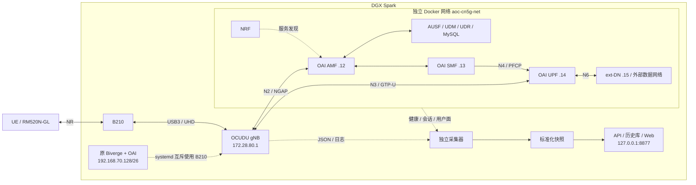

# 架构与部署拓扑

## 1. 边界

本项目提供一套独立实验栈：OCUDU 提供 RAN；OAI 提供 5GC；本项目监控提供采集、历史与界面。不导入 Biverge 模块、不调用其 HTTP API、不读取其快照/SQLite，不以其补丁或镜像为运行前提。

共享基础设施为 Spark 操作系统、Docker daemon、UHD/B210 和宿主机 systemd。共享不意味着修改全局 Docker 配置、替换 UHD、调整全局 CPU/IRQ 或接管旧监控服务。此类主机调优需要独立评估两个栈的回归风险。

## 2. 拓扑与数据流

控制面：UE 注册由 OCUDU 经 N2 转发至新 AMF，认证访问新订阅系统；SMF 通过 N4 管理新 UPF。用户面：UE 数据经 NR、OCUDU N3、UPF N6 到达 ext-DN/外部网络。监控为独立旁路，不在通信转发路径上。

## 3. 资源与所有权

唯一环境配置源为 `config/spark.example.json` 的结构；本地实例配置进入 `local/`。版本来源独立记录于 `config/upstreams.json`。发布时产生明确版本的只读目录 `/opt/agentic-ocudu/releases/<release-id>/`，`current` 指向已验收版本。不能仅切换二进制而忽略配置 schema 或数据库迁移兼容性。

| 位置 | 内容 |
| --- | --- |
| `/opt/agentic-ocudu` | 本项目程序、venv、前端产物、发布记录 |
| `/etc/agentic-ocudu` | 运行配置及受权限保护的 secrets |
| `/var/lib/agentic-ocudu` | 新监控数据库；核心网另用新 Compose volume |
| `/run/agentic-ocudu` | 本项目快照与运行时 IPC |
| `/var/log/agentic-ocudu` | RAN 日志、采集诊断、轮转文件 |

候选核心网 `172.28.80.0/24`、UE `10.80.0.0/24` 与现场活动/停用但保留的 Docker 网段、宿主路由、旧 UE 地址池分离。桥名称不超过 Linux IFNAMSIZ 限制。不重命名或重配 Wi-Fi、Tailscale 和物理网口。

协议端口复用通过地址/命名空间隔离：新旧 AMF 均可监听自身地址的 38412/SCTP，新旧 gNB 均绑定自身地址的 2152/UDP。部署前检查通配监听和 Docker published ports。UPF 的 NAT、TUN 和新数据池应限制在本栈范围；不向宿主添加宽泛的 `10.0.0.0/8` 路由或全局 MASQUERADE。

同一 SIM 可分别在两套独立数据库配置；认证材料由用户提供，不共用数据库。网络切换会使已有 RRC/PDU/IP 会话失效，UE 应重新注册/建立会话；这不是无缝漫游或不中断切换。

## 4. 现场依据与限制

2026-09-07 只读核对：Spark 为 ARM64，原 gNB 使用 B210；旧 Compose 网络为 `192.168.70.128/26`，另一停用网络 `192.168.72.128/26` 仍存在；Docker 另保留 `172.17.0.0/16`、`172.18.0.0/16`。新候选 8877/TCP、8001/TCP 未出现在本次监听列表。

这些是观察结果，不是永久资源预留。实时检查还须覆盖 Docker IPAM、策略路由、VPN 路由、双栈通配 socket 与 USB 占用。完整研究保存在 [research/](research/)，历史推荐方案不替代当前独立性约束。
