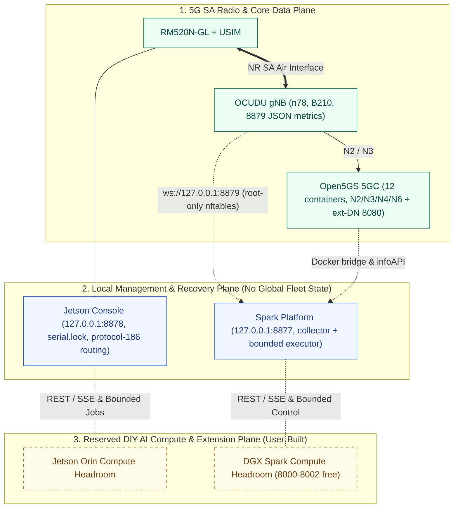

# Architecture

[简体中文](architecture.zh-CN.md)

## Product Boundary

Agentic-OCUDU delivers a reproducible 5G Standalone (SA) data network with
decoupled management consoles on both ends: **OCUDU** provides the RAN,
**Open5GS** provides the 5G core, **Spark Platform** observes and operates the
base station, and **Jetson Console** observes and operates the UE modem. IMS,
SIP and voice services are outside the current scope.

## Three-Plane Architecture

1. **5G SA Radio & Core Plane**: OCUDU gNB (USRP B210, Band `n78`) and Open5GS
   5GC (`12` containers + `ext-DN`) carry the single IPv4 data PDU. See
   [Hardware & Topology](hardware-and-topology.md).
2. **Local Management & Self-Recovery Plane**: **Spark Platform** (`0.2.1`) and
   **Jetson Console** (`0.6.2`) track strictly local host/device state, enforce
   evidence freshness, and execute bounded lifecycle, route-failover and
   recovery actions.
3. **Reserved Dual-End AI Compute & Extension Plane**: No built-in AI models
   are shipped in this repository today. Instead, **DGX Spark** and
   **Jetson Orin** intentionally reserve compute headroom at both ends, paired
   with port isolation (`8879` keeping `8000–8002` free), real-time CPU/DMA
   guards (`aoc-v2-cpu-latency`) and authenticated REST/SSE APIs for future DIY
   AI modules. See [DIY AI Customization](ai-customization.md).

## Component Ownership

| Component | Owns | Must Not Own |
| --- | --- | --- |
| Jetson Console (`0.6.2`) | Modem serial lock, bounded AT workflow, protocol-186 owned routes, UE state, `127.0.0.1:8878` | RAN/core lifecycle or arbitrary shell execution |
| Spark Platform (`0.2.1`) | Host/RAN/core evidence, history, events, bounded stack tasks, `127.0.0.1:8877` | Modem control or UE-only state |
| OCUDU stack | USRP B210 (`rx_gain=54`, `tx_gain=80`, `pusch.max_ue_mcs=24`), cell config, NGAP, `127.0.0.1:8879` metrics, `aoc-v2-cpu-latency` | Web sessions or platform UI state |
| Open5GS stack | Subscriber DB, registration, PDU sessions, N3/N4/N6 (`aoc-v2-open5gs-core`), MongoDB (`GLIBC_TUNABLES` on Linux 7.0+) | RAN hardware or UI state |

## Runtime, UI and Privilege Boundaries

- **Shared UI boundary**: Both React consoles consume [`packages/console-ui`](../packages/console-ui/README.md) (`Astryx Core`, `Charts`, `Neutral` theme, `UIProvider`) and track only local device/session state without a global fleet layer.
- **Privilege isolation**: Each web service (`aoc-monitor-web` on Spark, `aoc-v2-jetson-web` on Jetson) runs unprivileged without Docker socket or serial hardware access. Privileged actions run through the local socket executor (`aoc-control` / `aoc-v2-jetson-device`) or `/usr/local/sbin/aoc-maintain` (`deploy/maintenance/`), which enforces SHA-256 approved archives and exact `NOPASSWD: NOSETENV` allowlists.
- **Loopback port isolation**: Spark uses `127.0.0.1:8877`, Jetson uses `127.0.0.1:8878`, and OCUDU JSON remote-control WebSocket uses `127.0.0.1:8879` guarded by `aoc-v2-metrics-guard.service` (`table inet aoc_v2_metrics_guard` rejecting `skuid != 0`), keeping `127.0.0.1:8000–8002` clear on DGX Spark.
- **Host/USB adaptation**: Spark `collector.py::bridge_interface()` resolves the Docker bridge dynamically from `docker network inspect` (handling `br-<id12>` or named bridges); `deploy/spark/stack/` manages `/dev/cpu_dma_latency` (`aoc-v2-cpu-latency.service`) and Linux 7.0+ MongoDB allocator compatibility. Jetson `hardware.py::discover()` validates Quectel RM520N-GL USB interfaces across RNDIS (`00/01` -> AT `04`) and ECM `cdc_ether` (`04` or `0a` -> AT `02`) topologies before opening a serial port.
- **Opt-in Jetson boot coordinator**: When installed, `deploy/jetson/boot_connect.py` sits outside the immutable application release, verifies pinned hashes in `/etc/aoc-v2-jetson/boot.json`, gates startup on USB/Wi-Fi/Tailscale readiness, and runs at most one standard setup cycle per host `boot_id` without storing SIM credentials.

## Brand vs. Stable System Identifiers

Display branding (`Agentic-OCUDU`) is logically decoupled from underlying runtime
identifiers (`aoc-v2ctl`, `aoc-maintain`, `/opt/agentic-ocudu/`, `aoc-v2-*`
systemd units). Future rebranding changes display names and visual assets
without breaking deployed host paths or systemd manifests. See
[Visual Assets & Brand Guide](assets/README.md).

## Network Contract & Evidence Semantics

- **Contract (`config/network-contract.json`)**: PLMN `460/03`, TAC `1`, SST `1`,
  Band `n78`, `20 MHz`, `30 kHz` SCS, single IPv4 PDU, DNN `oai`, UE pool
  `10.0.0.0/24`, `5QI=9`.
- **Evidence semantics**: Evidence quality (`ok`, `stale`, `unavailable`,
  `unsupported`) is tracked independently from operational health. A UE reports
  connected only when fresh SIM, NR SA registration, IPv4 PDU, pool match,
  current RAN context and bound user-plane probes all agree. Collectors preserve
  source timestamps and process generations across restarts to avoid false zero
  traffic or rate spikes.

## Glossary

| Term | Meaning |
| --- | --- |
| `N2` / `N3` / `N4` / `N6` | 3GPP 5G SBA/reference interfaces: gNB-AMF control (`N2`), gNB-UPF user plane (`N3`), SMF-UPF control (`N4`), UPF-Data Network (`N6`) |
| `ext-DN` | Minimal external data-network container inside `aoc-v2-open5gs` exposing `/health` on TCP `8080` for bound data probes (without `iperf3`) |
| `Protocol-186 Routing` | Jetson routing table entries tagged with kernel protocol `186` owned by Jetson Console: Wi-Fi fallback (`metric 5`) vs. cellular preference (`metric 10`) |
| `Evidence Quality` | Freshness/trust marker (`ok`, `stale`, `unavailable`, `unsupported`) attached separately from business status |
| `QMAP / MPDN` | Quectel multiplexing/multi-PDN data association rules inspected on RM520N-GL firmware |
| `boot_id Ledger` | Per-boot journal keyed by Linux `/proc/sys/kernel/random/boot_id` inside `boot_connect.py` to prevent duplicate auto-setup replays on the same boot |
