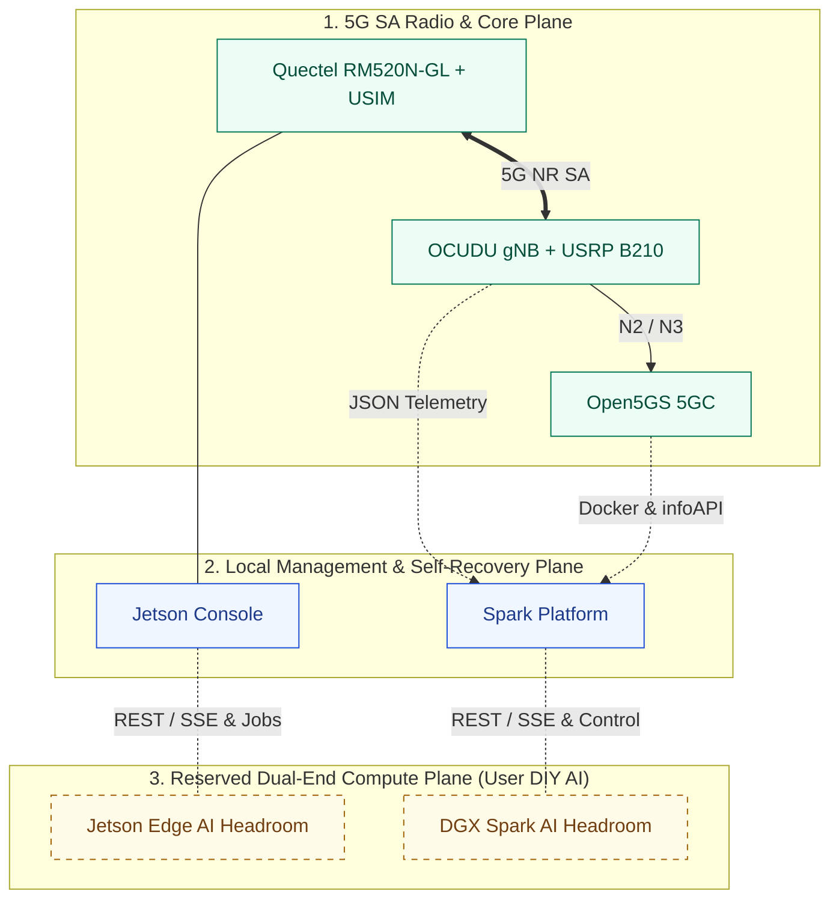

# Architecture

[简体中文](architecture.zh-CN.md)

## Design Overview

**Agentic-OCUDU** provides a self-contained **5G Standalone (SA)** IPv4 data
network paired with two decoupled local operations consoles:

- **Base-station & core side (`DGX Spark` + `USRP B210`)**: runs the **OCUDU**
  RAN, the **Open5GS** 5G Core, and **Spark Platform** for telemetry and
  bounded lifecycle control.
- **UE edge side (`Jetson Orin` + `Quectel RM520N-GL`)**: runs **Jetson
  Console** for modem supervision, dual-path Wi-Fi/cellular routing failover,
  and bounded link recovery.

Both hosts track strictly local state and remain independently deployable,
upgradable, and recoverable without a central fleet orchestrator.

## Three-Plane Model

1. **5G SA Radio & Core Plane**: Carries the single-PDU IPv4 user plane between
   the UE modem and Open5GS external data network (`ext-DN`). Exact RF and core
   profile values live in [Network & RF Profile](reference/network-and-rf-profile.md).
2. **Local Management & Self-Recovery Plane**: Unprivileged web services expose
   loopback consoles (`8877` and `8878`) and SSE updates while privileged system
   or modem actions pass exclusively through local executors or
   `/usr/local/sbin/aoc-maintain`.
3. **Reserved Dual-End AI Compute & Extension Plane**: **DGX Spark** and
   **Jetson Orin** provide dedicated local compute headroom at both ends. Port
   allocation keeps inference ports (`8000–8002`) free on Spark, real-time CPU
   guards protect gNB timing, and authenticated REST/SSE endpoints provide clean
   integration hooks for user-developed AI modules. See
   [DIY AI Customization](ai-customization.md).

## Component Scope & Isolation Boundaries

| Component | Primary Responsibility | Isolation Boundary |
| --- | --- | --- |
| **Jetson Console** | Modem serial lock, bounded AT workflow, dual-path IPv4 routing, UE state (`127.0.0.1:8878`) | Decoupled from base-station/core lifecycle and general administrator shell access |
| **Spark Platform** | Host, RAN, core evidence collection, history/events, bounded stack operations (`127.0.0.1:8877`) | Observes RAN/core evidence only; independent from UE modem control |
| **OCUDU Stack** | USRP B210 SDR pipeline, NR SA cell scheduling, NGAP, guarded JSON metrics (`127.0.0.1:8879`) | Runs independently of web sessions and UI storage |
| **Open5GS Stack** | Subscriber registry, 5G AKA, PDU sessions, N3/N4/N6 routing, `ext-DN` health responder | Owns its Compose project, bridge, and MongoDB volume separately from platform consoles |

## Key Architectural Guarantees

- **Privilege isolation**: Web processes run unprivileged without direct Docker
  socket or serial port access; hardware and systemd mutations traverse
  serialized local executors or the SHA-256 allow-listed `aoc-maintain` helper.
- **Dynamic adaptation**: Spark discovers its owned Open5GS Docker bridge
  dynamically at runtime; Jetson Console inspects RM520N-GL USB descriptors
  before opening any serial port and protects management Wi-Fi/`tailscale0`
  reachability before modifying routes.
- **Shared Astryx UI**: Both React consoles consume [`packages/console-ui`](../packages/console-ui/README.md)
  (`Astryx Core`, `Charts`, `Neutral` theme, `UIProvider`).
- **Evidence-driven connectivity**: Telemetry snapshots tag source timestamps,
  process generation IDs, and independent evidence quality (`ok`, `stale`,
  `unavailable`, `unsupported`) so stale values never mask real outages.
- **Brand vs. system identifiers**: Display branding (`Agentic-OCUDU`) is kept
  separate from stable runtime identifiers (`aoc-v2ctl`, `aoc-maintain`,
  `/opt/agentic-ocudu/`, `aoc-v2-*` units); see [Visual Assets & Brand Guide](assets/README.md).

## Technical References

- [Network, RF Baseline & Access Policy](reference/network-and-rf-profile.md)
- [Ports, Routing & Runtime Reference](reference/ports-and-runtime.md)
- [REST & SSE API Reference](reference/api-reference.md)
- [Glossary](reference/glossary.md)
