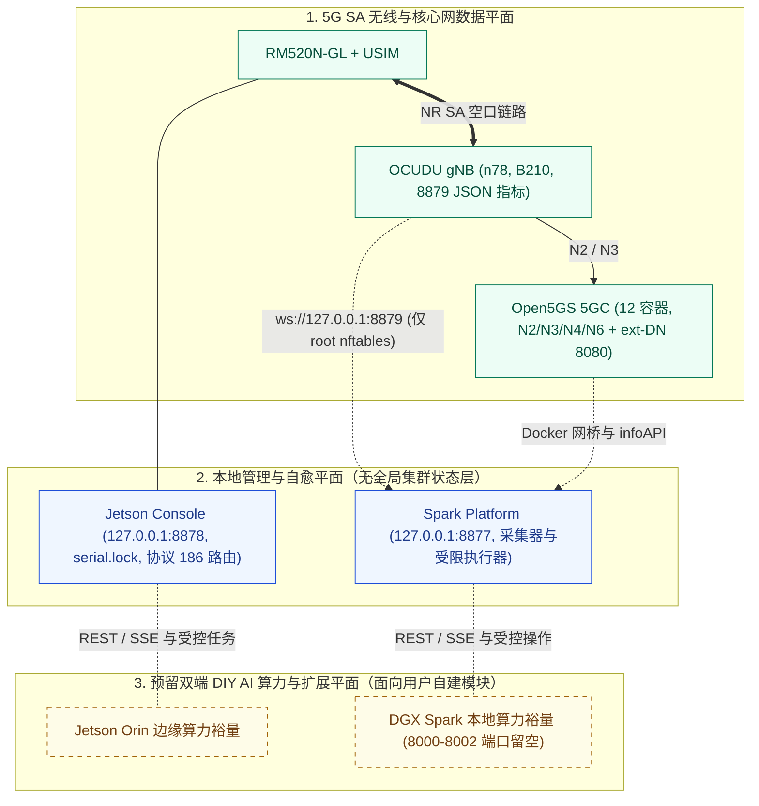

# 系统架构

[English](architecture.md)

## 产品边界

Agentic-OCUDU 提供一套可复现的 5G Standalone（SA）数据网络与双端解耦管理平台：
**OCUDU** 提供 RAN，**Open5GS** 提供 5G 核心网，**Spark Platform** 负责基站侧
观测与受限操作，**Jetson Console** 负责 UE 模组观测与受限操作。IMS、SIP 与语音
服务不属于当前产品边界。

## 三平面架构总览

1. **5G SA 无线与核心网平面**：OCUDU gNB（USRP B210、`n78` 频段）与 Open5GS 5GC
   （`12` 个核心网容器 + `ext-DN`）承载单 IPv4 数据 PDU，硬件配置见[硬件清单与拓扑](hardware-and-topology.zh-CN.md)。
2. **本地管理与自愈平面**：**Spark Platform**（`0.2.1`）与 **Jetson Console**（`0.6.2`）
   各自仅维护本地主机与设备状态、校验证据新鲜度，并执行有界生命周期、路由切换与恢复任务。
3. **双端预留 AI 算力与扩展平面**：当前仓库暂未内置 AI 模型，而是通过 **DGX Spark** 与
   **Jetson Orin** 在通信两端预留计算能力，结合端口隔离（`8879` 留空 `8000–8002`）、
   实时低时延守护（`aoc-v2-cpu-latency`）与鉴权 REST/SSE 接口支撑后续 DIY AI 扩展。
   详见[双端 AI 定制指南](ai-customization.zh-CN.md)。

## 组件归属

| 组件 | 拥有 | 不得拥有 |
| --- | --- | --- |
| Jetson Console（`0.6.2`） | 模组串口锁、受限 AT 流程、协议 186 自有路由、UE 状态、`127.0.0.1:8878` | RAN/核心网生命周期或任意 shell |
| Spark Platform（`0.2.1`） | 主机/RAN/核心网证据、历史、事件、受限栈任务、`127.0.0.1:8877` | 模组控制或仅 UE 可见的信息 |
| OCUDU 栈 | USRP B210（`rx_gain=54`、`tx_gain=80`、`pusch.max_ue_mcs=24`）、小区配置、NGAP、`127.0.0.1:8879` 指标、`aoc-v2-cpu-latency` | Web 会话或平台 UI 状态 |
| Open5GS 栈 | 订阅数据库、注册、PDU 会话、N3/N4/N6（`aoc-v2-open5gs-core`）、MongoDB（7.0+ 内核 `GLIBC_TUNABLES`） | 无线硬件或 UI 状态 |

## 运行时、UI 与权限边界

- **共享 UI 边界**：两个 React 控制台共用 [`packages/console-ui`](../packages/console-ui/README.zh-CN.md)（`Astryx Core`、`Charts`、`Neutral` 主题与 `UIProvider`），各自仅维护本地设备状态，不引入全局设备集群状态层。
- **权限隔离**：两端 Web 服务（Spark 的 `aoc-monitor-web`、Jetson 的 `aoc-v2-jetson-web`）以非特权账户运行，不能直接访问 Docker socket 或串口设备。特权动作均经本机执行器（`aoc-control` / `aoc-v2-jetson-device`）或 `/usr/local/sbin/aoc-maintain`（`deploy/maintenance/`）触发，后者强制校对 SHA-256 批准包与精确的 `NOPASSWD: NOSETENV` 白名单。
- **回环端口隔离**：Spark 监听 `127.0.0.1:8877`，Jetson 监听 `127.0.0.1:8878`，OCUDU JSON remote-control 指标端口固定在 `127.0.0.1:8879` 并由 `aoc-v2-metrics-guard.service`（`table inet aoc_v2_metrics_guard` 拒绝 `skuid != 0`）保护，从而将 DGX Spark 上共驻推理常用的 `127.0.0.1:8000–8002` 区间完整留空。
- **主机与硬件适配**：Spark 侧 `collector.py::bridge_interface()` 通过 `docker network inspect` 动态解析网桥接口（兼容 `br-<id12>` 与显式命名网桥）；`deploy/spark/stack/` 管理 `/dev/cpu_dma_latency` 与 7.0+ 内核 MongoDB 兼容配置。Jetson 侧 `hardware.py::discover()` 会在打开串口前校验 Quectel RM520N-GL 的 RNDIS（`00/01` -> AT `04`）与 ECM `cdc_ether`（`04` 或 `0a` -> AT `02`）拓扑。
- **可选开机协调器**：按需安装时，`deploy/jetson/boot_connect.py` 独立于只读发布包运行，基于 `/etc/aoc-v2-jetson/boot.json` 校对发布与配置哈希，在确认 USB、Wi-Fi 与 Tailscale 就绪后每个主机 `boot_id` 最多发起一次标准入网流程，不保存 SIM 鉴权密钥。

## 品牌名称与底层技术标识解耦

对外展示品牌名（`Agentic-OCUDU`）与底层运行时技术标识（`aoc-v2ctl`、`aoc-maintain`、
`/opt/agentic-ocudu/`、`aoc-v2-*` systemd 单元）在架构上相互独立。未来更换项目
品牌名称与 Logo 时，只需替换展示文案与视觉资源，无需破坏已部署主机的路径与脚本。
详见[视觉素材与品牌替换规范](assets/README.md)。

## 网络契约与状态语义

- **网络契约（`config/network-contract.json`）**：PLMN `460/03`、TAC `1`、SST `1`、
  频段 `n78`、`20 MHz`、`30 kHz` SCS、单 IPv4 数据 PDU、`DNN=oai`、UE 地址池 `10.0.0.0/24`、`5QI=9`。
- **证据质量语义**：证据质量（`ok`、`stale`、`unavailable`、`unsupported`）与业务健康状态
  互相独立。只有当新鲜的 SIM、NR SA 注册、IPv4 PDU、地址池、RAN 上下文与绑定用户面
  探测全部一致时，UE 才判定为已连接。采集器记录来源时间戳与进程代次，重启或计数器归零后
  开启新区间，避免虚假零流量或速率尖峰。

## 核心术语表

| 术语 | 说明 |
| --- | --- |
| `N2` / `N3` / `N4` / `N6` | 5G SA 关键接口：gNB-AMF 控制面（`N2`）、gNB-UPF 用户面（`N3`）、SMF-UPF 控制面（`N4`）、UPF-外部数据网（`N6`） |
| `ext-DN` | `aoc-v2-open5gs` 内部极简外部数据网容器，在 TCP `8080` 暴露 `/health` 供绑定接口探测使用（不含 `iperf3`） |
| 协议 `186` 路由 | Jetson Console 自有的内核协议 `186` 默认路由：Wi-Fi 兜底（`metric 5`）与蜂窝优先（`metric 10`） |
| 证据质量 | 独立于业务状态的新鲜度与可信度标签（`ok`、`stale`、`unavailable`、`unsupported`） |
| `QMAP / MPDN` | Quectel RM520N-GL 固件中的多路复用与多 PDN 数据规则关联状态 |
| `boot_id` 防重放账本 | `boot_connect.py` 按 Linux `/proc/sys/kernel/random/boot_id` 记录单次开机状态，防止同一次启动内重复触发开机流程 |
