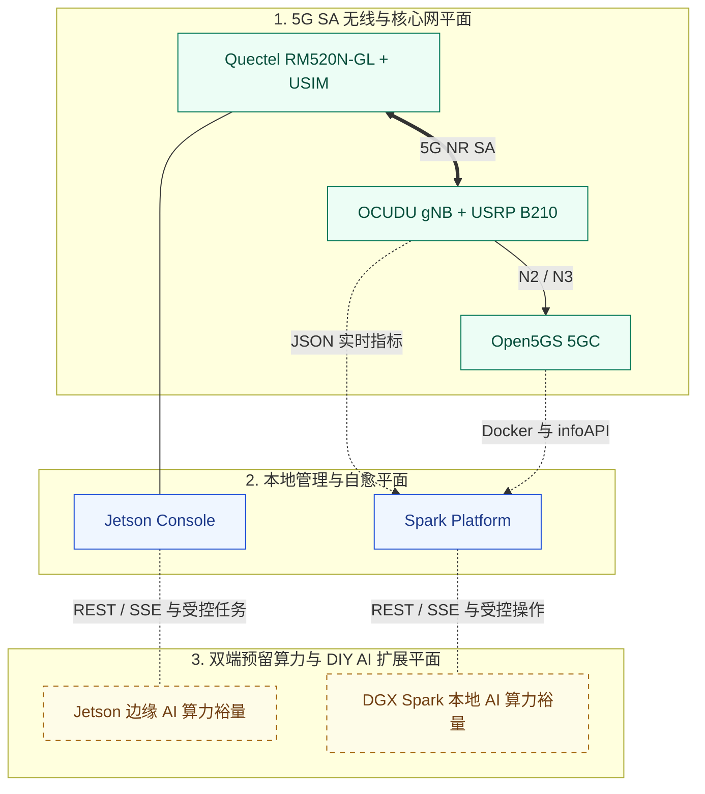

# 系统架构

[English](architecture.md)

## 设计总览

**OpenAirKit** 构建了一套可复现的 **5G 独立组网（SA）** IPv4 数据通信系统，
并在通信两端配套两个彼此解耦的本地管控平台：

- **基站与核心网侧（`DGX Spark` + `USRP B210`）**：运行 **OCUDU** RAN、**Open5GS**
  5G 核心网及 **Spark Platform**，负责基站侧实时遥测与受限生命周期运维。
- **UE 边缘侧（`Jetson Orin` + `Quectel RM520N-GL`）**：运行 **Jetson Console**，
  负责模组独占监管、Wi-Fi/蜂窝双路径路由切换与有界链路自愈。

双端均仅维护本机状态，支持独立安装、升级、回滚与故障隔离，不依赖中心化的全局集群控制面。

## 三平面架构

1. **5G SA 无线与核心网平面**：承载 UE 模组与 Open5GS 外部数据网（`ext-DN`）之间的
   单 IPv4 数据 PDU。完整射频与核心网参数见[网络契约与射频基线](reference/network-and-rf-profile.zh-CN.md)。
2. **本地管理与自愈平面**：非特权 Web 服务仅在回环端口（`8877` 与 `8878`）提供控制台与
   SSE 推送；涉及硬件或 systemd 的变更操作全部经由本机执行器或 SHA-256 批准的
   `/usr/local/sbin/aoc-maintain` 安全边界完成。
3. **双端预留 AI 算力与扩展平面**：**DGX Spark** 与 **Jetson Orin** 在两端预留本地算力；
   Spark 端口分配刻意留空 `8000–8002` 推理端口段，低时延守护保障无线线程实时性，
   鉴权后的 REST/SSE 接口为后续 DIY AI 模块提供稳定接入面。详见[双端 AI 定制指南](ai-customization.zh-CN.md)。

## 组件职责与隔离边界

| 组件 | 核心职责 | 隔离边界 |
| --- | --- | --- |
| **Jetson Console** | 模组串口独占锁、受限 AT 流程、双路径 IPv4 路由与 UE 状态（`127.0.0.1:8878`） | 与基站/核心网生命周期及通用管理员 shell 权限完全解耦 |
| **Spark Platform** | 主机、RAN、核心网证据采集、历史事件与受限栈操作（`127.0.0.1:8877`） | 仅观测基站侧数据，独立于终端模组控制 |
| **OCUDU 栈** | USRP B210 射频驱动、NR SA 调度、NGAP 与受守护 JSON 指标（`127.0.0.1:8879`） | 独立于 Web 会话与平台数据库运行 |
| **Open5GS 栈** | 订阅库、5G AKA 鉴权、PDU 会话、N3/N4/N6 转发及 `ext-DN` 健康探测端点 | 独立持有自身 Compose 项目、Docker 网桥与 MongoDB 数据卷 |

## 核心架构保障

- **最小权限隔离**：Web 服务以非特权用户运行，不直接访问 Docker socket 或串口设备；特权动作经受限本地执行器或 `aoc-maintain` 白名单触发。
- **动态环境适配**：Spark 在运行时动态发现所属 Open5GS 网桥；Jetson Console 在打开串口前校验 RM520N-GL USB 接口描述符，并在路由切换前核验 Wi-Fi 与 `tailscale0` 管理通路。
- **统一 Astryx UI 底座**：两端前端均采用 [`packages/console-ui`](../packages/console-ui/README.zh-CN.md)（`Astryx Core`、`Charts`、`Neutral` 主题与 `UIProvider`）。
- **证据质量与进程代次**：采集器随快照保留来源时间、进程代次与证据质量标签（`ok`、`stale`、`unavailable`、`unsupported`），防止历史状态掩盖真实故障。
- **品牌名与技术标识解耦**：对外展示品牌名（`OpenAirKit`）与底层运行标识（`aoc-v2ctl`、`aoc-maintain`、`/opt/agentic-ocudu/`、`aoc-v2-*` 服务单元）互不耦合；详见[视觉素材与品牌替换规范](assets/README.md)。

## 技术参考入口

- [网络契约、射频基线与接入策略](reference/network-and-rf-profile.zh-CN.md)
- [端口分配、路由策略与运行时参考](reference/ports-and-runtime.zh-CN.md)
- [REST 与 SSE 接口参考](reference/api-reference.zh-CN.md)
- [核心术语表](reference/glossary.zh-CN.md)
