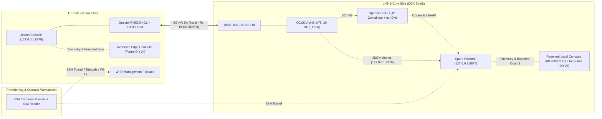

# Hardware Bill of Materials, Topology and Prerequisites

[简体中文](hardware-and-topology.zh-CN.md)

This guide defines the physical hardware, software prerequisites, network
boundaries and multi-UE expansion pattern for **Agentic-OCUDU**.

## Why This Hardware Stack

Agentic-OCUDU targets an intentionally asymmetric dual-compute hardware stack:

- **gNB / 5G Core side (`DGX Spark` + `USRP B210`)**: runs the OCUDU 5G SA RAN
  and Open5GS 5GC while reserving local GPU/CPU headroom and keeping ports
  `127.0.0.1:8000–8002` free for future DIY AI services alongside the base
  station.
- **UE side (`Jetson Orin` + `Quectel RM520N-GL`)**: manages the 5G modem,
  routing protection and self-recovery locally on the Jetson host while
  reserving edge AI compute capacity on Orin for future user-built UE agents.

> [!NOTE]
> Built-in gNB or UE AI modules are not yet implemented in this repository.
> Selecting DGX Spark and Jetson Orin reserves local compute capacity at both
> ends so you can DIY and deploy custom AI capabilities on top of a reproducible
> 5G SA communication baseline. See [DIY AI Customization](ai-customization.md).

## Hardware Bill of Materials (BOM)

| Role | Recommended Hardware | Key Requirements & Notes |
| --- | --- | --- |
| Base station & core host | **DGX Spark** (ARM64) | Ubuntu 24.04 ARM64, USB 3.0 host port for B210, Docker Compose, systemd |
| SDR front-end | **Ettus USRP B210** | USB 3.0 Type-B cable, Band n78 antennas (or cabled SMA attenuators for benchtop testing); optional external power/GPSDO |
| UE edge host | **NVIDIA Jetson Orin** (Nano) | Ubuntu 22.04 ARM64, independent Wi-Fi uplink for management access, USB 3.0 port for the modem |
| M.2 5G carrier board | **[Waveshare SIM8262E-M2 5G for Jetson Orin](https://www.waveshare.net/shop/SIM8262E-M2-5G-for-Jetson-Orin.htm)** | M.2 B-Key expansion board / enclosure connecting to Jetson Orin over USB 3.1/3.0, with onboard Nano-SIM slot, 4x SMA-to-IPEX antennas and 3A power circuit; used here as the carrier to mount the **Quectel RM520N-GL** module |
| 5G NR modem | **Quectel RM520N-GL** | Mounted in the Waveshare M.2 B-Key carrier board above; supported USB modes: RNDIS (`00/01` -> AT `04`) or ECM `cdc_ether` (`04` / `0a` -> AT `02`). *(Jetson Console validates and supports RM520N-GL workflows rather than the SIM8262E-M2 modem.)* |
| Programmable USIM | **TB01 blank USIM** | One physical USIM and one independent Open5GS subscriber per UE; see [TB01 SIM Programming](sim-programming-tb01.md) |
| SIM writer | **PC/SC smartcard reader** | Standard USB CCID/PC/SC reader attached to a Linux or macOS provisioning workstation |

## Physical and Logical Topology

### Physical Wiring Checklist

1. Connect **USRP B210** directly to a native USB 3.0 port on **DGX Spark** (avoid unpowered hubs) and attach n78 antennas or verified bench attenuators (never transmit into an open/unterminated TX port).
2. Install the **Quectel RM520N-GL** module and programmed **TB01 USIM** (Nano-SIM) into the **[Waveshare SIM8262E-M2 5G for Jetson Orin](https://www.waveshare.net/shop/SIM8262E-M2-5G-for-Jetson-Orin.htm)** M.2 B-Key expansion board, attach all four 5G antennas, and connect it to a USB 3.0 port on **Jetson Orin**.
3. Ensure **Jetson Orin** maintains an independent **Wi-Fi management interface** with an IPv4 fallback gateway and reachability to the Spark management address (directly or via Tailscale).

## Ports, Network Contract and Isolation Baseline

All web UIs and metrics feeds listen on loopback only (`127.0.0.1`) and are accessed remotely over SSH port forwarding or authenticated local callers.

| Plane / Service | Endpoint or Parameter | Ownership & Purpose |
| --- | --- | --- |
| Spark Platform Web & API | `127.0.0.1:8877` | `aoc-monitor-web.service` (FastAPI + Astryx UI + SSE `/api/v1/stream`) |
| OCUDU JSON Metrics | `ws://127.0.0.1:8879` | Root-only nftables guard (`aoc-v2-metrics-guard.service`), keeping `127.0.0.1:8000–8002` free for co-located AI inference containers |
| Jetson Console Web & API | `127.0.0.1:8878` | `aoc-v2-jetson-web.service` (FastAPI + Astryx UI + SSE `/api/v1/events/stream`) |
| 5G Radio Baseline | Band `n78`, `20 MHz`, `30 kHz` SCS, `1T1R` | Default `tx_gain=80`, `rx_gain=54`, `cell_cfg.pusch.max_ue_mcs=24`, carrier ARFCN `643392`, PCI `666` (`config/network-contract.json`) |
| 5G Core & Data PDU | PLMN `460/03`, TAC `1`, SST `1` | Single IPv4 PDU, `DNN=oai`, UE pool `10.0.0.0/24`, `5QI=9` (no IMS/voice) |
| Jetson Owned Routing | Kernel protocol `186` | Metric `5` = Wi-Fi fallback default; metric `10` = verified cellular default (host routes to UPF, ext-DN and probe targets remain bound to cellular) |

## Host Software Prerequisites

- **Build / Operator Workstation**:
  - Python `3.10–3.12`, Node.js `22` (if building frontend releases locally), `git`, SSH, and PC/SC driver + `pyscard` / Osmocom `pySim` for SIM provisioning.
- **DGX Spark Host**:
  - Ubuntu `24.04` ARM64, Python `3.12`, `systemd`, Docker Engine with Compose plugin, reviewed UHD drivers for B210, `nftables`, and passwordless restricted maintenance (`/usr/local/sbin/aoc-maintain`) when using operator shortcuts.
  - On Linux `7.0+` kernels running MongoDB `8.0.30`, `stacks/open5gs/compose/render.py` automatically injects `GLIBC_TUNABLES=glibc.pthread.rseq=1`.
  - Radio stability uses `aoc-v2-cpu-latency.service` (`/dev/cpu_dma_latency=0`) and optional `realtime.conf` (`CPUAffinity`, `LimitRTPRIO=99`) to protect gNB real-time scheduling when co-located workloads run on Spark.
- **Jetson Orin Host**:
  - Ubuntu `22.04` ARM64, Python `3.10`, `systemd`, `NetworkManager` (with existing default routes set to metrics strictly above `10`), and `ModemManager` stopped/disabled so `aoc-v2-jetson-device.service` holds exclusive control over the AT serial port.

## Scaling to Multiple UEs

Adding a second or subsequent UE requires no changes to the shared Spark codebase or other UEs:

1. Provision a dedicated Jetson Orin + Quectel RM520N-GL pair.
2. Add an independent subscriber entry in Open5GS via `stacks/open5gs/subscriber.py` (unique IMSI, Ki and OPc; never share credentials across UEs).
3. Program a dedicated TB01 SIM card matching that subscriber and install Jetson Console independently on the new Jetson host.

## Next

Proceed to the [End-to-End Quickstart](quickstart.md) to deploy and bring up the full system step by step.
