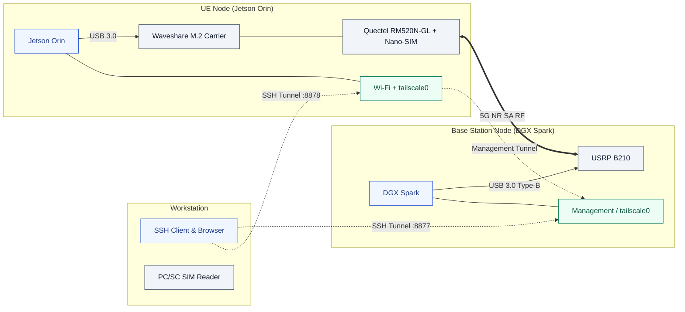

# Hardware Bill of Materials and Topology

[简体中文](hardware-and-topology.zh-CN.md)

This guide defines the physical hardware kit, wiring topology, host software
prerequisites, and multi-UE expansion workflow. For RF baseline values, port
allocations, and RM520N-GL USB interface layouts, see the [Technical Reference](reference/ports-and-runtime.md).

## Dual-End Compute Design

- **gNB / 5G Core side (`DGX Spark` + `USRP B210`)**: executes the **OCUDU**
  RAN, **Open5GS** 5GC, and **Spark Platform** while reserving local GPU/CPU
  compute headroom and unallocated inference ports for custom base-station AI
  services.
- **UE side (`Jetson Orin` + `Waveshare M.2 5G Carrier` + `Quectel RM520N-GL`)**:
  executes **Jetson Console** for modem supervision and link recovery while
  reserving edge compute headroom on Orin for user-built UE AI workloads.

<!-- ASSET_SLOT: docs/assets/hardware/kit-overview.jpg | 16:9 full kit hardware photo showing Spark, B210, Jetson Orin, Waveshare carrier + RM520N-GL, antennas and SIM reader -->

## Hardware Bill of Materials (BOM)

<table>
  <tr>
    <td align="center"> <b>gNB / 5GC Host: DGX Spark</b></td>
    <td align="center"> <b>SDR Front-End: Ettus USRP B210</b></td>
  </tr>
</table>

<table>
  <tr>
    <td align="center"> <b>UE Host: Jetson Orin Nano</b></td>
    <td align="center"> <b>Carrier: Waveshare M.2 5G</b></td>
    <td align="center"> <b>5G Modem: Quectel RM520N-GL</b></td>
  </tr>
</table>

| Role | Hardware Component | Notes |
| --- | --- | --- |
| Base station & core host | **DGX Spark** (ARM64) | Ubuntu 24.04 ARM64, native USB 3.0 port for B210, Docker Engine + Compose |
| SDR front-end | **Ettus USRP B210** | USB 3.0 Type-B cable and Band `n78` antennas (or SMA benchtop attenuators) |
| UE edge host | **NVIDIA Jetson Orin** (Nano) | Ubuntu 22.04 ARM64, Wi-Fi management uplink, USB 3.0 host port |
| M.2 5G carrier board | **[Waveshare SIM8262E-M2 5G for Jetson Orin](https://www.waveshare.net/shop/SIM8262E-M2-5G-for-Jetson-Orin.htm)** | USB 3.1/3.0 M.2 B-Key expansion board with Nano-SIM slot, 4x SMA-to-IPEX antennas, and 3A power circuit; used as the physical carrier to mount the **Quectel RM520N-GL** module |
| 5G NR modem | **Quectel RM520N-GL** | Mounted inside the Waveshare M.2 B-Key carrier board (supports RNDIS or ECM mode; see [Hardware Notes](reference/hardware-notes.md)) |
| Programmable USIM | **5G USIM** (Milenage-capable) | One independent USIM card and Open5GS subscriber per UE |
| SIM writer | **PC/SC smartcard reader** | Standard USB CCID/PC/SC reader attached to your provisioning workstation |

## Physical Wiring and Access Topology

<!-- ASSET_SLOT: docs/assets/hardware/spark-b210-wiring.jpg | 16:9 close-up of DGX Spark connected to USRP B210 with antennas/attenuators -->
<!-- ASSET_SLOT: docs/assets/hardware/jetson-waveshare-rm520n.jpg | 16:9 close-up of Jetson Orin + Waveshare M.2 5G carrier with Quectel RM520N-GL, Nano-SIM and 4 antennas -->

### Wiring Checklist

1. Connect **USRP B210** directly to a native USB 3.0 port on **DGX Spark** (avoid unpowered hubs) and attach Band `n78` antennas or verified SMA attenuators before transmitting.
2. Seat the **Quectel RM520N-GL** module and programmed Nano-SIM into the **[Waveshare SIM8262E-M2 5G for Jetson Orin](https://www.waveshare.net/shop/SIM8262E-M2-5G-for-Jetson-Orin.htm)** board, attach all four 5G antennas, and connect it to a USB 3.0 port on **Jetson Orin**.
3. Ensure **Jetson Orin** maintains an active Wi-Fi management link with an IPv4 fallback gateway and a **`tailscale0`** route to Spark's management address.

## Host Software Prerequisites

- **Build / Provisioning Workstation**: Python `3.10–3.12`, Node.js `22` (for frontend builds), `git`, SSH, and PC/SC driver + `pyscard` / Osmocom `pySim`.
- **DGX Spark**: Ubuntu `24.04` ARM64, Python `3.12`, `systemd`, Docker Engine with Compose plugin, UHD for USRP B210, `nftables`, and Tailscale.
- **Jetson Orin**: Ubuntu `22.04` ARM64, Python `3.10`, `systemd`, `NetworkManager`, `tailscale0`, and `ModemManager` disabled so Jetson Console owns the AT serial port exclusively.

Exact ports, routing metrics, RF parameters, and kernel notes are maintained in
[Network & RF Profile](reference/network-and-rf-profile.md) and
[Ports & Runtime](reference/ports-and-runtime.md).

## Scaling to Multiple UEs

1. Assemble an independent **Jetson Orin + Waveshare M.2 Carrier + Quectel RM520N-GL** kit.
2. Add a unique subscriber record in Open5GS via `stacks/open5gs/subscriber.py`.
3. Program a dedicated 5G USIM and install Jetson Console on the new host.

Proceed to the [End-to-End Quickstart](quickstart.md) when your hardware is ready.
