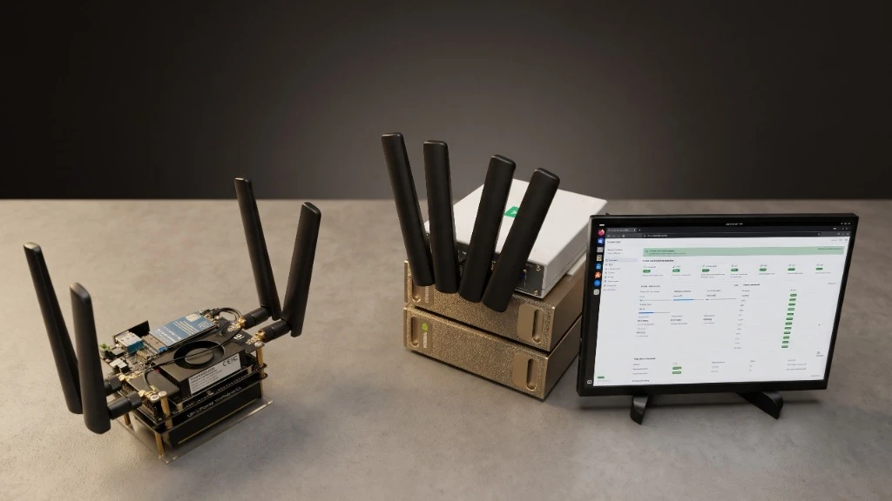
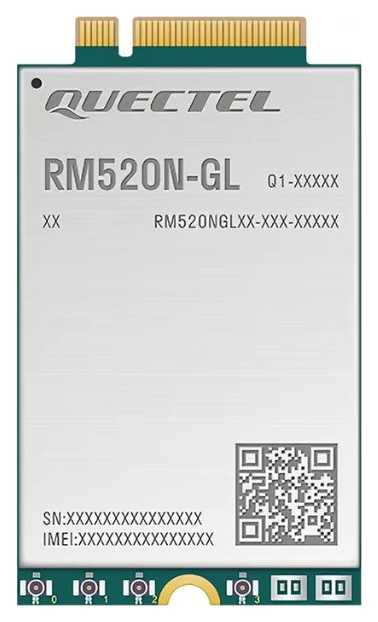
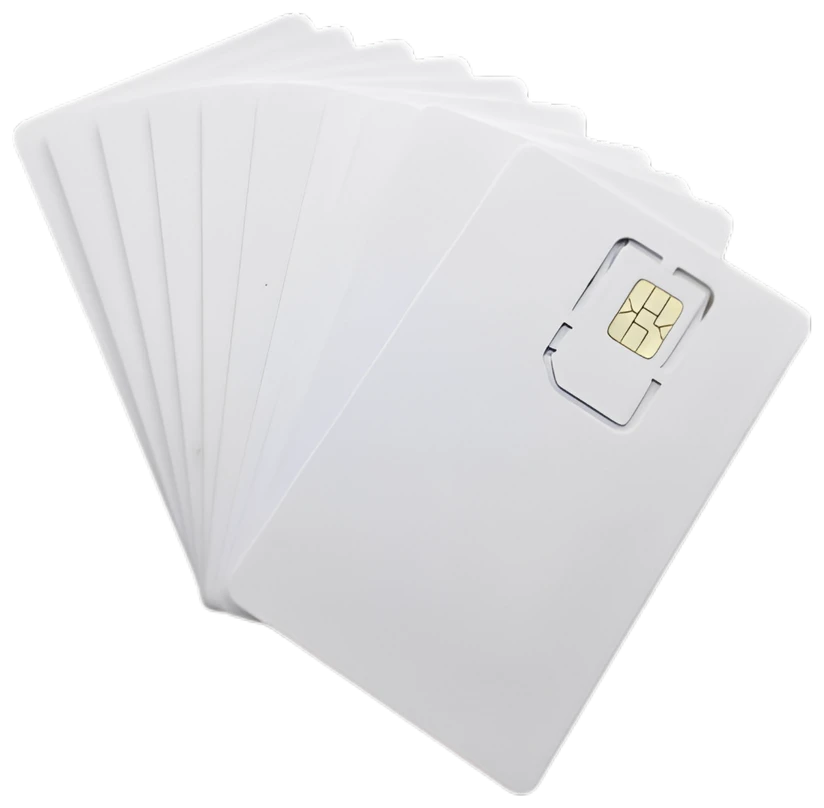
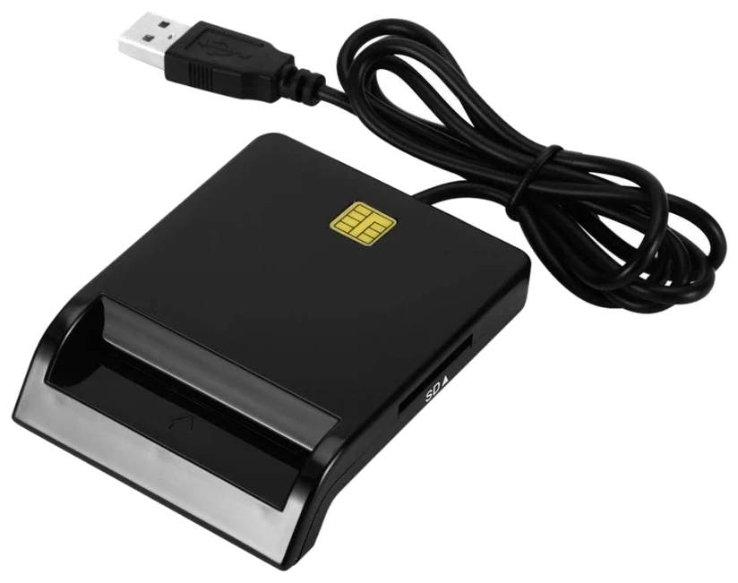
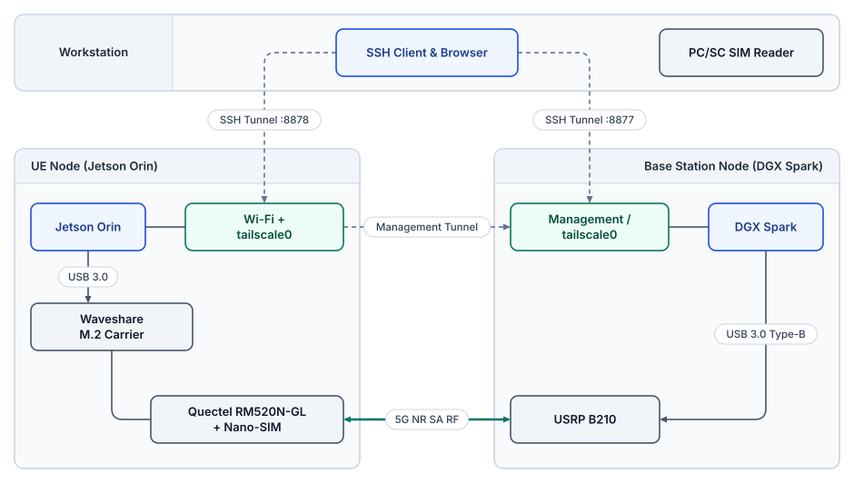

# Hardware Bill of Materials and Topology

[简体中文](hardware-and-topology.zh-CN.md)

This specification defines the standardized hardware bill of materials (BOM),
physical interconnect topology, host software prerequisites, and multi-UE
scaling procedure. Authoritative RF baselines, port allocations, and RM520N-GL
USB interface layouts are consolidated in [Ports & Runtime](reference/ports-and-runtime.md).

## Dual-End Compute Architecture

- **gNB / 5G Core node (`DGX Spark` + `USRP B210`)**: Runs the **OCUDU** RAN,
  **Open5GS** 5GC, and **Spark Console** while reserving local GPU/CPU
  compute capacity and dedicated inference ports for co-located base-station AI
  services and user-defined AI pipelines.
- **UE edge node (`Jetson Orin` + `Waveshare M.2 5G Carrier` + `Quectel RM520N-GL`)**:
  Runs **Jetson Console** for modem supervision and automated link recovery
  while reserving edge AI compute resources on Orin for on-device inference
  workloads.

  

## Hardware Bill of Materials (BOM)

<table>
  <tr>
    <td align="center" valign="bottom" width="50%"> <b>gNB / 5GC Host: DGX Spark</b></td>
    <td align="center" valign="bottom" width="50%"> <b>SDR Front-End: Ettus USRP B210</b></td>
  </tr>
</table>

<table>
  <tr>
    <td align="center" valign="bottom" width="33%"> <b>UE Host: Jetson Orin Nano</b></td>
    <td align="center" valign="bottom" width="33%"> <b>Carrier: Waveshare M.2 5G</b></td>
    <td align="center" valign="bottom" width="33%"> <b>5G Modem: Quectel RM520N-GL</b></td>
  </tr>
</table>

<table>
  <tr>
    <td align="center" valign="bottom" width="50%"> <b>SIM Card: Programmable 5G USIM</b></td>
    <td align="center" valign="bottom" width="50%"> <b>Programmer: PC/SC Smartcard Reader</b></td>
  </tr>
</table>

| Role | Hardware Component | Notes |
| --- | --- | --- |
| Base station & core host | **DGX Spark** (ARM64) | Ubuntu 24.04 ARM64, native USB 3.0 port for B210, Docker Engine + Compose |
| SDR front-end | **Ettus USRP B210** | USB 3.0 Type-B cable and Band `n78` antennas (or inline SMA attenuators for benchtop testing) |
| UE edge host | **NVIDIA Jetson Orin** (Nano) | Ubuntu 22.04 ARM64, Wi-Fi management uplink, USB 3.0 host port |
| M.2 5G carrier board | **Waveshare SIM8262E-M2 5G for Jetson Orin** | USB 3.1/3.0 M.2 B-Key expansion board with Nano-SIM slot, 4x SMA-to-IPEX antennas, and 3A power stage; serves as the physical carrier for the **Quectel RM520N-GL** module |
| 5G NR modem | **Quectel RM520N-GL** | Seated inside the Waveshare M.2 B-Key carrier board (supports RNDIS or ECM mode; see [Hardware Notes](reference/hardware-notes.md)) |
| Programmable USIM | **Programmable 5G USIM** (Milenage-capable) | One dedicated USIM card and Open5GS subscriber record per UE |
| Smartcard programmer | **PC/SC smartcard reader** | Standard USB CCID/PC/SC reader attached to your provisioning workstation |

## Physical Wiring and Access Topology

<picture>
  <source media="(prefers-color-scheme: dark)" srcset="assets/diagrams/hardware-topology-en-dark.svg">
  <source media="(prefers-color-scheme: light)" srcset="assets/diagrams/hardware-topology-en-light.svg">
  
</picture>

### Wiring Checklist

1. Connect the **USRP B210** directly to a native USB 3.0 port on **DGX Spark** (bypassing unpowered hubs) and terminate RF ports with Band `n78` antennas or calibrated SMA attenuators before enabling transmission.
2. Install the **Quectel RM520N-GL** module and provisioned Nano-SIM into the **Waveshare SIM8262E-M2 5G for Jetson Orin** board, fasten all four 5G antennas, and attach the assembly to a USB 3.0 port on **Jetson Orin**.
3. Verify **Jetson Orin** maintains an active out-of-band Wi-Fi management link with an IPv4 fallback gateway and a **`tailscale0`** route to Spark's management IP.

## Host Software Prerequisites

- **Build / Provisioning Workstation**: Python `3.10–3.12`, Node.js `22` (for frontend builds), `git`, SSH, and PC/SC driver + `pyscard` / Osmocom `pySim`.
- **DGX Spark**: Ubuntu `24.04` ARM64, Python `3.12`, `systemd`, Docker Engine with Compose plugin, UHD for USRP B210, `nftables`, and Tailscale.
- **Jetson Orin**: Ubuntu `22.04` ARM64, Python `3.10`, `systemd`, `NetworkManager`, `tailscale0`, and `ModemManager` disabled so Jetson Console holds exclusive ownership of the AT serial port.

Authoritative ports, routing metrics, RF baselines, and kernel compatibility
notes reside in [Network & RF Profile](reference/network-and-rf-profile.md) and
[Ports & Runtime](reference/ports-and-runtime.md).

## Scaling to Multiple UEs

1. Assemble an independent **Jetson Orin + Waveshare M.2 Carrier + Quectel RM520N-GL** kit.
2. Provision a unique subscriber entry in Open5GS via `stacks/open5gs/subscriber.py`.
3. Program a dedicated 5G USIM and deploy Jetson Console independently on the new host.

Proceed to the [End-to-End Quickstart](quickstart.md) once physical assembly is complete.
