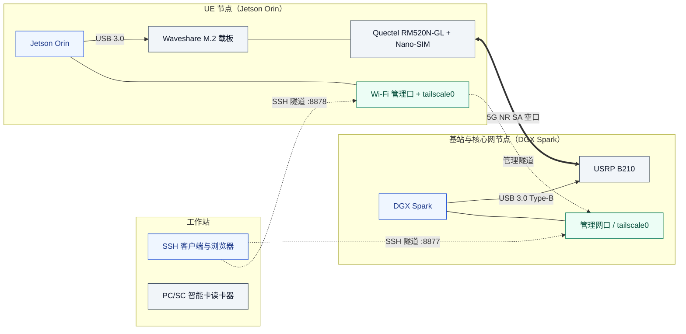

# 硬件清单与拓扑结构

[English](hardware-and-topology.md)

本文档定义整套系统的标准硬件清单、物理连线拓扑、主机软件前置条件与多 UE 扩展方法。
射频基线参数、端口分配与 RM520N-GL USB 接口细节请参阅[技术参考目录](reference/ports-and-runtime.zh-CN.md)。

## 双端异构算力选型设计

- **gNB / 核心网侧（`DGX Spark` + `USRP B210`）**：运行 **OCUDU** RAN、**Open5GS**
  5G 核心网与 **Spark Platform**，同时在基站侧预留本地 GPU/CPU 算力与独立推理端口，
  方便后续共驻部署自定义 AI 模块。
- **UE 侧（`Jetson Orin` + `Waveshare M.2 5G 扩展载板` + `Quectel RM520N-GL`）**：运行
  **Jetson Console** 完成模组监管与链路恢复，同时利用 Orin 预留边缘算力支撑终端侧
  DIY AI 应用。

<!-- ASSET_SLOT: docs/assets/hardware/kit-overview.jpg | 16:9 整套硬件设备全家福与桌面连线实拍图 -->

## 硬件清单（BOM）

| 角色 | 硬件组件 | 关键说明 |
| --- | --- | --- |
| 基站与核心网主机 | **DGX Spark**（ARM64） | Ubuntu 24.04 ARM64、原生 USB 3.0 接口（接 B210）、Docker Engine + Compose |
| 射频前端（SDR） | **Ettus USRP B210** | USB 3.0 Type-B 线缆、`n78` 频段天线（桌面近场测试建议配备 SMA 固定衰减器） |
| UE 边缘主机 | **NVIDIA Jetson Orin**（Nano） | Ubuntu 22.04 ARM64、独立 Wi-Fi 管理链路、USB 3.0 主机端口 |
| M.2 5G 扩展载板 | **[Waveshare SIM8262E-M2 5G for Jetson Orin](https://www.waveshare.net/shop/SIM8262E-M2-5G-for-Jetson-Orin.htm)** | 通过 USB 3.1/3.0 连入 Jetson Orin 的 M.2 B-Key 扩展载板，内置 Nano-SIM 卡槽、4 路 SMA 转 IPEX 天线及 3A 供电；本项目用于搭载 **Quectel RM520N-GL** 模组 |
| 5G NR 模组 | **Quectel RM520N-GL** | 安装于上述 Waveshare M.2 B-Key 扩展载板内（支持 RNDIS 或 ECM 模式；详见[硬件附录](reference/hardware-notes.zh-CN.md)） |
| 可编程 USIM | **5G USIM 白卡**（支持 Milenage） | 每台 UE 独占一张物理 SIM 卡与一条独立 Open5GS 订阅 |
| 写卡器 | **PC/SC 智能卡读卡器** | 标准 USB CCID/PC/SC 读卡器，接入开户工作站使用 |

## 物理接线与访问拓扑

<!-- ASSET_SLOT: docs/assets/hardware/spark-b210-wiring.jpg | 16:9 DGX Spark 与 USRP B210 连线及射频天线/衰减器实拍 -->
<!-- ASSET_SLOT: docs/assets/hardware/jetson-waveshare-rm520n.jpg | 16:9 Jetson Orin + Waveshare 载板 + RM520N-GL + Nano-SIM 装配实拍 -->

### 物理接线核对清单

1. 将 **USRP B210** 直接接入 **DGX Spark** 原生 USB 3.0 端口（避免经过无源 Hub），安装 `n78` 天线或经校验的 SMA 衰减器。
2. 将 **Quectel RM520N-GL** 与已烧录的 Nano-SIM 装入 **[Waveshare SIM8262E-M2 5G for Jetson Orin](https://www.waveshare.net/shop/SIM8262E-M2-5G-for-Jetson-Orin.htm)** 载板，接好 4 根 5G 天线后连入 **Jetson Orin** 的 USB 3.0 接口。
3. 确认 **Jetson Orin** 保持独立的 Wi-Fi 管理回退网关，并具备经由 **`tailscale0`** 到达 Spark 管理地址的可达路由。

## 主机软件前置条件

- **构建 / 写卡工作站**：Python `3.10–3.12`、Node.js `22`（本地打包前端时使用）、`git`、SSH 以及 PC/SC 驱动 + `pyscard` / Osmocom `pySim`。
- **DGX Spark 主机**：Ubuntu `24.04` ARM64、Python `3.12`、`systemd`、Docker Engine（含 Compose 插件）、UHD（B210 驱动）、`nftables` 与 Tailscale。
- **Jetson Orin 主机**：Ubuntu `22.04` ARM64、Python `3.10`、`systemd`、`NetworkManager`、`tailscale0`，并已停用/禁用 `ModemManager` 以保障串口独占。

完整端口分配、路由切换阈值、射频默认基线与内核兼容说明见[网络契约与射频基线](reference/network-and-rf-profile.zh-CN.md)与[端口与运行时参考](reference/ports-and-runtime.zh-CN.md)。

## 扩展多台 UE

1. 新增一套 **Jetson Orin + Waveshare M.2 载板 + Quectel RM520N-GL** 终端硬件。
2. 在 Open5GS 中通过 `stacks/open5gs/subscriber.py` 添加独立订阅。
3. 烧录新 5G USIM 并在新 Jetson 上独立安装与初始化 Jetson Console。

硬件准备就绪后，请前往[端到端快速搭建指南](quickstart.zh-CN.md)完成全链路部署。
