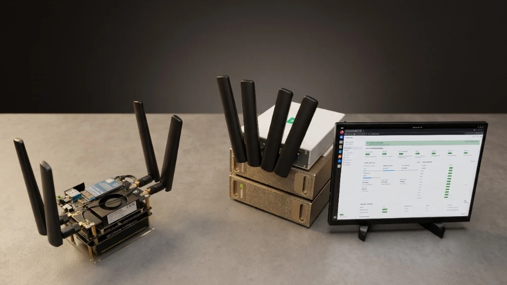
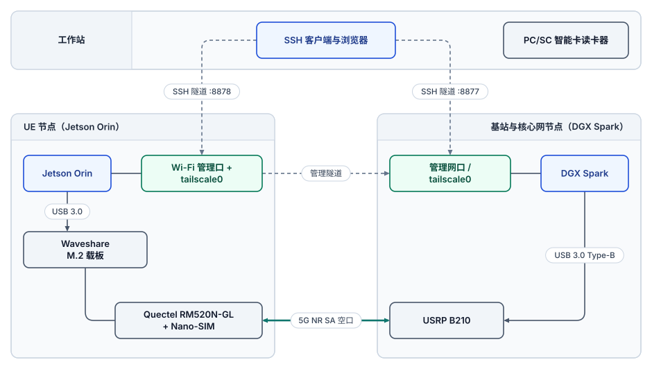

# 硬件清单与拓扑结构

[English](hardware-and-topology.md)

本文档规范整套实验平台的硬件物料清单（BOM）、物理互连拓扑、主机软件前置条件以及
多终端（Multi-UE）横向扩展流程。射频基线参数、端口规划及 RM520N-GL USB 接口布局
请参阅[端口与运行时参考](reference/ports-and-runtime.zh-CN.md)。

## 端网双端异构算力设计

- **gNB / 核心网侧（`DGX Spark` + `USRP B210`）**：承担 **OCUDU** RAN、**Open5GS**
  5G 核心网与 **Spark Console** 的运行，同时在基站侧提供**预留 AI 算力资源**与独立
  预留推理端口段，支持共驻部署网侧 AI 服务与自定义推理流水线。
- **UE 边缘侧（`Jetson Orin` + `Waveshare M.2 5G 扩展载板` + `Quectel RM520N-GL`）**：运行
  **Jetson Console** 完成模组独占监管与链路自动恢复，同时借助 Orin 预留的端侧算力资源
  承载边缘 AI 推理任务。

  

## 硬件物料清单（BOM）

<table>
  <tr>
    <td align="center" valign="bottom" width="50%"> <b>基站/核心网主机：DGX Spark</b></td>
    <td align="center" valign="bottom" width="50%"> <b>SDR 射频前端：Ettus USRP B210</b></td>
  </tr>
</table>

<table>
  <tr>
    <td align="center" valign="bottom" width="33%"> <b>UE 主机：Jetson Orin Nano</b></td>
    <td align="center" valign="bottom" width="33%"> <b>扩展载板：Waveshare M.2 5G</b></td>
    <td align="center" valign="bottom" width="33%"> <b>5G 模组：Quectel RM520N-GL</b></td>
  </tr>
</table>

| 角色 | 硬件组件 | 技术规格与说明 |
| --- | --- | --- |
| 基站与核心网主机 | **DGX Spark**（ARM64） | Ubuntu 24.04 ARM64、原生 USB 3.0 接口（连接 B210）、Docker Engine + Compose |
| SDR 射频前端 | **Ettus USRP B210** | USB 3.0 Type-B 线缆、`n78` 频段天线（桌面近场测试须加装 SMA 固定衰减器） |
| UE 边缘主机 | **NVIDIA Jetson Orin**（Nano） | Ubuntu 22.04 ARM64、带外 Wi-Fi 管理链路、USB 3.0 主机端口 |
| M.2 5G 扩展载板 | **Waveshare SIM8262E-M2 5G for Jetson Orin** | 通过 USB 3.1/3.0 连入 Jetson Orin 的 M.2 B-Key 载板，集成 Nano-SIM 卡槽、4 路 SMA 转 IPEX 接口及 3A 供电电路，用于承载 **Quectel RM520N-GL** 模组 |
| 5G NR 模组 | **Quectel RM520N-GL** | 安装于 Waveshare M.2 B-Key 扩展载板内（支持 RNDIS 与 ECM 模式；详见[硬件附录](reference/hardware-notes.zh-CN.md)） |
| 可编程 USIM | **可编程 5G USIM 卡**（支持 Milenage） | 每台 UE 独占一张物理 SIM 卡与一条独立 Open5GS 订阅记录 |
| 写卡器 | **PC/SC 智能卡读卡器** | 标准 USB CCID/PC/SC 读卡器，接入烧录工作站使用 |

## 物理接线与访问拓扑

<picture>
  <source media="(prefers-color-scheme: dark)" srcset="assets/diagrams/hardware-topology-zh-dark.svg">
  <source media="(prefers-color-scheme: light)" srcset="assets/diagrams/hardware-topology-zh-light.svg">
  
</picture>

<!-- ASSET_SLOT: docs/assets/hardware/spark-b210-wiring.jpg | 16:9 DGX Spark 与 USRP B210 连线及射频天线/衰减器实拍 -->
<!-- ASSET_SLOT: docs/assets/hardware/jetson-waveshare-rm520n.jpg | 16:9 Jetson Orin + Waveshare 载板 + RM520N-GL + Nano-SIM 装配实拍 -->

### 物理接线核对清单

1. 将 **USRP B210** 直连 **DGX Spark** 原生 USB 3.0 端口（避免经过无源 Hub），发射前须先接好 `n78` 天线或经校验的 SMA 衰减器。
2. 将 **Quectel RM520N-GL** 与已烧录的 Nano-SIM 装入 **Waveshare SIM8262E-M2 5G for Jetson Orin** 载板，紧固 4 路 5G 天线后接入 **Jetson Orin** 的 USB 3.0 接口。
3. 确认 **Jetson Orin** 具备独立的带外 Wi-Fi 管理默认网关，且 **`tailscale0`** 可稳定路由至 Spark 管理地址。

## 主机软件前置条件

- **构建 / 烧录工作站**：Python `3.10–3.12`、Node.js `22`（构建前端产物时使用）、`git`、SSH 以及 PC/SC 驱动 + `pyscard` / Osmocom `pySim`。
- **DGX Spark 主机**：Ubuntu `24.04` ARM64、Python `3.12`、`systemd`、Docker Engine（含 Compose 插件）、UHD（B210 驱动）、`nftables` 与 Tailscale。
- **Jetson Orin 主机**：Ubuntu `22.04` ARM64、Python `3.10`、`systemd`、`NetworkManager`、`tailscale0`，且已停用并屏蔽 `ModemManager` 以确保串口独占。

完整端口规划、路由切换阈值、射频基线与内核兼容说明请参阅[网络契约与射频基线](reference/network-and-rf-profile.zh-CN.md)与[端口与运行时参考](reference/ports-and-runtime.zh-CN.md)。

## 扩展多台 UE

1. 新增一套独立 **Jetson Orin + Waveshare M.2 载板 + Quectel RM520N-GL** 终端组件。
2. 在 Open5GS 中运行 `stacks/open5gs/subscriber.py` 添加独立用户订阅。
3. 烧录新的 5G USIM 卡，并在新 Jetson 主机上独立部署与初始化 Jetson Console。

硬件装配与检查完成后，请按[端到端快速搭建指南](quickstart.zh-CN.md)完成跨主机全链路部署。
