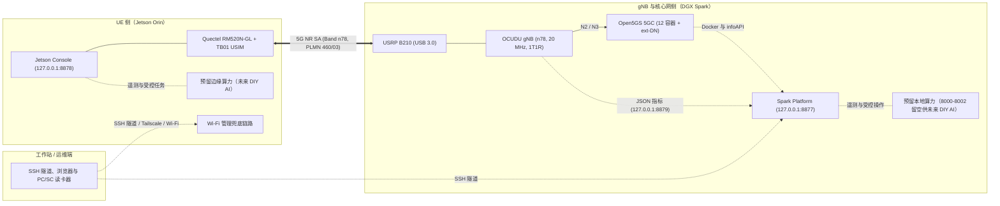

# 硬件清单、拓扑结构与前置条件

[English](hardware-and-topology.md)

本文档定义 **Agentic-OCUDU** 的标准硬件组成、物理与逻辑拓扑、端口与网络边界，以及多 UE 扩展方式。

## 硬件选型意图

Agentic-OCUDU 采用双端异构算力架构：

- **gNB / 核心网侧（`DGX Spark` + `USRP B210`）**：负责运行 OCUDU 5G SA RAN 与 Open5GS 5GC，同时在基站侧预留本地 GPU/CPU 算力，并将 `127.0.0.1:8000–8002` 端口区间留空，方便后续与共驻推理服务安全并行。
- **UE 侧（`Jetson Orin` + `Quectel RM520N-GL`）**：由 Jetson 本地管理模组状态、路由保护与故障自愈，同时利用 Jetson Orin 预留的边缘计算能力支撑后续用户自主开发的终端侧 AI 模块。

> [!NOTE]
> 双端内置 AI 模型与智能体目前尚未在本仓库中实现。选用 DGX Spark 与 Jetson Orin
> 的核心目的是在双端预留充足算力，帮助开发者在可复现的 5G SA 通信底座之上 DIY
> 自定义 AI 能力。详见[双端 AI 定制指南](ai-customization.zh-CN.md)。

## 硬件清单（BOM）

| 角色 | 推荐硬件 | 关键要求与说明 |
| --- | --- | --- |
| 基站与核心网主机 | **DGX Spark**（ARM64） | Ubuntu 24.04 ARM64、USB 3.0 直连口（接 B210）、Docker Compose、systemd |
| 射频前端（SDR） | **Ettus USRP B210** | USB 3.0 Type-B 线缆、n78 频段天线（桌面近场调试建议加装合适固定衰减器；严禁空载大功率发射） |
| UE 边缘主机 | **NVIDIA Jetson Orin**（Nano） | Ubuntu 22.04 ARM64、独立 Wi-Fi 管理网口、USB 3.0 接口 |
| M.2 5G 扩展载板 | **[Waveshare SIM8262E-M2 5G for Jetson Orin](https://www.waveshare.net/shop/SIM8262E-M2-5G-for-Jetson-Orin.htm)** | 适配 Jetson Orin 的 M.2 B-Key 扩展板/外壳，通过 USB 3.1/3.0 与 Jetson 相连，自带 Nano-SIM 卡槽、4 路 SMA 转 IPEX 天线及 3A 供电；本项目将其作为载板用于安装 **Quectel RM520N-GL** 模组 |
| 5G NR 模组 | **Quectel RM520N-GL** | 安装于上述 Waveshare M.2 B-Key 扩展载板中；支持 RNDIS（`00/01` -> AT `04`）与 ECM `cdc_ether`（`04`/`0a` -> AT `02`）。*（Jetson Console 适配并校验 RM520N-GL 流程，而非 SIM8262E-M2 模组本身。）* |
| 可编程 USIM | **TB01 实验白卡** | 每台 UE 独占一张物理卡与一条独立 Open5GS 订阅；参见[TB01 SIM 烧录](sim-programming-tb01.zh-CN.md) |
| 写卡器 | **PC/SC 智能卡读卡器** | 标准 USB CCID/PC/SC 读卡器，用于管理工作站离线写卡 |

## 物理与逻辑拓扑

### 物理接线核对清单

1. 将 **USRP B210** 直接接入 **DGX Spark** 原生 USB 3.0 接口（不要经无源 Hub 转接），安装 n78 天线或桌面衰减器。
2. 将 **Quectel RM520N-GL** 模组与已烧录的 **TB01 USIM**（Nano-SIM）装入 **[Waveshare SIM8262E-M2 5G for Jetson Orin](https://www.waveshare.net/shop/SIM8262E-M2-5G-for-Jetson-Orin.htm)** M.2 B-Key 扩展载板，接好 4 根 5G 天线后通过 USB 3.0 连接到 **Jetson Orin**。
3. 确保 **Jetson Orin** 具备独立的 **Wi-Fi 管理链路**（拥有可用的 IPv4 默认网关），且能够到达 Spark 管理地址（直连或经 Tailscale）。

## 端口、网络契约与隔离基线

所有 Web 界面与内部指标监听端口均仅绑定回环地址（`127.0.0.1`），远程访问统一通过 SSH 端口转发进行。

| 平面 / 服务 | 端点或参数 | 归属与用途说明 |
| --- | --- | --- |
| Spark Platform Web & API | `127.0.0.1:8877` | `aoc-monitor-web.service`（FastAPI + Astryx UI + SSE `/api/v1/stream`） |
| OCUDU JSON 指标 | `ws://127.0.0.1:8879` | 由 `aoc-v2-metrics-guard.service`（nftables）限制仅 root 可访问，并将 `127.0.0.1:8000–8002` 留给 Spark 上共驻的 AI 推理容器 |
| Jetson Console Web & API | `127.0.0.1:8878` | `aoc-v2-jetson-web.service`（FastAPI + Astryx UI + SSE `/api/v1/events/stream`） |
| 5G 无线基线 | 频段 `n78`、`20 MHz`、`30 kHz` SCS、`1T1R` | 默认 `tx_gain=80`、`rx_gain=54`、`cell_cfg.pusch.max_ue_mcs=24`、载波 ARFCN `643392`、PCI `666`（见 `config/network-contract.json`） |
| 5G 核心网与数据 PDU | PLMN `460/03`、TAC `1`、SST `1` | 单 IPv4 数据 PDU、`DNN=oai`、UE 地址池 `10.0.0.0/24`、`5QI=9`（不含 IMS/语音） |
| Jetson 自有路由 | 内核路由协议号 `186` | Metric `5` = Wi-Fi 管理兜底默认路由；Metric `10` = 蜂窝数据优先默认路由（UPF/ext-DN/探测目标主机路由始终绑定蜂窝接口） |

## 主机软件前置条件

- **开发 / 运维工作站**：
  - Python `3.10–3.12`、Node.js `22`（如需本地构建前端发布包）、`git`、SSH，以及用于 SIM 烧录的 PC/SC 驱动、`pyscard` 与 Osmocom `pySim`。
- **DGX Spark 主机**：
  - Ubuntu `24.04` ARM64、Python `3.12`、`systemd`、Docker Engine + Compose 插件、经核验的 UHD（B210 驱动）、`nftables`，以及按需安装的受限免密维护助手 `/usr/local/sbin/aoc-maintain`。
  - Linux `7.0+` 内核配合 MongoDB `8.0.30` 时，`stacks/open5gs/compose/render.py` 会自动注入 `GLIBC_TUNABLES=glibc.pthread.rseq=1`。
  - 无线实时性依赖 `aoc-v2-cpu-latency.service`（`/dev/cpu_dma_latency=0`）以及可选的 `realtime.conf`（`CPUAffinity`、`LimitRTPRIO=99`），避免共驻计算负载引发 gNB 采样欠载（underflow）或延迟（late）。
- **Jetson Orin 主机**：
  - Ubuntu `22.04` ARM64、Python `3.10`、`systemd`、`NetworkManager`（既有默认路由 metric 须严格大于 `10`），并停止/禁用 `ModemManager`，保证 `aoc-v2-jetson-device.service` 独占 AT 串口。

## 扩展多台 UE

接入第二台或更多 UE 时，不需要修改 Spark 共享源码或影响已有 UE：

1. 新增一台 Jetson Orin + Quectel RM520N-GL。
2. 通过 `stacks/open5gs/subscriber.py` 为新 UE 添加独立订阅（独立 IMSI、Ki、OPc；禁止多卡共用身份）。
3. 烧录一张新的 TB01 SIM 卡并在新 Jetson 上独立安装和初始化 Jetson Console。

## 下一步

请继续阅读[端到端快速搭建指南](quickstart.zh-CN.md)，按步骤拉起整套系统并完成联调验证。
