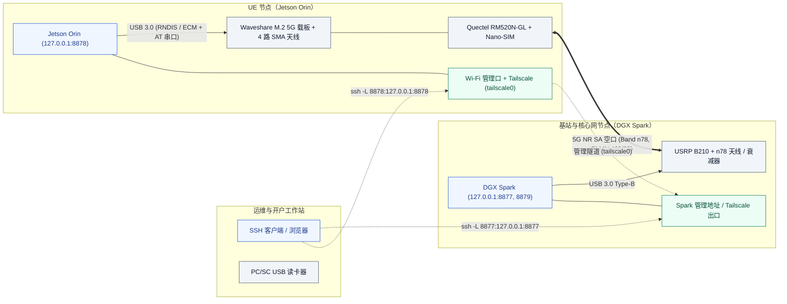

# 硬件清单、拓扑结构与前置条件

[English](hardware-and-topology.md)

本文档定义整套系统的标准硬件 BOM、物理接线与访问拓扑、端口契约、主机软件前置条件以及多 UE 扩展方式。

## 硬件选型意图

本平台采用双端异构算力硬件组合：

- **gNB / 核心网侧（`DGX Spark` + `USRP B210`）**：承担 **OCUDU** 5G SA RAN 与 **Open5GS** 5GC 运行，同时在基站侧预留本地 GPU/CPU 算力，并将 `127.0.0.1:8000–8002` 端口区间完整留空，便于后续共驻部署自定义 AI 推理服务。
- **UE 侧（`Jetson Orin` + `Waveshare M.2 5G 扩展载板` + `Quectel RM520N-GL`）**：在 Jetson 上本地负责模组管控、双路径路由保护与自愈，同时预留 Orin 边缘 AI 算力以支撑后续终端侧 DIY 智能体。

> [!NOTE]
> 双端内置 AI 模型与智能体**目前尚未在本仓库中实现**。选用 DGX Spark 与
> Jetson Orin 的核心目的，是在可复现的 5G SA 通信底座之上为双端预留算力裕量，
> 方便开发者后续自主定制并部署 AI 能力。详见[双端 AI 定制指南](ai-customization.zh-CN.md)。

<!-- ASSET_SLOT: docs/assets/hardware/kit-overview.jpg | 16:9 整套硬件设备全家福与桌面连线实拍图 -->

## 硬件清单（BOM）

| 角色 | 推荐硬件 | 关键要求与说明 |
| --- | --- | --- |
| 基站与核心网主机 | **DGX Spark**（ARM64） | Ubuntu 24.04 ARM64、原生 USB 3.0 接口（接 B210）、Docker Engine + Compose、systemd |
| 射频前端（SDR） | **Ettus USRP B210** | USB 3.0 Type-B 线缆、`n78` 频段天线（桌面近场测试建议加装 SMA 固定衰减器；严禁空载发射） |
| UE 边缘主机 | **NVIDIA Jetson Orin**（Nano） | Ubuntu 22.04 ARM64、独立 Wi-Fi 管理网口、USB 3.0 接口 |
| M.2 5G 扩展载板 | **[Waveshare SIM8262E-M2 5G for Jetson Orin](https://www.waveshare.net/shop/SIM8262E-M2-5G-for-Jetson-Orin.htm)** | 适配 Jetson Orin 的 M.2 B-Key 扩展载板/外壳，通过 USB 3.1/3.0 与 Jetson 相连，自带 Nano-SIM 卡槽、4 路 SMA 转 IPEX 天线及 3A 供电；本项目将其作为载板用于安装 **Quectel RM520N-GL** 模组 |
| 5G NR 模组 | **Quectel RM520N-GL** | 安装于上述 Waveshare M.2 B-Key 扩展载板中；支持 RNDIS（`00/01` -> AT `04`）与 ECM `cdc_ether`（`04`/`0a` -> AT `02`）。*（Jetson Console 适配并校验 RM520N-GL 流程，而非 SIM8262E-M2 模组本身。）* |
| 可编程 USIM | **5G USIM 白卡**（支持 Milenage，如 TB01 Nano-SIM） | 每台 UE 独占一张物理卡与一条独立 Open5GS 订阅；参见[SIM 开户与 TB01 参考](sim-programming-tb01.zh-CN.md) |
| 写卡器 | **PC/SC 智能卡读卡器** | 标准 USB CCID/PC/SC 读卡器，用于工作站离线写卡 |

## 物理接线与访问拓扑

<!-- ASSET_SLOT: docs/assets/hardware/spark-b210-wiring.jpg | 16:9 DGX Spark 与 USRP B210 连线及射频天线/衰减器实拍 -->
<!-- ASSET_SLOT: docs/assets/hardware/jetson-waveshare-rm520n.jpg | 16:9 Jetson Orin + Waveshare 载板 + RM520N-GL + Nano-SIM 装配实拍 -->

### 物理接线核对清单

1. 将 **USRP B210** 直接接入 **DGX Spark** 原生 USB 3.0 接口（不要经无源 Hub 转接），安装 `n78` 天线或桌面衰减器。
2. 将 **Quectel RM520N-GL** 模组与已烧录的 **Nano-SIM** 装入 **[Waveshare SIM8262E-M2 5G for Jetson Orin](https://www.waveshare.net/shop/SIM8262E-M2-5G-for-Jetson-Orin.htm)** M.2 B-Key 扩展载板，接好 4 根 5G 天线后通过 USB 3.0 连接到 **Jetson Orin**。
3. 确保 **Jetson Orin** 具备独立的 **Wi-Fi 管理链路**（拥有可用 IPv4 回退默认网关）及到达 Spark 管理地址的 **`tailscale0` 管理路由**。

## 端口、网络契约与隔离基线

所有 Web 界面与内部指标端口均仅监听回环地址（`127.0.0.1`），远程访问统一经由 SSH 端口转发。

| 平面 / 服务 | 端点或参数 | 归属与用途说明 |
| --- | --- | --- |
| Spark Platform Web & API | `127.0.0.1:8877` | `aoc-monitor-web.service`（FastAPI + Astryx UI + SSE `/api/v1/stream`） |
| OCUDU JSON 指标 | `ws://127.0.0.1:8879` | 由 `aoc-v2-metrics-guard.service`（nftables）限制仅 root 可访问，并将 `127.0.0.1:8000–8002` 留给 Spark 上共驻的 AI 推理容器 |
| Jetson Console Web & API | `127.0.0.1:8878` | `aoc-v2-jetson-web.service`（FastAPI + Astryx UI + SSE `/api/v1/events/stream`） |
| 5G 无线基线 | 频段 `n78`、`20 MHz`、`30 kHz` SCS、`1T1R` | 默认 `tx_gain=80`、`rx_gain=54`、`cell_cfg.pusch.max_ue_mcs=24`、载波 ARFCN `643392`、PCI `666`（见 `config/network-contract.json`） |
| 5G 核心网与数据 PDU | PLMN `460/03`、TAC `1`、SST `1` | 单 IPv4 数据 PDU、`DNN=oai`、UE 地址池 `10.0.0.0/24`、`5QI=9`（不含 IMS/语音） |
| Jetson 自有路由 | 内核路由协议号 `186` | Metric `5` = Wi-Fi 管理兜底默认路由；Metric `10` = 蜂窝数据优先默认路由（UPF/ext-DN/探测目标主机路由始终绑定蜂窝接口） |

## 主机软件前置条件

- **构建 / 运维工作站**：
  - Python `3.10–3.12`、Node.js `22`（如需本地构建前端发布包）、`git`、SSH，以及用于 SIM 烧录的 PC/SC 驱动、`pyscard` 与 Osmocom `pySim`。
- **DGX Spark 主机**：
  - Ubuntu `24.04` ARM64、Python `3.12`、`systemd`、Docker Engine + Compose 插件、经核验的 UHD（B210 驱动）、`nftables` 及 Tailscale。
  - Linux `7.0+` 内核配合 MongoDB `8.0.30` 时，`stacks/open5gs/compose/render.py` 会自动注入 `GLIBC_TUNABLES=glibc.pthread.rseq=1`。
  - 无线实时性依赖 `aoc-v2-cpu-latency.service`（`/dev/cpu_dma_latency=0`）与可选 `realtime.conf`（`CPUAffinity`、`LimitRTPRIO=99`），避免共驻计算负载引起 B210 欠载（underflow）或延迟（late）。
- **Jetson Orin 主机**：
  - Ubuntu `22.04` ARM64、Python `3.10`、`systemd`、`NetworkManager`（既有默认路由 metric 严格大于 `10`）、经由 `tailscale0` 到达 Spark 管理地址的路由（当前 `management_protected` 运行时校验项），并停止/禁用 `ModemManager` 以确保串口独占。

## 扩展多台 UE

接入第二台或更多 UE 时，不需要修改 Spark 共享源码或影响已有 UE：

1. 新增一台 **Jetson Orin + Waveshare M.2 载板 + Quectel RM520N-GL** 终端组合。
2. 通过 `stacks/open5gs/subscriber.py` 为新 UE 添加独立订阅（独立 IMSI、Ki、OPc；禁止多卡共用身份）。
3. 烧录一张新的 5G USIM 并在新 Jetson 上独立安装和初始化 Jetson Console。

## 下一步

请继续阅读[端到端快速搭建指南](quickstart.zh-CN.md)，按跨主机步骤完成安装、开户与端到端联调。
