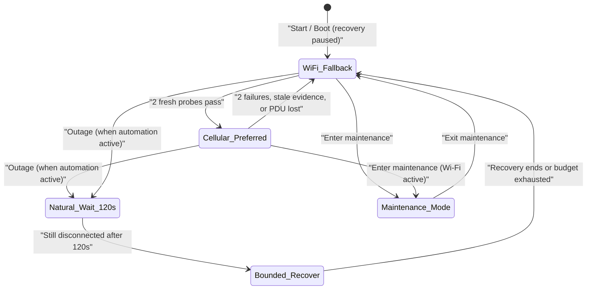

# Jetson Console Operations

[简体中文](jetson-operations.zh-CN.md)

This guide covers Jetson Console UI workflows, operator lifecycle scripts,
dual-path Wi-Fi/cellular routing failover, bounded modem recovery, and upgrade/rollback.

## Web Console Overview

Jetson Console listens on `127.0.0.1:8878`. Open it from your workstation via
an SSH tunnel (`ssh -L 8878:127.0.0.1:8878 <user>@<jetson-host>`):

<!-- ASSET_SLOT: docs/assets/screenshots/jetson-console-overview.png | 16:9 redacted screenshot of Jetson Console Overview / Device Setup pages (redact IMSI, Tailnet IPs, Wi-Fi IP/SSID) -->

| Page | Route | Capabilities |
| --- | --- | --- |
| Overview | `/` | SIM readiness, cell camping, NR SA registration, IPv4 PDU, pool match, RNDIS/ECM interface, bound data probes, `management_protected`, and IPv4 egress |
| Device Setup | `/setup` | Previews configuration changes and triggers bounded Setup, Recover, or Maintenance actions |
| History | `/history` | Passive RX/TX interface rates, bound probe latencies, and historical Setup/Recover jobs |
| Settings | `/settings` | Inspects active network expectations, `observe_only` selection mode, diagnostics, and recovery policies |

Authenticated REST and SSE endpoints are documented in
[REST & SSE API Reference](reference/api-reference.md#jetson-console-api-1270018878).

## Dual-Path Routing & Self-Recovery State Machine



- **IPv4 failover & egress**: Consecutive clean bound cellular probes switch
  ordinary IPv4 traffic to the cellular default route (`metric 10`); failures,
  stale samples, or registration/PDU drops return ordinary traffic to the Wi-Fi
  fallback default (`metric 5`) while keeping diagnostic host routes bound to
  cellular. IPv4 failover is supported; management reachability (`Wi-Fi` +
  `tailscale0`) is verified continuously before writes.
- **Bounded recovery**: Enabled after a successful user Setup or Recover run.
  Following an outage, the executor waits for natural re-attachment before
  running bounded recovery attempts with a fixed cooldown. Diagnostic-only
  probe failures switch routing back to Wi-Fi without resetting the modem.
- **Maintenance mode**: Waits for any active AT command, switches default egress
  to Wi-Fi, pauses collection/recovery, and releases the AT serial lock. Exiting
  maintenance rediscovers the modem and restores data-probe routes.

Exact route metrics, freshness cutoffs, and recovery budgets are listed in
[Ports & Runtime Reference](reference/ports-and-runtime.md); UE status
semantics are defined in [Network & RF Profile](reference/network-and-rf-profile.md).

## Service Lifecycle Controls

Copy `deploy/jetson/{start.sh,stop.sh,platformctl.py}` into `~/aoc-ops/jetson/`
for passwordless operator shortcuts (with matching `aoc-maintain` approval):

```sh
~/aoc-ops/jetson/start.sh
~/aoc-ops/jetson/stop.sh
/usr/bin/python3 -I ~/aoc-ops/jetson/platformctl.py status
```

Administrators can also invoke `/opt/agentic-ocudu/jetson/current/deploy/manage.py`
(`status`, `start`, `stop`) directly via `sudo`. Always confirm both systemd
units (`aoc-v2-jetson-web.service` and `aoc-v2-jetson-device.service`) are
inactive before opening the modem serial device with external diagnostic tools.

### Unattended Boot Coordinator Status

When opt-in boot coordination (`aoc-v2-jetson-boot.service`) is enabled, inspect
sanitized boot progress in `/var/lib/aoc-v2-jetson-boot/public/status.json`.
Because `boot_connect.py` enforces one execution ledger per Linux `boot_id`,
use UI Setup/Recover or `aoc-maintain ue-recover` for manual retries within
the same boot.

## Upgrade and Rollback

1. Stop Jetson Console (`~/aoc-ops/jetson/stop.sh` or `manage.py stop`).
2. Verify and install the target release (`manage.py verify` / `preflight` / `install`, or `aoc-maintain install`), then refresh `/etc/aoc-v2-jetson/boot.json` if boot coordination is enabled.
3. Start services and verify `/api/v1/health`, `/api/v1/status`, and bound data probes.
4. Rollback restores the prior release symlink, compatible SQLite backup, configuration, and saved systemd unit files; start services and run Device Setup/Recover if modem settings were changed during testing.
