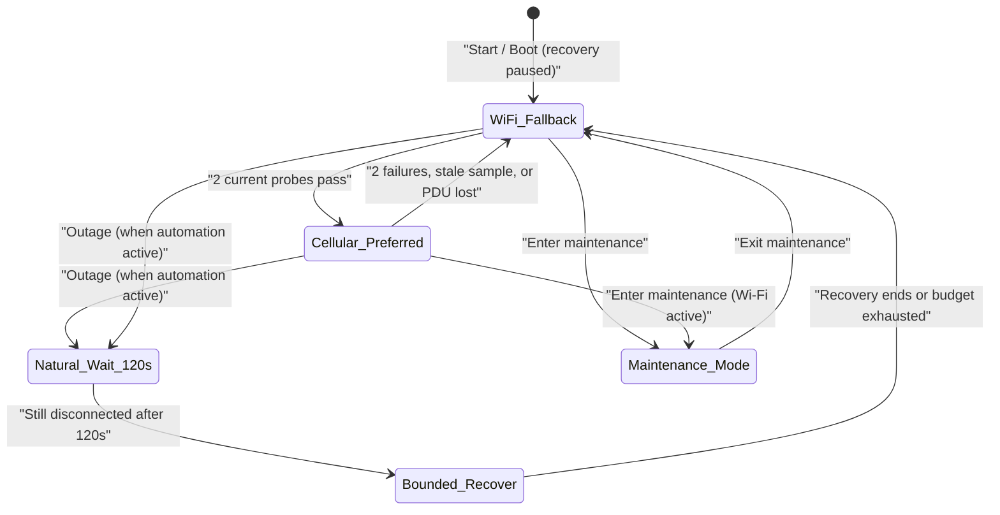

# Jetson Console Operations

[简体中文](jetson-operations.zh-CN.md)

This guide covers **Jetson Console** Web UI operations, lifecycle control
scripts, dual-path Wi-Fi/cellular route failover, bounded modem recovery, and
upgrade/rollback workflows on **Jetson Orin**.

## Web Console Overview

Jetson Console listens strictly on `127.0.0.1:8878`. Open it from your
workstation via an SSH tunnel (`ssh -L 8878:127.0.0.1:8878 <user>@<jetson-host>`):

<!-- ASSET_SLOT: docs/assets/screenshots/jetson-console-overview.png | 16:9 redacted screenshot of Jetson Console Overview / Device Setup pages (redact IMSI, Tailnet IPs, Wi-Fi IP/SSID) -->

| Page | Route | Capabilities |
| --- | --- | --- |
| Overview | `/` | USIM readiness, serving-cell camp, NR SA registration, IPv4 PDU, pool match, RNDIS/ECM interface, bound probes, `management_protected`, and IPv4 egress |
| Device Setup | `/setup` | Previews configuration mutations and executes bounded Setup, Recover, or Maintenance actions |
| History | `/history` | Passive RX/TX interface counters, bound probe latencies, and historical Setup/Recover jobs |
| Settings | `/settings` | Inspects active network contract expectations, `observe_only` selection mode, diagnostic targets, and recovery policies |

Authenticated REST and SSE endpoints for external integrations are specified
in [REST & SSE API Reference](reference/api-reference.md#jetson-console-api-1270018878).

## Dual-Path Routing & Self-Recovery State Machine



- **IPv4 failover & egress**: Two consecutive valid bound cellular probes
  promote the cellular default route (`metric 10`) for general IPv4 traffic;
  probe failures, stale telemetry, or registration/PDU drops immediately revert
  general egress to the Wi-Fi fallback default route (`metric 5`) while
  retaining host-bound diagnostic routes on the cellular interface.
  Out-of-band management reachability (`Wi-Fi` + `tailscale0`) is verified
  continuously prior to every route write.
- **Bounded recovery**: Armed automatically after a successful Setup or Recover
  run. When connectivity drops, the executor observes a natural re-attach wait
  window before triggering bounded recovery attempts separated by a cooldown
  interval. Diagnostic-only probe failures trigger Wi-Fi fallback without
  resetting the modem.
- **Maintenance mode**: Completes any in-flight AT command, switches default
  egress back to Wi-Fi, suspends telemetry polling and automated recovery, and
  releases the AT serial lock. Exiting maintenance re-enumerates the modem and
  restores bound probe routes.

Exact routing metrics, telemetry freshness windows, and recovery budgets are
defined in [Ports & Runtime Reference](reference/ports-and-runtime.md); UE
connection semantics reside in
[Network & RF Profile](reference/network-and-rf-profile.md).

## Service Lifecycle Controls

Copy `deploy/jetson/{start.sh,stop.sh,platformctl.py}` into `~/aoc-ops/jetson/`
for passwordless operator wrappers (backed by a matching `aoc-maintain`
approval):

```sh
~/aoc-ops/jetson/start.sh
~/aoc-ops/jetson/stop.sh
/usr/bin/python3 -I ~/aoc-ops/jetson/platformctl.py status
```

Administrators may also run `/opt/agentic-ocudu/jetson/current/deploy/manage.py`
(`status`, `start`, `stop`) directly via `sudo`. Always verify both systemd
units (`aoc-v2-jetson-web.service` and `aoc-v2-jetson-device.service`) are
inactive before attaching external diagnostic tools to the modem serial port.

### Unattended Boot Coordinator Status

When opt-in boot coordination (`aoc-v2-jetson-boot.service`) is enabled, check
sanitized boot progress in `/var/lib/aoc-v2-jetson-boot/public/status.json`.
Because `boot_connect.py` enforces at most one execution per Linux `boot_id`,
trigger manual retries within the same boot cycle via Web UI Setup/Recover or
`aoc-maintain ue-recover`.

## Upgrade and Rollback

1. Stop Jetson Console (`~/aoc-ops/jetson/stop.sh` or `manage.py stop`).
2. Verify and install the target archive (`manage.py verify` / `preflight` / `install`, or `aoc-maintain install`), and regenerate `/etc/aoc-v2-jetson/boot.json` if boot coordination is enabled.
3. Start services and verify `/api/v1/health`, `/api/v1/status`, and bound data probes.
4. Rollback restores the prior release symlink, compatible SQLite snapshot, configuration, and saved systemd unit files; start services and run Device Setup/Recover if modem settings were altered during testing.
