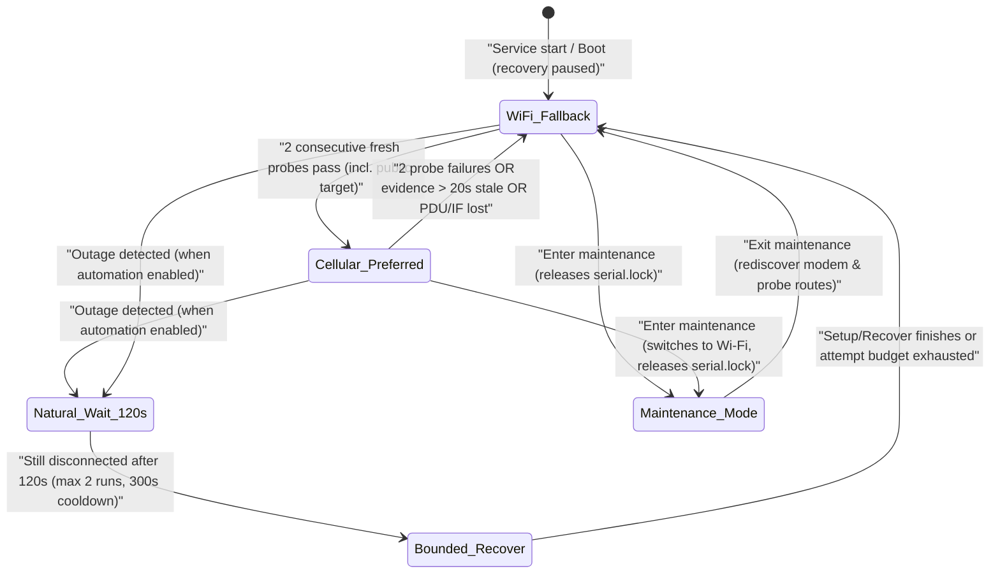

# Jetson Console operations

[简体中文](jetson-operations.zh-CN.md)

## Web Console Overview

Jetson Console (`0.6.2`) serves a local-only Astryx web console on
`127.0.0.1:8878` and coordinates **Quectel RM520N-GL** discovery, dual-path
Wi-Fi/cellular route selection, bounded recovery and optional cold-boot
attachment. Access the console from your workstation over an SSH tunnel:

```sh
ssh -L 8878:127.0.0.1:8878 <user>@<jetson-host>
```

<!-- ASSET_SLOT: docs/assets/screenshots/jetson-console-overview.png | 16:9 redacted screenshot of Jetson Console Overview / Device Setup pages (redact IMSI, Tailnet IPs, Wi-Fi IP/SSID) -->

| Page | Route | What It Shows & Manages |
| --- | --- | --- |
| Overview | `/` | Independent readiness for SIM, camping, 5GS registration, IPv4 PDU, pool match, RNDIS/ECM interface, bound data probes, `management_protected` and IPv4 egress |
| Device Setup | `/setup` | Previews and applies bounded APN/PDU verification, baseline capture, Recover and Maintenance actions |
| History | `/history` | Passive RX/TX throughput samples, probe latency history and recent job records |
| Settings | `/settings` | Inspects schema 3 network expectations, selection observation mode, diagnostics and recovery timers |

## REST and SSE API Summary

Authenticated endpoints use the session cookie and CSRF token from
`/api/v1/auth/login`. These local interfaces also serve as the integration
boundary for DIY UE-side AI applications (see [DIY AI Customization](ai-customization.md)).

| Endpoint | Method | Purpose |
| --- | --- | --- |
| `/api/v1/health` | `GET` | Unauthenticated web and device-executor liveness check (`127.0.0.1:8878`) |
| `/api/v1/auth/login`, `/api/v1/auth/session`, `/api/v1/auth/logout` | `POST` / `GET` | Session authentication and CSRF lifecycle |
| `/api/v1/status`, `/api/v1/config` | `GET` | Current UE state snapshot (with evidence quality) and active schema 3 config |
| `/api/v1/events/stream` | `GET` | Real-time SSE state and job stream |
| `/api/v1/metrics`, `/api/v1/history`, `/api/v1/diagnostics` | `GET` | Retained passive counters, probe history and interface diagnostics |
| `/api/v1/jobs`, `/api/v1/jobs/{identifier}`, `/api/v1/jobs/{identifier}/run`, `/api/v1/jobs/{identifier}/cancel`, `/api/v1/maintenance` | `GET` / `POST` | Bounded Device Setup, Recover, cancellation and Maintenance mode transitions |

## Service lifecycle

For normal local operation, use the separately deployed shortcuts:

```sh
~/aoc-ops/jetson/start.sh
~/aoc-ops/jetson/stop.sh
/usr/bin/python3 -I ~/aoc-ops/jetson/platformctl.py status
```

Run these as the commissioned SSH user with the matching 0.6.2 application and
restricted maintenance approval. Start checks resource ownership, prepares missing
host routes for the configured UPF, ext-DN and public probe, starts both services,
and exits maintenance with automatic recovery paused. It does not reset the modem
or configure its SIM/PDU. A disconnected UE remains a separate warning.

Existing correct routes are reused. Missing routes are added only when no conflicting
exact host route exists. NetworkManager profiles, foreign routes and external
services are not modified. Protocol-186 defaults use metric 5 for Wi-Fi fallback
and metric 10 for verified cellular preference; foreign defaults must use metrics above 10. Owned routes are recorded privately with numeric protocol readback.
Wi-Fi must retain an available default gateway. Startup rejects uncertain
management protection, conflicting routes and active device operations.

Repeated start rechecks route preparation and observation without restarting healthy
services. Stop terminates the executor and Web service before removing only matching
owned routes. Cleanup also runs on a repeated stop and works after device removal.
Changed routes or ambiguous command outcomes retain their journal and cause an error;
manual inspection is required rather than deleting a route with uncertain ownership.
Startup failures preserve completed stages; `stop` performs owned-resource cleanup.

Status separates services, observation (`paused`, `current`, `unavailable`) and
connectivity (`verified`, `not verified`). A listening port alone does not establish
ownership or device connectivity. Each helper call is bounded to 330 seconds and each
health wait to 60 seconds. After timeout, query status before retrying.

One user-level lock serializes these scripts across copies. Do not run lifecycle
actions through the UI or another entrypoint concurrently. The lock does not replace
the helper's own access/locking checks. Exit codes are 0 for success, 1 for execution
or verification failure, 2 for invalid arguments and 3 for a busy script. A successful
`status` query returns 0 even when services are stopped. Runtime output is English.

After backing up existing shortcuts, copy the three scripts from the verified
release (or the matching checkout). The example below uses checkout paths;
inside an unpacked release, use `deploy/` in place of `deploy/jetson/`:

```sh
mkdir -p ~/aoc-ops/jetson
install -m 0755 deploy/jetson/start.sh deploy/jetson/stop.sh \
  deploy/jetson/platformctl.py ~/aoc-ops/jetson/
```

Verify transfer hashes before execution. The same files can be copied over SSH;
no checkout is needed on the device. They are included in 0.6.0 application releases
and do not enable boot startup. Upgrade the application, approved maintenance bundle
and shortcuts together; do not pair new shortcuts with an older manager. Do not put site addresses in these scripts.
See the [2026-09-24 lifecycle acceptance](acceptance/2026-09-24-platform-lifecycle.md),
the [0.6.0 hardware acceptance](acceptance/2026-09-27-independent-lifecycle-deployment.md),
and the [2026-11-23 alignment record](acceptance/2026-11-23-spark-ue-alignment.md).

The underlying installed manager remains available to administrators:

```sh
sudo /opt/agentic-ocudu/jetson/current/venv/bin/python -I \
  /opt/agentic-ocudu/jetson/current/deploy/manage.py status
sudo /opt/agentic-ocudu/jetson/current/venv/bin/python -I \
  /opt/agentic-ocudu/jetson/current/deploy/manage.py start
sudo /opt/agentic-ocudu/jetson/current/venv/bin/python -I \
  /opt/agentic-ocudu/jetson/current/deploy/manage.py stop
```

`stop` must terminate the web process, device executor, bounded helper and
owned child tasks within its timeout. Confirm both systemd units are inactive
before another process opens the modem.

## Device status and setup

The Overview page separates SIM readiness, cell camping, 5GS registration,
PDU activation, pool membership, RNDIS/ECM addressing and verified data path.
Device Setup previews every write and records a private baseline before it
changes an allowed data context. Duplicate DNNs, conflicting CIDs or uncertain
device identity stop the workflow.

If opt-in boot coordination (`aoc-v2-jetson-boot.service` and `boot_connect.py`)
is enabled, inspect redacted progress in
`/var/lib/aoc-v2-jetson-boot/public/status.json`. Because `boot_connect.py`
key-locks one operation ledger per Linux `boot_id`, do not manually replay
`aoc-v2-jetson-boot.service` within the same boot after it has recorded a
run; use standard UI Setup/Recover or `aoc-maintain ue-recover` instead.

Maintenance mode waits for the current command, selects Wi-Fi fallback, suspends
collection and recovery, and releases the serial port. Leaving maintenance rediscovers the
device, prepares configured data routes and reads current state. It never replays an
interrupted command; route preparation failure leaves maintenance enabled.

## Recovery and connectivity

### Dual-Path Routing & Self-Recovery State Machine



| Policy / Routing Parameter | Default / Constraint |
| --- | --- |
| Owned protocol-186 defaults | `metric 5` = Wi-Fi fallback; `metric 10` = verified cellular preference (foreign defaults must be `> 10`) |
| Probe & freshness cadence | Sample interval: `10 s`; stale cutoff: `20 s`; host routes to UPF, ext-DN and probe target remain bound to cellular |
| Automatic recovery budget | Triggered only after successful user Setup/Recover: `120 s` natural wait -> max `2` recovery jobs (`300 s` cooldown) |
| Helper / health timeouts | Helper call limit: `330 s`; health wait: `60 s`; exit codes: `0` ok, `1` failure, `2` bad args, `3` busy |

IPv4 default-route selection is independent of permission to reset the modem.
Two complete fresh probe samples, including the public target, must pass before
cellular is preferred. Two failures return ordinary traffic to Wi-Fi; loss of
registration/PDU/interface or evidence older than 20 seconds triggers fallback on
the next reconciliation. Sampling normally runs every 10 seconds. Ready or paused
tasks cannot retain a cellular default after their evidence expires. Diagnostic
host routes remain bound to cellular so recovery can be detected while using Wi-Fi.
A renamed USB interface replaces only routes with verified ownership. Start and
systemd post-stop select fallback; the manager's full stop restores the original
system routes by removing both owned route journals. A foreign high-priority
route, changed ownership or uncertain mutation stops reconciliation with an error.

The Overview IPv4 egress reports an ordinary destination outside the diagnostic
host routes. `management_protected` means the Wi-Fi fallback gateway and configured
Tailscale route are available; it does not verify an independent tunnel transport.
These Jetson kernels do not support policy routing. A switch may briefly reconnect
Tailscale. IPv6 failover is not implemented or claimed.

Recovery first checks current state and repairs only owned routes. A task may
perform one modem reconnect when needed and persists every step, cancellation
and cleanup result. If CFUN=0 may have taken effect but its response or readback
fails, the adapter attempts CFUN=1 once while retaining hardware ownership, even
when cancellation is pending. The task keeps its original failure/cancellation;
failed power restoration is reported explicitly. Temporary restoration authority
is cleared after that attempt. Inspect state before another recovery request.

After a network outage, automatic recovery waits 120 seconds, then permits at
most two attempts with a 300-second cooldown. It runs only after a successful
user setup/recovery has enabled it. Maintenance, uncertain management protection
or exhausted attempts stop writes. A failed diagnostic probe alone never resets
the modem. Successful data evidence must remain healthy for the cooldown before
the automatic attempt budget resets.

The four pages are Overview, Device Setup, History and Settings. Interface RX/TX
activity and bound low-traffic probes remain; active throughput tasks are removed.
See [UE access policy](ue-access-policy.md) for independent status meanings.

## Upgrade and rollback

Stop the platform, verify the new release, install it, start it and validate
health before running device operations. Rollback restores both the previous
release link, compatible database backup, configuration and saved systemd unit
files, then reloads systemd before starting the web service. Older checkpoints
without a unit snapshot use the saved release's packaged units. The device
service remains stopped for inspection until explicitly started. If a workflow changed modem or
network state, use its recorded recovery action as well; changing application
code alone does not restore device state.

<details>
<summary>Upgrading from Schema 2 (pre-0.4.0) releases</summary>

Schema 2 configuration migrates once to schema 3 during installation. The
installer backs up configuration and databases before migration. Database schema
2 preserves old benchmark results but marks unfinished benchmark tasks
interrupted and retired; they cannot be launched. Roll back using the matching
pre-upgrade backup.

</details>
