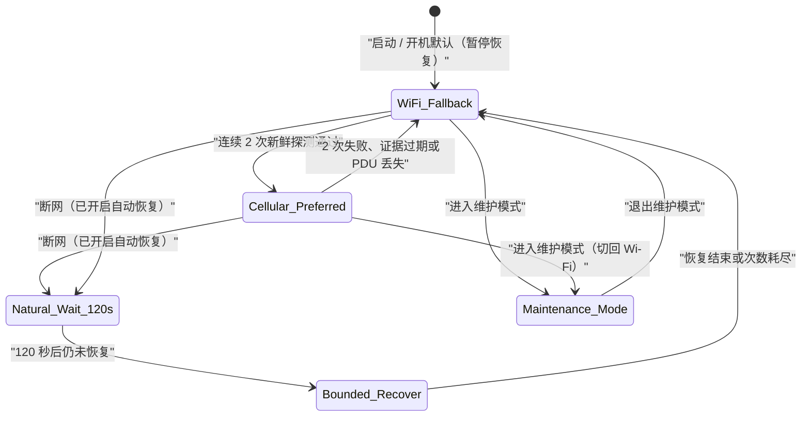

# Jetson Console 运维指南

[English](jetson-operations.md)

本指南介绍 **Jetson Console** Web 控制台界面、生命周期启停脚本、Wi-Fi/蜂窝双路径路由切换、
有界模组恢复以及升级回滚流程。

## Web 控制台导览

Jetson Console 仅监听 `127.0.0.1:8878`，从工作站通过 SSH 端口转发访问
（`ssh -L 8878:127.0.0.1:8878 <user>@<jetson-host>`）：

<!-- ASSET_SLOT: docs/assets/screenshots/jetson-console-overview.png | 16:9 脱敏后的 Jetson Console Overview / Device Setup 页面截图（须遮蔽 IMSI、Tailnet IP、Wi-Fi IP/SSID） -->

| 页面 | 路由 | 观测与管控能力 |
| --- | --- | --- |
| Overview | `/` | 独立展示 SIM 就绪、驻留、NR SA 注册、IPv4 PDU、地址池、RNDIS/ECM 网卡、绑定探测、`management_protected` 与普通 IPv4 出口 |
| Device Setup | `/setup` | 写入前预览上下文变更并保存基线，执行 Setup、Recover 与维护模式切换 |
| History | `/history` | 被动网卡收发速率、绑定探测时延与历史 Setup/Recover 任务记录 |
| Settings | `/settings` | 查看当前网络契约预期、只读选网观测策略、探测目标与自动恢复策略 |

完整的 REST 与 SSE 接口说明见[REST 与 SSE 接口参考](reference/api-reference.zh-CN.md#jetson-console-接口1270018878)。

## 双路径路由与有界自愈状态机



- **IPv4 双路径切换**：连续两次新鲜绑定探测成功后，普通 IPv4 流量优先经由蜂窝默认路由
  （`metric 10`）；探测失败、样本过期或注册/PDU 丢失时立即回退至 Wi-Fi 兜底路由
  （`metric 5`），同时保持诊断主机路由绑定在蜂窝网卡上。当前支持 IPv4 故障切换，
  所有写操作前均先核验 Wi-Fi 与 `tailscale0` 管理通路可达。
- **有界自动恢复**：用户成功执行一次 Setup 或 Recover 后激活；断网先等待自然重连，
  随后按冷却间隔执行有限次重连恢复。仅数据探测失败只触发路由回退 Wi-Fi，不会重置模组。
- **维护模式**：等待当前 AT 指令完成，切回 Wi-Fi 兜底，暂停采集与自愈，并释放串口锁；
  退出维护模式后重新发现模组并重建探测路由。

精确的路由 metric、新鲜度阈值与自愈预算见[端口与运行时参考](reference/ports-and-runtime.zh-CN.md)；
独立状态语义见[网络契约与射频基线](reference/network-and-rf-profile.zh-CN.md)。

## 服务生命周期控制

配置好对应的 `aoc-maintain` 批准包并将 `deploy/jetson/{start.sh,stop.sh,platformctl.py}`
复制到 `~/aoc-ops/jetson/` 后，可执行免密快捷操作：

```sh
~/aoc-ops/jetson/start.sh
~/aoc-ops/jetson/stop.sh
/usr/bin/python3 -I ~/aoc-ops/jetson/platformctl.py status
```

管理员亦可直接使用 `sudo /opt/agentic-ocudu/jetson/current/deploy/manage.py`
（`status`、`start`、`stop`）。使用外部工具直连模组串口前，务必确认 `aoc-v2-jetson-web.service`
与 `aoc-v2-jetson-device.service` 均已停止。

### 开机自连协调状态查询

启用 `aoc-v2-jetson-boot.service` 后，可在 `/var/lib/aoc-v2-jetson-boot/public/status.json`
只读查看脱敏开机入网状态。由于 `boot_connect.py` 按当前内核 `boot_id` 防止同次开机重复执行，
同一次开机周期内如需手动重连，请使用 Web 控制台 Setup/Recover 或 `aoc-maintain ue-recover`。

## 升级与回滚

1. 先停止 Jetson Console（`~/aoc-ops/jetson/stop.sh` 或 `manage.py stop`）。
2. 校验并安装新版本（`manage.py verify` / `preflight` / `install` 或 `aoc-maintain install`）；若启用了开机自连，同步刷新 `/etc/aoc-v2-jetson/boot.json`。
3. 启动服务并核验 `/api/v1/health`、`/api/v1/status` 与绑定数据探测。
4. 回滚时会恢复上一版本链接、兼容数据库备份、配置及 systemd 服务单元；若测试期间修改过模组状态，请在启动后配合执行 Device Setup/Recover。
