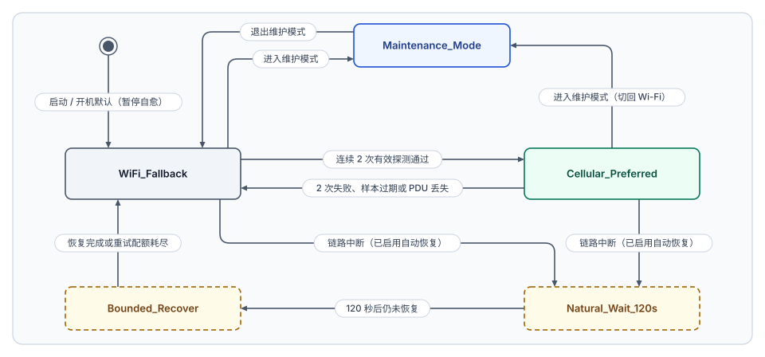

# Jetson Console 运维指南

[English](jetson-operations.md)

本指南说明 **Jetson Console** Web 控制台操作、生命周期控制脚本、Wi-Fi/蜂窝双路径
路由切换、有界模组恢复以及升级与回滚流程。

## Web 控制台导览

Jetson Console 仅绑定回环地址 `127.0.0.1:8878`，从工作站通过 SSH 端口转发访问
（`ssh -L 8878:127.0.0.1:8878 <user>@<jetson-host>`）：

<!-- ASSET_SLOT: docs/assets/screenshots/jetson-console-overview.png | 16:9 脱敏后的 Jetson Console Overview / Device Setup 页面截图（须遮蔽 IMSI、Tailnet IP、Wi-Fi IP/SSID） -->

| 页面 | 路由 | 核心能力 |
| --- | --- | --- |
| Overview | `/` | 独立展示 USIM 就绪、小区驻留、NR SA 注册、IPv4 PDU、地址池、RNDIS/ECM 网卡、绑定探测、`management_protected` 与普通 IPv4 出口 |
| Device Setup | `/setup` | 下发前预览配置变更并留存基线，执行 Setup、Recover 与维护模式切换 |
| History | `/history` | 被动网卡收发速率、绑定探测时延与历史 Setup/Recover 任务记录 |
| Settings | `/settings` | 查阅网络契约预期、只读选网观测策略、探测目标与自动恢复配置 |

供外部客户端集成的 REST 与 SSE 接口规范，请参阅
[REST 与 SSE 接口参考](reference/api-reference.zh-CN.md#jetson-console-接口1270018878)。

## 双路径路由与有界自愈状态机

<div align="center">

<picture>
  <source media="(prefers-color-scheme: dark)" srcset="assets/diagrams/jetson-state-machine-zh-dark.svg">
  <source media="(prefers-color-scheme: light)" srcset="assets/diagrams/jetson-state-machine-zh-light.svg">
  
</picture>

</div>

- **IPv4 双路径切换**：连续两次有效期内绑定探测成功后，普通 IPv4 默认路由切换为
  蜂窝优先（`metric 10`）；若连续探测失败、样本过期或注册/PDU 丢失，立即回退至
  Wi-Fi 备用默认路由（`metric 5`），同时保持诊断主机路由继续绑定蜂窝接口以持续探测
  链路恢复。每次写路由前均会校验带外 `Wi-Fi` 与 `tailscale0` 管理通路可达性。
- **有界自动恢复**：仅在用户成功执行一次 Setup 或 Recover 后激活；断网后先等待自然
  重附着窗口，随后按冷却间隔执行有限次恢复尝试。仅数据探测失败只触发路由回退至
  Wi-Fi 备用路由，不会主动复位模组。
- **维护模式**：等待当前 AT 指令结束，切回 Wi-Fi 备用默认路由，暂停遥测采集与自动
  恢复并释放 AT 串口锁；退出维护模式后重新发现模组并重建诊断路由。

精确路由 metric、数据时效性阈值与自愈预算见[端口与运行时参考](reference/ports-and-runtime.zh-CN.md)；
UE 连接判定语义见[网络契约与射频基线](reference/network-and-rf-profile.zh-CN.md)。

## 服务生命周期控制

配置好对应的 `aoc-maintain` 批准包并将 `deploy/jetson/{start.sh,stop.sh,platformctl.py}`
复制至 `~/aoc-ops/jetson/` 后，即可使用受限免密运维脚本：

```sh
~/aoc-ops/jetson/start.sh
~/aoc-ops/jetson/stop.sh
/usr/bin/python3 -I ~/aoc-ops/jetson/platformctl.py status
```

管理员亦可直接通过 `sudo /opt/agentic-ocudu/jetson/current/deploy/manage.py`
执行 `status`、`start` 与 `stop`。使用外部调试工具直连模组串口前，务必确认
`aoc-v2-jetson-web.service` 与 `aoc-v2-jetson-device.service` 均处于停止状态。

### 开机自连协调状态查询

启用 `aoc-v2-jetson-boot.service` 后，可在 `/var/lib/aoc-v2-jetson-boot/public/status.json`
只读查询脱敏开机入网进度。`boot_connect.py` 按内核 `boot_id` 限制单次开机仅执行一轮
编排；同一开机周期内如需手动重连，请使用 Web 控制台 Setup/Recover 或运行
`aoc-maintain ue-recover`。

## 升级与回滚

1. 停止 Jetson Console 服务（`~/aoc-ops/jetson/stop.sh` 或 `manage.py stop`）。
2. 校验并安装目标版本（`manage.py verify` / `preflight` / `install` 或 `aoc-maintain install`）；若已启用开机自连，同步刷新 `/etc/aoc-v2-jetson/boot.json`。
3. 启动服务并核验 `/api/v1/health`、`/api/v1/status` 及绑定数据探测状态。
4. 回滚时会恢复上一版本软链接、兼容 SQLite 数据库备份、配置及 systemd 服务单元；若测试期间曾修改模组配置，启动后请配合执行一次 Device Setup 或 Recover。
