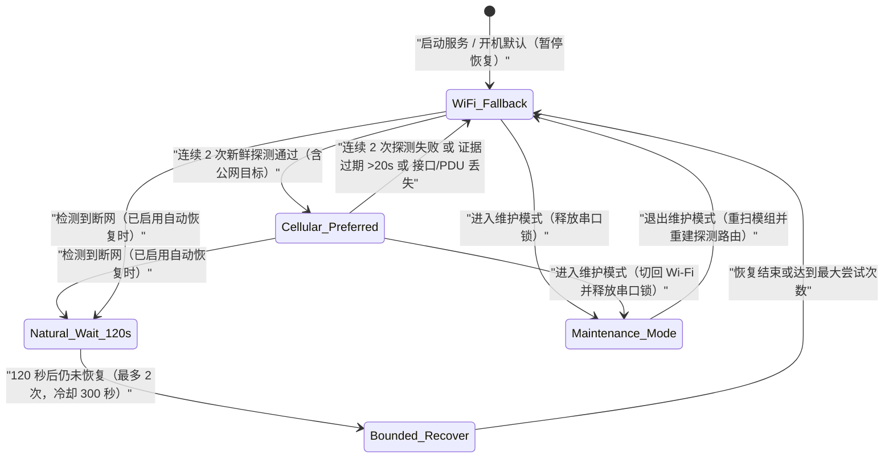

# Jetson Console 运维

[English](jetson-operations.md)

## Web 控制台导览

Jetson Console（`0.6.2`）在回环地址 `127.0.0.1:8878` 提供本地 Astryx Web 控制台，
负责 **Quectel RM520N-GL** 模组发现、Wi-Fi/蜂窝双路径路由保护、有界故障恢复及可选开机自连。
建议从工作站通过 SSH 端口转发访问：

```sh
ssh -L 8878:127.0.0.1:8878 <user>@<jetson-host>
```

<!-- ASSET_SLOT: docs/assets/screenshots/jetson-console-overview.png | 16:9 脱敏后的 Jetson Console Overview / Device Setup 页面截图（须遮蔽 IMSI、Tailnet IP、Wi-Fi IP/SSID） -->

| 页面 | 路由 | 观测与管控内容 |
| --- | --- | --- |
| Overview | `/` | 独立展示 SIM、驻留、5GS 注册、IPv4 PDU、地址池、RNDIS/ECM 接口、绑定探测、`management_protected` 与普通 IPv4 出口 |
| Device Setup | `/setup` | 在写入前预览上下文与基线校验，并执行 Setup、Recover 与维护模式切换 |
| History | `/history` | 被动接口收发速率曲线、探测时延与历史任务记录 |
| Settings | `/settings` | 查看 schema 3 网络契约预期、只读选网观测策略、探测目标与自动恢复冷却参数 |

## REST 与 SSE 接口速查

除 `/api/v1/health` 与登录接口外，其余端点均需携带 `/api/v1/auth/login` 返回的会话
Cookie 与 CSRF Token。这些本机接口同时是 UE 侧 DIY AI 模块接入 Jetson 状态的唯一边界
（参见[双端 AI 定制指南](ai-customization.zh-CN.md)）。

| 接口端点 | 方法 | 用途说明 |
| --- | --- | --- |
| `/api/v1/health` | `GET` | Web 与设备执行器存活检查（无需鉴权） |
| `/api/v1/auth/login`、`/api/v1/auth/session`、`/api/v1/auth/logout` | `POST` / `GET` | 登录会话与 CSRF Token 管理 |
| `/api/v1/status`、`/api/v1/config` | `GET` | 当前 UE 状态快照（含证据质量）与现役 schema 3 配置 |
| `/api/v1/events/stream` | `GET` | 实时状态与任务 SSE 推送流 |
| `/api/v1/metrics`、`/api/v1/history`、`/api/v1/diagnostics` | `GET` | 被动收发计数、历史探测与接口诊断信息 |
| `/api/v1/jobs`、`/api/v1/jobs/{identifier}`、`/api/v1/jobs/{identifier}/run`、`/api/v1/jobs/{identifier}/cancel`、`/api/v1/maintenance` | `GET` / `POST` | 受限 Setup、Recover、任务取消与维护模式控制 |

## 服务生命周期

日常在设备本地执行独立部署的快捷脚本：

```sh
~/aoc-ops/jetson/start.sh
~/aoc-ops/jetson/stop.sh
/usr/bin/python3 -I ~/aoc-ops/jetson/platformctl.py status
```

使用已完成 commissioning 的 SSH 用户，应用和受限维护批准包均须匹配 0.6.2。
启动检查资源归属，补齐配置的 UPF、ext-DN、公网探测主机路由，启动两个服务，
退出维护并保持自动恢复暂停。不会重置模组或配置 SIM/PDU；UE 未连接单独告警。

复用现有正确路由，只有不存在冲突的精确主机路由时才添加缺失路由；不修改
管理员路由、NetworkManager 连接或外部服务。自建路由记入私有日志，协议号按数字读回。
自有默认路由使用协议号 186，Wi-Fi 回退 metric 为 5，蜂窝优先 metric 为 10；
既有默认路由 metric 必须大于 10，Wi-Fi 必须保留可用的默认网关。管理保护不确定、路由冲突或存在活动设备任务
时，启动报错。

重复启动重新检查路由与采集，不重启健康服务。停止先结束执行器和 Web，再仅清理
匹配所有权记录的路由；重复停止仍执行清理，设备断开后也可清理。路由发生变化或
命令结果不确定时，保留日志并报错，要求检查，不删除归属不确定的路由。启动失败
保留已完成步骤，`stop` 负责清理自有资源。

状态将服务、采集（`paused`、`current`、`unavailable`）和连接（`verified`、
`not verified`）分开显示。端口监听本身不证明归属或设备连通。每次维护调用最多
330 秒，每次健康等待最多 60 秒；超时后先查询状态再重试。

同一用户的各份脚本共用操作锁。不要同时通过网页或其他入口执行生命周期操作；此锁不
替代维护工具自身的权限及互斥检查。退出码：成功 0、执行或验证失败 1、参数错误 2、
脚本忙 3。`status` 成功读取状态即返回 0，服务停止不算查询失败。运行输出使用英文。

先备份已有快捷脚本，再从校验后的发布包或匹配的仓库复制三个脚本。下面示例使用
仓库路径；在解压后的发布包中，将 `deploy/jetson/` 改为 `deploy/`：

```sh
mkdir -p ~/aoc-ops/jetson
install -m 0755 deploy/jetson/start.sh deploy/jetson/stop.sh \
  deploy/jetson/platformctl.py ~/aoc-ops/jetson/
```

执行前核对传输哈希，也可通过 SSH 复制这些文件，设备不需要完整仓库。脚本包含在 0.6.0
发布包中，不开启开机自启。应用、维护批准包和快捷脚本须一起升级，不将新脚本与旧
管理器混用。脚本中不要加入站点地址。
历史实机结果见 [2026-09-24 启停验收](acceptance/2026-09-24-platform-lifecycle.zh-CN.md)、
[0.6.0 实机验收](acceptance/2026-09-27-independent-lifecycle-deployment.zh-CN.md)以及
[2026-11-23 对齐验收](acceptance/2026-11-23-spark-ue-alignment.zh-CN.md)。

管理员仍可使用底层已安装管理器：

```sh
sudo /opt/agentic-ocudu/jetson/current/venv/bin/python -I \
  /opt/agentic-ocudu/jetson/current/deploy/manage.py status
sudo /opt/agentic-ocudu/jetson/current/venv/bin/python -I \
  /opt/agentic-ocudu/jetson/current/deploy/manage.py start
sudo /opt/agentic-ocudu/jetson/current/venv/bin/python -I \
  /opt/agentic-ocudu/jetson/current/deploy/manage.py stop
```

`stop` 必须在超时内终止 Web、设备执行器、受限 helper 和自有子任务。其他进程
打开模组前，应确认两个 systemd 单元都处于 inactive。

## 设备状态与配置

Overview 分别展示 SIM、驻留、5GS 注册、PDU 激活、地址池、RNDIS/ECM 地址和真实
数据路径。Device Setup 在写入前展示变更，并保存私有基线。重复 DNN、CID 冲突
或设备身份不确定都会停止流程。

若已启用可选开机协调器（`aoc-v2-jetson-boot.service` 与 `boot_connect.py`），
可从 `/var/lib/aoc-v2-jetson-boot/public/status.json` 只读查看脱敏状态。
由于 `boot_connect.py` 按内核 `boot_id` 防止单次开机重放，同一启动周期内已有记录后
不要手工重复触发 `aoc-v2-jetson-boot.service`，常规维护请使用界面 Setup/Recover
或 `aoc-maintain ue-recover`。

维护模式会等待当前命令结束，切换到 Wi-Fi 回退，暂停采集和恢复，并释放串口。退出维护后重新发现
设备，准备配置的数据路由并读取现场状态，不重放中断命令；路由准备失败时保持维护模式。

## 恢复与连通性

### 双路径路由切换与有界自愈状态机



| 路由与恢复策略参数 | 默认阈值与约束 |
| --- | --- |
| 协议 `186` 自有默认路由 | `metric 5` = Wi-Fi 回退路由；`metric 10` = 蜂窝优先路由（外部默认路由 metric 须 `> 10`） |
| 探测与证据过期时间 | 正常采样间隔：`10 s`；新鲜度上限：`20 s`；UPF/ext-DN/探测目标主机路由始终绑定蜂窝接口 |
| 自动恢复预算 | 仅在用户成功完成 Setup/Recover 后激活：先自然等待 `120 s`，最多触发 `2` 次恢复（冷却 `300 s`） |
| 超时与退出码 | Helper 调用上限 `330 s`；健康等待 `60 s`；退出码：`0` 成功、`1` 失败、`2` 参数错、`3` 锁忙 |

IPv4 默认路由切换独立于模组重置权限。连续两组完整且新鲜的探测（包含公网）成功
后优先蜂窝，连续两组失败后回退 Wi-Fi；注册、PDU、接口丢失或证据超过 20 秒时，
在下一次协调中回退。正常采样间隔为 10 秒。等待或暂停中的任务也不能在证据过期后
一直保留蜂窝默认路由。诊断主机路由始终绑定蜂窝，因此 Wi-Fi 回退期间仍可检测恢复。
USB 网卡改名时只重建归属明确的自有路由。启动和 systemd 停止后钩子选择 Wi-Fi 回退；
管理器完整停止时清理两个路由所有权日志，恢复原有系统路由。外部高优先级路由、
所有权变化或变更结果不确定会让协调报错停止。

Overview 的 IPv4 出口使用探测主机路由之外的普通目标读取。`management_protected`
表示 Wi-Fi 回退网关和到配置的 Spark 地址的 Tailscale 路由可用，并不证明隧道底层
传输独立。由于当前目标 Jetson 内核不支持策略路由，切换默认出口时 Tailscale 可能
短时重连；当前版本仅支持 IPv4 故障切换，暂不支持 IPv6 自动切换。

恢复任务先检查状态，只修复本项目拥有的路由；必要时每个任务最多执行一次模组
重连，并持久化步骤、取消和清理结果。若 CFUN=0 可能已生效但应答或回读失败，
适配器在保持硬件独占时尝试一次 CFUN=1，即使任务正在取消。任务仍保留原始失败/
取消结果；电源恢复失败会明确报告，每次尝试后清除临时恢复授权。再次请求恢复前
先检查现场状态。

网络中断后自动恢复先等待 120 秒，再最多尝试两次，间隔至少 300 秒。仅在用户
成功执行配置或恢复后启用；维护模式、管理保护不确定或次数耗尽会停止写入。
单个诊断目标不可达不会触发模组重置。数据验证持续健康达到冷却期后才重置尝试预算。

界面仅保留 Overview、Device Setup、History、Settings 四页。保留被动收发计数和
绑定接口的小流量探测，移除主动测速。独立状态含义见[UE 接入策略](ue-access-policy.zh-CN.md)。

## 升级与回滚

先停止平台并校验新发布，再安装、启动和验证健康，之后才能运行设备操作。回滚应
同时恢复上一发布链接、兼容数据库备份、配置和备份中的 systemd 服务文件，
重新加载 systemd 后再启动 Web 服务。缺少服务文件快照的旧备份使用对应旧发布
中的服务文件。设备服务保持停止，检查后需显式启动。如果任务修改过模组或网络状态，还需执行
记录中的设备恢复动作；只回滚应用代码不能恢复设备现场。

<details>
<summary>从早期 Schema 2（0.4.0 之前）升级迁移说明</summary>

安装时将配置从 schema 2 一次性迁移到 schema 3，迁移前备份配置与数据库。
数据库 schema 2 保留旧测速历史，未结束的测速任务标记为中断与退役，不能再次执行。
回滚使用对应的升级前备份。

</details>
