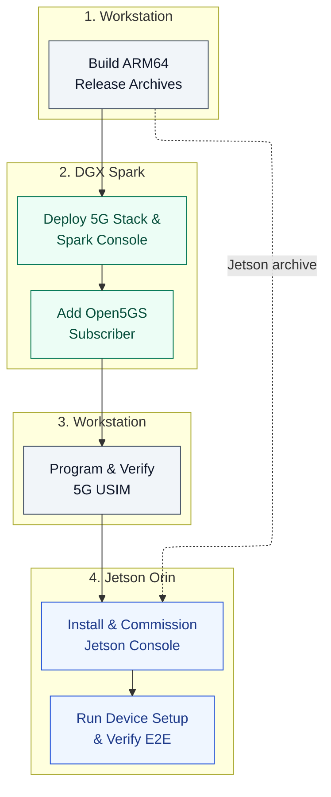

# End-to-End Quickstart

[简体中文](quickstart.zh-CN.md)

This guide walks through the end-to-end multi-host deployment workflow—from
assembled hardware to a verified **5G SA** IPv4 data connection supervised by
**Spark Console** and **Jetson Console**.

## Deployment Flow Across Hosts



## Prerequisites

1. Complete physical cabling per [Hardware & Topology](hardware-and-topology.md).
2. Enroll both **DGX Spark** and **Jetson Orin** in the same Tailscale network
   so Jetson reaches Spark over `tailscale0` while preserving an independent
   out-of-band Wi-Fi management gateway.
3. Build offline ARM64 release archives on a macOS or Linux workstation
   (Python `3.10–3.12`, Node.js `22`), or stage verified release artifacts:
   ```sh
   make install-dev BOOTSTRAP_PYTHON=python3.12
   make check
   make build-spark-release RELEASE_OUT=/tmp/aoc-spark-release
   make build-jetson-release RELEASE_OUT=/tmp/aoc-jetson-release
   ```
4. Maintain an access-restricted local directory outside Git (`chmod 0700`) for
   subscriber keys and site core bundles.

---

## Step 1 — Deploy Spark 5G Stack & Spark Console

Execute on **DGX Spark**:

1. **Build OCUDU and Open5GS runtime images**:
   - Build the pinned OCUDU `gnb` and `probe-b210` binaries per [Spark Stack Deployment](../deploy/spark/stack/README.md).
   - Build the Open5GS base validation image per [Open5GS ARM64 Build](../stacks/open5gs/build/README.md), then build both minimal runtime derivatives:
     ```sh
     docker build -f stacks/open5gs/build/Dockerfile.n6 -t aoc-open5gs-n6:local .
     docker build -f stacks/open5gs/build/Dockerfile.connectivity -t aoc-open5gs-connectivity:local .
     ```
     Verify image tags and digests against `stacks/open5gs/artifacts.lock.json`, then render (`--database-auth --n6`), initialize MongoDB, and install `aoc-v2ctl` per [Spark Stack Deployment](../deploy/spark/stack/README.md).
2. **Install Spark Console**:
   Transfer and unpack the Spark release archive, then run verification, host checks, and installation (initial install prompts for a Web Console password of at least 12 characters):
   ```sh
   python3 -I -B install.py verify --path .
   python3 -I -B install.py check-host --path .
   sudo python3 -I -B install.py install --path .
   ```
3. **Enable OCUDU telemetry and start services**:
   ```sh
   sudo python3 scripts/spark/enable_radio_json_metrics.py
   sudo aoc-v2ctl start
   sudo systemctl start aoc-control.service aoc-observe.service aoc-monitor-web.service
   ```
4. **Verify Spark readiness**:
   Confirm `sudo aoc-v2ctl status` reports all 12 core containers healthy with N2
   NG Setup complete, and `curl -fsS http://127.0.0.1:8877/api/v1/health` returns `ok`.

---

## Step 2 — Provision Open5GS Subscriber & Program 5G USIM

Follow [Subscriber Provisioning & USIM Setup](sim-provisioning.md):

1. Register a dedicated subscriber on **DGX Spark** (`stacks/open5gs/subscriber.py`) matching the [Network & RF Profile](reference/network-and-rf-profile.md).
2. On your workstation, program a Milenage-capable 5G USIM with matching `IMSI`, `Ki`, and `OPc`, then confirm `IMSI` readback and local Milenage vector validation.

---

## Step 3 — Deploy Jetson Console & Connect UE

Execute on **Jetson Orin**:

1. **Verify hardware and management network prerequisites**:
   Confirm the **Quectel RM520N-GL** and Nano-SIM are seated in the Waveshare carrier, `ModemManager` is stopped and disabled, the out-of-band Wi-Fi management gateway is active, and `tailscale0` reaches Spark.
2. **Install, commission, and start Jetson Console**:
   Unpack the Jetson release archive (initial installation prompts interactively for the console password), substituting Spark's actual Tailscale IP for `192.0.2.20`:
   ```sh
   python3 -I -B deploy/manage.py verify
   python3 -I -B deploy/manage.py preflight
   sudo bash deploy/install-jetson.sh
   sudo /usr/bin/python3 -I -B /opt/agentic-ocudu/jetson/current/deploy/manage.py stop
   sudo /usr/bin/python3 -I -B /opt/agentic-ocudu/jetson/current/deploy/manage.py commission \
     --spark-address 192.0.2.20 --wifi-interface auto
   sudo /usr/bin/python3 -I -B /opt/agentic-ocudu/jetson/current/deploy/manage.py start
   ```
3. **Verify Jetson health and trigger Device Setup**:
   Confirm `curl -fsS http://127.0.0.1:8878/api/v1/health` returns `ok`, establish an SSH tunnel (`ssh -L 8878:127.0.0.1:8878 <user>@<jetson-host>`), sign in at `http://127.0.0.1:8878`, and run **Device Setup**.

---

## Step 4 — End-to-End Verification & Optional Post-Deployment Enhancements

1. **Verify dual-end connectivity state**:
   - **Jetson Overview (`127.0.0.1:8878`)**: reports `SIM` ready, NR SA registration, active IPv4 PDU, verified bound data probes, cellular preferred egress, and `management_protected = true`.
   - **Spark Console (`ssh -L 8877:127.0.0.1:8877 <user>@<spark-host>`)**: reports live gNB telemetry, correlated UE RNTI context, active PDU session, and N3/N6 bridge traffic counters.
2. **Optional post-deployment enhancements**:
   - Configure passwordless operator wrappers (`~/aoc-ops/*/start.sh`) via [Maintenance Helper](../deploy/maintenance/README.md).
   - Enable unattended cold-boot attachment (`boot_connect.py`) via [Jetson Setup](setup-ue-jetson.md#3-opt-in-boot-coordination).
   - Integrate user-defined AI pipelines and external clients per [AI Extensibility Guide](ai-customization.md).
