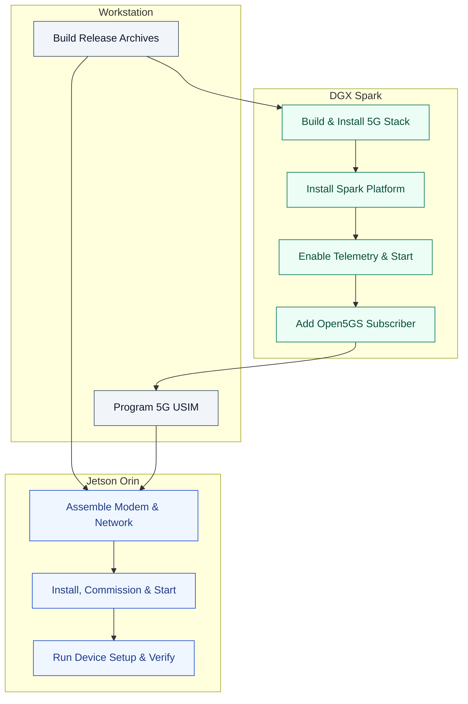

# End-to-End Quickstart

[简体中文](quickstart.zh-CN.md)

This guide takes you from assembled hardware to a verified end-to-end 5G SA
data connection managed by **Spark Platform** and **Jetson Console**.

## Deployment Flow Across Hosts



## Prerequisites

1. Complete physical wiring per [Hardware & Topology](hardware-and-topology.md).
2. Connect both **DGX Spark** and **Jetson Orin** to your Tailscale network so
   Jetson reaches Spark via `tailscale0` while keeping an independent Wi-Fi
   management gateway.
3. Prepare offline ARM64 application archives on your macOS or Linux workstation
   (Python `3.10–3.12` and Node.js `22`), or download verified release archives:
   ```sh
   make install-dev BOOTSTRAP_PYTHON=python3.12
   make check
   make build-spark-release RELEASE_OUT=/tmp/aoc-spark-release
   make build-jetson-release RELEASE_OUT=/tmp/aoc-jetson-release
   ```
4. Keep an access-restricted directory outside Git (`chmod 0700`) for SIM keys
   and site core bundles.

---

## Step 1 — Deploy Spark 5G Stack & Spark Platform

Run on **DGX Spark**:

1. **Build OCUDU and Open5GS runtime images**:
   - Build the pinned OCUDU `gnb` and `probe-b210` binaries per [Spark Stack Deployment](../deploy/spark/stack/README.md).
   - Build the Open5GS base validation image per [Open5GS ARM64 Build](../stacks/open5gs/build/README.md), then build the two production derivatives:
     ```sh
     docker build -f stacks/open5gs/build/Dockerfile.n6 -t aoc-open5gs-n6:local .
     docker build -f stacks/open5gs/build/Dockerfile.connectivity -t aoc-open5gs-connectivity:local .
     ```
     Align image tags/IDs with `stacks/open5gs/artifacts.lock.json`, then follow [Spark Stack Deployment](../deploy/spark/stack/README.md) to render (`--database-auth --n6`), provision MongoDB, and install `aoc-v2ctl`.
2. **Install Spark Platform**:
   Transfer and unpack the Spark release archive, then run the installer (fresh installs prompt for a Web Console password of at least 12 characters):
   ```sh
   python3 -I -B install.py verify --path .
   python3 -I -B install.py check-host --path .
   sudo python3 -I -B install.py install --path .
   ```
3. **Enable OCUDU telemetry and start services**:
   ```sh
   sudo python3 scripts/spark/enable_radio_json_metrics.py
   sudo aoc-v2ctl start
   sudo systemctl start aoc-control.service aoc-observe.service aoc-monitor-web.service
   ```
4. **Verify Spark readiness**:
   `sudo aoc-v2ctl status` confirms all 12 core containers are healthy and N2
   NG Setup succeeded, and `curl -fsS http://127.0.0.1:8877/api/v1/health`
   returns `ok`.

---

## Step 2 — Provision Open5GS Subscriber & Program 5G USIM

Follow [Subscriber Provisioning & USIM Setup](sim-provisioning.md):

1. Register an independent subscriber on **DGX Spark** (`stacks/open5gs/subscriber.py`) matching the [Network & RF Profile](reference/network-and-rf-profile.md).
2. Program any standard Milenage-capable 5G USIM on your workstation with matching `IMSI`, `Ki`, and `OPc`, then confirm `IMSI` readback and local Milenage verification.

---

## Step 3 — Deploy Jetson Console & Connect UE

Run on **Jetson Orin**:

1. **Confirm hardware & network prerequisites**:
   Ensure the **Quectel RM520N-GL** and Nano-SIM are seated in the Waveshare carrier, `ModemManager` is stopped and disabled, Wi-Fi management fallback is up, and `tailscale0` reaches Spark.
2. **Install, commission, and start Jetson Console**:
   Unpack the Jetson archive (fresh installation prompts interactively for the Jetson Console password), then replace `192.0.2.20` with Spark's Tailscale IP:
   ```sh
   python3 -I -B deploy/manage.py verify
   python3 -I -B deploy/manage.py preflight
   sudo bash deploy/install-jetson.sh
   sudo /usr/bin/python3 -I -B /opt/agentic-ocudu/jetson/current/deploy/manage.py stop
   sudo /usr/bin/python3 -I -B /opt/agentic-ocudu/jetson/current/deploy/manage.py commission \
     --spark-address 192.0.2.20 --wifi-interface auto
   sudo /usr/bin/python3 -I -B /opt/agentic-ocudu/jetson/current/deploy/manage.py start
   ```
3. **Verify Jetson health & run Device Setup**:
   Verify `curl -fsS http://127.0.0.1:8878/api/v1/health` returns `ok`, open an
   SSH tunnel (`ssh -L 8878:127.0.0.1:8878 <user>@<jetson-host>`), sign in at
   `http://127.0.0.1:8878`, and run **Device Setup**.

---

## Step 4 — End-to-End Verification & Optional Extras

1. **Inspect UE connectivity**:
   - **Jetson Overview (`127.0.0.1:8878`)**: confirms `SIM` ready, NR SA registration, active IPv4 PDU, verified bound data path, cellular preferred routing, and `management_protected = true`.
   - **Spark Platform (`ssh -L 8877:127.0.0.1:8877 <user>@<spark-host>`)**: confirms live telemetry, attached UE context, active PDU session, and N3/N6 bridge counters.
2. **Optional next configurations**:
   - Enable passwordless operator shortcuts (`~/aoc-ops/*/start.sh`) via [Maintenance Helper](../deploy/maintenance/README.md).
   - Enable unattended cold-boot attachment (`boot_connect.py`) via [Jetson Setup](setup-ue-jetson.md#3-opt-in-boot-coordination).
   - Build custom AI extensions per [DIY AI Customization](ai-customization.md).
