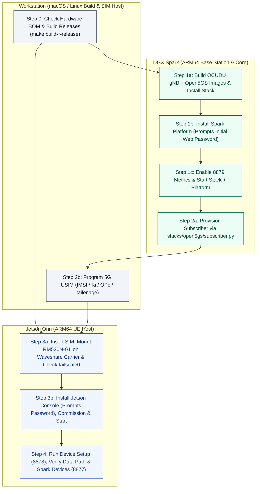

# End-to-End Quickstart

[简体中文](quickstart.zh-CN.md)

This guide provides the linear 0-to-1 path from bare hardware to a verified
5G SA data connection managed by **Spark Platform** and **Jetson Console**.
Every step lists where commands run, how credentials/images are produced, and
the exact pass criteria before advancing.

## Cross-Host Deployment Flow



## Before You Start

1. Verify all hardware, wiring and OS requirements in [Hardware & Topology](hardware-and-topology.md).
2. Choose how you obtain application release archives:
   - **Building from source** (run on your macOS or Linux workstation with Python `3.10–3.12` and Node.js `22`):
     ```sh
     make install-dev BOOTSTRAP_PYTHON=python3.12
     make check
     make build-spark-release RELEASE_OUT=/tmp/aoc-spark-release
     make build-jetson-release RELEASE_OUT=/tmp/aoc-jetson-release
     ```
     This produces offline ARM64 archives under `/tmp/aoc-*-release/` (`agentic-ocudu-spark-<version>-linux-arm64.tar.gz` and `agentic-ocudu-jetson-<version>-linux-arm64.tar.gz`).
   - **Installing from pre-built release archives**: transfer the verified `.tar.gz` and `.sha256` files directly to Spark and Jetson.
3. Create an access-restricted directory outside Git (`chmod 0700`) for SIM keys, candidate core bundles and backups.

> [!IMPORTANT]
> **Management network requirement on Jetson**: `Jetson Console` (`0.6.2`)
> validates both an independent **Wi-Fi IPv4 fallback gateway** and an active
> **`tailscale0` route** reaching Spark's management IP before allowing
> operational writes (`management_protected = true`). Connect both hosts to your
> Tailscale network and note Spark's Tailscale IPv4 before running `commission`.

---

## Step 1 — Build & Start Spark 5G Stack and Spark Platform

Run on **DGX Spark** (ARM64 Ubuntu 24.04):

1. **Build OCUDU and Open5GS runtime images**:
   - **OCUDU radio & B210 probe**: build the pinned gNB binary (`stacks/ocudu/scripts/build.py`) and `probe-b210` per [Spark stack deployment](../deploy/spark/stack/README.md).
   - **Open5GS images (`pull_policy: never`)**: follow [Open5GS ARM64 build & verification](../stacks/open5gs/build/README.md) to build `aoc-open5gs-validation`, then build the two lightweight production derivatives from `stacks/open5gs/build/`:
     ```sh
     docker build -f stacks/open5gs/build/Dockerfile.n6 -t aoc-open5gs-n6:local .
     docker build -f stacks/open5gs/build/Dockerfile.connectivity -t aoc-open5gs-connectivity:local .
     ```
     Ensure the local image IDs/tags match `stacks/open5gs/artifacts.lock.json` (or update the lock entries if rebuilding locally from source), then follow [Spark stack deployment](../deploy/spark/stack/README.md) to render (`--database-auth --n6`), provision (`provision.py`), stage, verify and install `/usr/local/bin/aoc-v2ctl`.
2. **Install Spark Platform (`0.2.1`)**:
   Transfer and extract the Spark release archive on Spark, verify it, and run the installer (on first install it prompts you to set a Web Console password of at least 12 characters, stored hashed in `/etc/aoc-monitor/auth.json`):
   ```sh
   python3 -I -B install.py verify --path .
   python3 -I -B install.py check-host --path .
   sudo python3 -I -B install.py install --path .
   ```
3. **Enable guarded OCUDU JSON metrics (`127.0.0.1:8879`)**:
   Run `sudo python3 scripts/spark/enable_radio_json_metrics.py` from your checkout so gNB telemetry binds to `127.0.0.1:8879` behind `aoc-v2-metrics-guard.service` (leaving `8000–8002` free).
4. **Start the 5G stack and Spark Platform**:
   ```sh
   sudo aoc-v2ctl start
   sudo systemctl start aoc-control.service aoc-observe.service aoc-monitor-web.service
   sudo aoc-v2ctl status
   curl -fsS http://127.0.0.1:8877/api/v1/health
   ```
   *(Optional later step)*: If you want passwordless SSH-user shortcuts (`~/aoc-ops/spark/start.sh`), install `/usr/local/sbin/aoc-maintain` via [Maintenance helper](../deploy/maintenance/README.md).

**Step 1 Pass Criteria**:
- All 12 `aoc-v2-open5gs` containers are healthy.
- `aoc-v2-radio.service` and `aoc-v2-cpu-latency.service` are active, and `aoc-v2ctl status` confirms N2 NG Setup succeeded.
- `http://127.0.0.1:8877/api/v1/health` returns OK.

---

## Step 2 — Provision Open5GS Subscriber & Program 5G USIM

1. **Review the network contract**: [UE Access Policy](ue-access-policy.md) (`PLMN 460/03`, `DNN oai`, `SST 1`, `5QI 9`, IPv4 pool `10.0.0.0/24`).
2. **Register an independent subscriber on Spark**:
   Use `stacks/open5gs/subscriber.py` with a unique `IMSI`, `Ki`, and `OPc` (`sqn=0`, single IPv4 PDU, `dnn=oai`, `sst=1`, `five_qi=9`). Never share credentials across multiple UEs.
3. **Program your 5G USIM on your workstation**:
   - Any standard **Milenage-capable programmable 5G USIM** (for example, Osmocom `pySim`-supported cards such as sysmoISIM) works as long as `IMSI`, `Ki`, `OPc`, and Milenage match the Open5GS subscriber record.
   - If you are using **TB01 blank cards**, follow the verified APDU/selector contract in [SIM Provisioning & TB01 Reference](sim-programming-tb01.md) (PC/SC `T=0`, **Milenage selector `00`**, readback + local AUTS verification).

**Step 2 Pass Criteria**:
- Open5GS lists the new active subscriber without altering existing subscribers.
- Card IMSI readback and Milenage verification match your private subscriber file (stored off-repo under `0700`/`0600`).

---

## Step 3 — Deploy Jetson Console & Connect UE

Run on **Jetson Orin** (ARM64 Ubuntu 22.04):

1. **Assemble hardware & verify OS prerequisites**:
   Mount the **Quectel RM520N-GL** and insert the programmed Nano-SIM into the **[Waveshare SIM8262E-M2 5G for Jetson Orin](https://www.waveshare.net/shop/SIM8262E-M2-5G-for-Jetson-Orin.htm)** board, connect all four 5G antennas, plug into Jetson USB 3.0, stop/disable `ModemManager`, verify Wi-Fi fallback gateway (external defaults strictly above metric `10`), and confirm `tailscale0` reaches Spark.
2. **Install, commission and start Jetson Console (`0.6.2`)**:
   Extract the Jetson release archive and run (fresh install interactively prompts for your Jetson Console password):
   ```sh
   python3 -I -B deploy/manage.py verify
   python3 -I -B deploy/manage.py preflight
   sudo bash deploy/install-jetson.sh
   sudo /usr/bin/python3 -I -B /opt/agentic-ocudu/jetson/current/deploy/manage.py stop
   sudo /usr/bin/python3 -I -B /opt/agentic-ocudu/jetson/current/deploy/manage.py commission \
     --spark-address 192.0.2.20 --wifi-interface auto
   sudo /usr/bin/python3 -I -B /opt/agentic-ocudu/jetson/current/deploy/manage.py start
   ```
   *(Replace `192.0.2.20` with Spark's actual Tailscale/management IP.)*
3. **Open Jetson Console via SSH tunnel & run Device Setup**:
   ```sh
   ssh -L 8878:127.0.0.1:8878 <user>@<jetson-host>
   ```
   Open `http://127.0.0.1:8878`, sign in with the password set during installation, go to **Device Setup**, review the preview, and run setup.

**Step 3 Pass Criteria**:
- `curl -fsS http://127.0.0.1:8878/api/v1/health` returns OK.
- **Overview** shows `SIM` ready, `NR SA` registered on `460/03`, active IPv4 PDU in `10.0.0.0/24`, `management_protected = true`, and a verified data path.

---

## Step 4 — End-to-End Verification & Optional Upgrades

1. **Inspect Spark Platform over SSH tunnel**:
   ```sh
   ssh -L 8877:127.0.0.1:8877 <user>@<spark-host>
   ```
   Open `http://127.0.0.1:8877` and confirm **Overview**, **gNB**, **Core Network**, and **Devices** display live `127.0.0.1:8879` telemetry, the attached UE context, active PDU session, and fresh N3/N6/bridge counters.
2. **Verify dual-path failover routing on Jetson**:
   Confirm cellular traffic becomes the preferred IPv4 default (metric `10`) after two clean probe cycles while Wi-Fi management (`metric 5` fallback + `tailscale0` SSH access) stays reachable.
3. **(Optional) Passwordless shortcuts & cold-boot auto-connect**:
   - Configure `/usr/local/sbin/aoc-maintain` via [Maintenance helper](../deploy/maintenance/README.md) to enable `~/aoc-ops/{spark,jetson}/start.sh`.
   - Configure unattended cold-boot attachment via **Opt-in boot coordination** in [Jetson Setup](setup-ue-jetson.md), then verify after a real cold reboot.

## Next Steps

- **Web consoles & daily ops**: [Spark Operations](spark-operations.md) and [Jetson Operations](jetson-operations.md)
- **Troubleshooting**: [Spark Troubleshooting](troubleshooting-bs-spark.md) and [Jetson Troubleshooting](troubleshooting-ue-jetson.md)
- **DIY AI development**: [DIY AI Customization](ai-customization.md)
