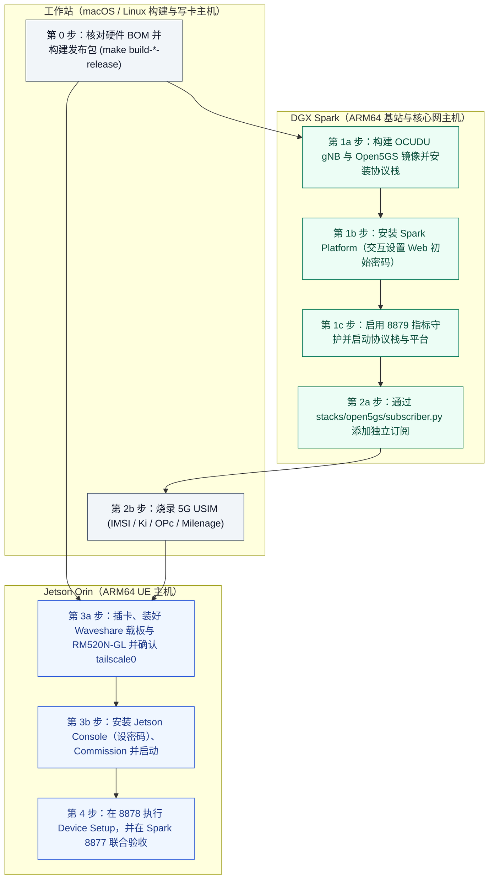

# 端到端快速搭建指南

[English](quickstart.md)

本指南提供从零硬件到端到端 5G SA 数据通路验收的线性主线路径，明确标出每一步的
**执行主机**、**镜像与密码生成方式**以及**通过标准**。

## 跨主机部署流程总览



## 准备阶段

1. 按[硬件清单、拓扑结构与前置条件](hardware-and-topology.zh-CN.md)完成物理接线与操作系统检查。
2. 准备应用发布包（二选一）：
   - **从源码构建**（在具备 Python `3.10–3.12` 与 Node.js `22` 的 macOS 或 Linux 工作站执行）：
     ```sh
     make install-dev BOOTSTRAP_PYTHON=python3.12
     make check
     make build-spark-release RELEASE_OUT=/tmp/aoc-spark-release
     make build-jetson-release RELEASE_OUT=/tmp/aoc-jetson-release
     ```
     产物位于 `/tmp/aoc-*-release/`（`agentic-ocudu-spark-<version>-linux-arm64.tar.gz` 与 `agentic-ocudu-jetson-<version>-linux-arm64.tar.gz`）。
   - **使用已构建的发布包**：直接将校验好的 `.tar.gz` 与 `.sha256` 传送到 Spark 和 Jetson。
3. 在 Git 之外创建受限目录（`chmod 0700`）保存 SIM 密钥、站点核心网包和备份。

> [!IMPORTANT]
> **Jetson 管理网络前提**：`Jetson Console`（`0.6.2`）在执行写入前会校验
> **独立 Wi-Fi IPv4 回退网关** 与到达 Spark 管理地址的 **`tailscale0` 路由**
> （`management_protected = true`）。运行 `commission` 前请确保两台主机均已连入
> Tailscale，并记录 Spark 的 Tailscale IPv4 地址。

---

## 第 1 步 — 构建并拉起 Spark 5G 栈与 Spark Platform

在 **DGX Spark**（ARM64 Ubuntu 24.04）上执行：

1. **构建并安装 OCUDU + Open5GS 协议栈**：
   - **OCUDU 无线栈与 B210 探针**：按[独立协议栈包指南](../deploy/spark/stack/README.zh-CN.md)编译固定版本 `gnb` 与 `probe-b210`。
   - **Open5GS 运行时镜像（`pull_policy: never`）**：按 [Open5GS ARM64 构建与验证](../stacks/open5gs/build/README.md)构建基础镜像 `aoc-open5gs-validation`，再在 `stacks/open5gs/build/` 衍生构建两个轻量化镜像：
     ```sh
     docker build -f stacks/open5gs/build/Dockerfile.n6 -t aoc-open5gs-n6:local .
     docker build -f stacks/open5gs/build/Dockerfile.connectivity -t aoc-open5gs-connectivity:local .
     ```
     确认本机镜像 ID/标签与 `stacks/open5gs/artifacts.lock.json` 一致（本地自建镜像需同步校验/更新本地锁信息），随后按[独立协议栈包指南](../deploy/spark/stack/README.zh-CN.md)完成渲染（`--database-auth --n6`）、MongoDB 初始化（`provision.py`）、打包校验与安装（生成 `/usr/local/bin/aoc-v2ctl`）。
2. **安装 Spark Platform（`0.2.1`）**：
   上传并解压 Spark 发布包（首次安装会交互提示设置不少于 12 位的 Web 控制台密码，并加密写入 `/etc/aoc-monitor/auth.json`）：
   ```sh
   python3 -I -B install.py verify --path .
   python3 -I -B install.py check-host --path .
   sudo python3 -I -B install.py install --path .
   ```
3. **开启受守护的 OCUDU JSON 指标（`127.0.0.1:8879`）**：
   在仓库目录运行 `sudo python3 scripts/spark/enable_radio_json_metrics.py`，安装 `aoc-v2-metrics-guard.service` 并启用 `127.0.0.1:8879`（将 `8000–8002` 留空）。
4. **启动协议栈与监测平台**：
   ```sh
   sudo aoc-v2ctl start
   sudo systemctl start aoc-control.service aoc-observe.service aoc-monitor-web.service
   sudo aoc-v2ctl status
   curl -fsS http://127.0.0.1:8877/api/v1/health
   ```
   *（可选进阶）*：若需要 SSH 用户免密快捷脚本（`~/aoc-ops/spark/start.sh`），后续可按[维护助手指南](../deploy/maintenance/README.zh-CN.md)配置 `/usr/local/sbin/aoc-maintain`。

**第 1 步通过标准**：
- `aoc-v2-open5gs` 全部 12 个容器处于健康状态；
- `aoc-v2-radio.service` 与 `aoc-v2-cpu-latency.service` 处于 `active`，且 `aoc-v2ctl status` 确认 N2 NG Setup 成功；
- `http://127.0.0.1:8877/api/v1/health` 返回正常。

---

## 第 2 步 — 在 Open5GS 开户并烧录 5G USIM

1. **核对实验室契约**：参见[UE 接入与实验室策略](ue-access-policy.zh-CN.md)（`PLMN 460/03`、`DNN oai`、`SST 1`、`5QI 9`、IPv4 地址池 `10.0.0.0/24`）。
2. **在 Spark 上添加独立 Open5GS 订阅**：
   调用 `stacks/open5gs/subscriber.py` 写入一组独立的 `IMSI`、`Ki` 与 `OPc`（`sqn=0`、单 IPv4 PDU、`dnn=oai`、`sst=1`、`five_qi=9`）。禁止多台设备共用同一身份。
3. **在工作站烧录 5G USIM 卡**：
   - 任何支持标准 **5G Milenage 的可编程 USIM 白卡**（例如 Osmocom `pySim` 兼容白卡，如 sysmoISIM）只要写入与 Open5GS 一致的 `IMSI`、`Ki`、`OPc` 与算法即可接入。
   - 若使用 **TB01 空白卡**，请按[SIM 开户与 TB01 参考](sim-programming-tb01.zh-CN.md)中经过核验的协议要点烧录（PC/SC 显式 `T=0`、**Milenage 选择值 `00`**、Imsi 读回与本地 AUTS 校验）。

**第 2 步通过标准**：
- Open5GS 核心网成功新增独立订阅且未影响原有订阅；
- 卡内 IMSI 读回与 Milenage 校验一致，私密资料以 `0700`/`0600` 权限保存在 Git 之外。

---

## 第 3 步 — 部署 Jetson Console 并接入 UE

在 **Jetson Orin**（ARM64 Ubuntu 22.04）上执行：

1. **装卡装配并检查 OS 与网络条件**：
   将 **Quectel RM520N-GL** 与已烧录的 Nano-SIM 装入 **[Waveshare SIM8262E-M2 5G for Jetson Orin](https://www.waveshare.net/shop/SIM8262E-M2-5G-for-Jetson-Orin.htm)** 载板，接好 4 根 5G 天线并连入 Jetson USB 3.0；停用并禁用 `ModemManager`，确认 Wi-Fi 管理回退网关可用（外部默认路由 metric 严格大于 `10`），且 `tailscale0` 可达 Spark。
2. **安装、初始化并启动 Jetson Console（`0.6.2`）**：
   解压 Jetson 发布包后执行（首次安装会交互设置 Jetson Console 密码）：
   ```sh
   python3 -I -B deploy/manage.py verify
   python3 -I -B deploy/manage.py preflight
   sudo bash deploy/install-jetson.sh
   sudo /usr/bin/python3 -I -B /opt/agentic-ocudu/jetson/current/deploy/manage.py stop
   sudo /usr/bin/python3 -I -B /opt/agentic-ocudu/jetson/current/deploy/manage.py commission \
     --spark-address 192.0.2.20 --wifi-interface auto
   sudo /usr/bin/python3 -I -B /opt/agentic-ocudu/jetson/current/deploy/manage.py start
   ```
   *（请将示例地址 `192.0.2.20` 替换为 Spark 实际的 Tailscale/管理 IP。）*
3. **通过 SSH 隧道打开 Jetson Console 并执行 Device Setup**：
   ```sh
   ssh -L 8878:127.0.0.1:8878 <user>@<jetson-host>
   ```
   浏览器打开 `http://127.0.0.1:8878` 登录，进入 **Device Setup** 核对变更预览并执行配置流程。

**第 3 步通过标准**：
- `curl -fsS http://127.0.0.1:8878/api/v1/health` 返回正常；
- **Overview** 显示 SIM 就绪、`460/03` NR SA 注册成功、获得 `10.0.0.0/24` 活动 IPv4 PDU、`management_protected = true`，且数据面探测通过。

---

## 第 4 步 — 端到端联调验收与可选进阶配置

1. **通过 SSH 隧道查看 Spark Platform**：
   ```sh
   ssh -L 8877:127.0.0.1:8877 <user>@<spark-host>
   ```
   打开 `http://127.0.0.1:8877`，确认 **Overview**、**gNB**、**Core Network** 与 **Devices** 页面均可看到 `127.0.0.1:8879` 实时指标、在线 UE 上下文、PDU 会话以及新鲜的 N3/N6/网桥计数。
2. **核验 Jetson 双路径切换保护**：
   连续两次新鲜探测成功后，普通 IPv4 默认路由自动切至蜂窝优先（metric `10`），同时 Wi-Fi 管理链路（metric `5` 回退与 `tailscale0` SSH 通路）保持在线。
3. **（可选）配置免密快捷运维与冷重启开机自连**：
   - 按[维护助手指南](../deploy/maintenance/README.zh-CN.md)配置 `/usr/local/sbin/aoc-maintain` 以启用 `~/aoc-ops/{spark,jetson}/start.sh`。
   - 按[Jetson Console 安装](setup-ue-jetson.zh-CN.md)中的“可选的开机协调”部署 `boot_connect.py` 与 `aoc-v2-jetson-boot.service`，并通过真实冷重启验收。

## 后续阅读

- **平台控制台与日常运维**：[Spark 运维](spark-operations.zh-CN.md) 与 [Jetson 运维](jetson-operations.zh-CN.md)
- **故障诊断与恢复**：[Spark 故障排查](troubleshooting-bs-spark.zh-CN.md) 与 [Jetson 故障排查](troubleshooting-ue-jetson.zh-CN.md)
- **利用双端预留算力开发自定义 AI**：[双端 AI 定制指南](ai-customization.zh-CN.md)
