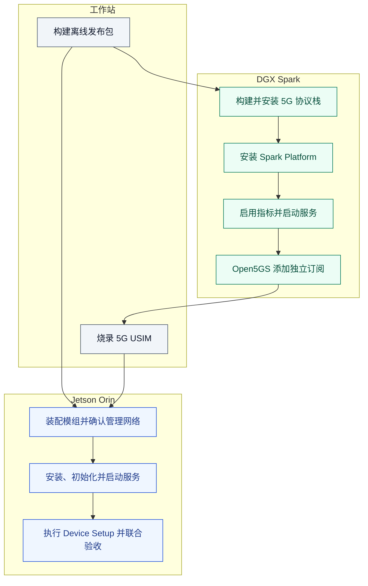

# 端到端快速搭建指南

[English](quickstart.md)

本指南引导您从零硬件完成端到端 5G SA 数据通路联调，并通过 **Spark Platform** 与
**Jetson Console** 完成双端纳管。

## 跨主机部署流程



## 前置准备

1. 按[硬件清单与拓扑](hardware-and-topology.zh-CN.md)完成物理接线。
2. 将 **DGX Spark** 与 **Jetson Orin** 连入同一个 Tailscale 网络，确保 Jetson
   拥有独立 Wi-Fi 管理回退网关的同时，能够通过 `tailscale0` 路由到达 Spark。
3. 在 macOS 或 Linux 工作站（Python `3.10–3.12`、Node.js `22`）生成离线 ARM64
   发布包，或使用已校验的发布归档：
   ```sh
   make install-dev BOOTSTRAP_PYTHON=python3.12
   make check
   make build-spark-release RELEASE_OUT=/tmp/aoc-spark-release
   make build-jetson-release RELEASE_OUT=/tmp/aoc-jetson-release
   ```
4. 在 Git 之外建立受限目录（`chmod 0700`）存放 SIM 密钥与站点核心网包。

---

## 第 1 步 — 部署 Spark 5G 协议栈与 Spark Platform

在 **DGX Spark** 上执行：

1. **构建 OCUDU 与 Open5GS 运行时镜像**：
   - 按[Spark 协议栈部署](../deploy/spark/stack/README.zh-CN.md)编译固定版本 `gnb` 与 `probe-b210`。
   - 按 [Open5GS ARM64 构建与验证](../stacks/open5gs/build/README.md)构建基础镜像后，构建两个轻量化衍生镜像：
     ```sh
     docker build -f stacks/open5gs/build/Dockerfile.n6 -t aoc-open5gs-n6:local .
     docker build -f stacks/open5gs/build/Dockerfile.connectivity -t aoc-open5gs-connectivity:local .
     ```
     核对镜像摘要与 `stacks/open5gs/artifacts.lock.json` 一致后，按[Spark 协议栈部署](../deploy/spark/stack/README.zh-CN.md)完成渲染（`--database-auth --n6`）、MongoDB 初始化及安装 `aoc-v2ctl`。
2. **安装 Spark Platform**：
   上传并解压 Spark 发布包并执行安装（首次安装会交互提示设置不少于 12 位的 Web 密码）：
   ```sh
   python3 -I -B install.py verify --path .
   python3 -I -B install.py check-host --path .
   sudo python3 -I -B install.py install --path .
   ```
3. **开启 OCUDU 指标并启动全部服务**：
   ```sh
   sudo python3 scripts/spark/enable_radio_json_metrics.py
   sudo aoc-v2ctl start
   sudo systemctl start aoc-control.service aoc-observe.service aoc-monitor-web.service
   ```
4. **验证基站与平台就绪**：
   `sudo aoc-v2ctl status` 显示全部 12 个核心网容器健康且 N2 NG Setup 成功，
   `curl -fsS http://127.0.0.1:8877/api/v1/health` 返回 `ok`。

---

## 第 2 步 — Open5GS 开户与 5G USIM 写卡

按[Open5GS 开户与 5G USIM 配卡指南](sim-provisioning.zh-CN.md)完成：

1. 在 **DGX Spark** 上使用 `stacks/open5gs/subscriber.py` 创建与[网络契约与射频基线](reference/network-and-rf-profile.zh-CN.md)一致的独立订阅。
2. 在工作站为任意支持 5G Milenage 的可编程 USIM 写入匹配的 `IMSI`、`Ki` 与 `OPc`，并完成读回与本地校验。

---

## 第 3 步 — 部署 Jetson Console 并接入 UE

在 **Jetson Orin** 上执行：

1. **确认硬件装配与网络就绪**：
   确认 **Quectel RM520N-GL** 与 Nano-SIM 已装入 Waveshare 载板、`ModemManager` 已禁用、Wi-Fi 管理回退可用且 `tailscale0` 可达 Spark。
2. **安装、初始化并启动 Jetson Console**：
   解压 Jetson 发布包（首次安装会交互提示设置控制台密码），并将下面 `192.0.2.20` 替换为 Spark 的实际 Tailscale IP：
   ```sh
   python3 -I -B deploy/manage.py verify
   python3 -I -B deploy/manage.py preflight
   sudo bash deploy/install-jetson.sh
   sudo /usr/bin/python3 -I -B /opt/agentic-ocudu/jetson/current/deploy/manage.py stop
   sudo /usr/bin/python3 -I -B /opt/agentic-ocudu/jetson/current/deploy/manage.py commission \
     --spark-address 192.0.2.20 --wifi-interface auto
   sudo /usr/bin/python3 -I -B /opt/agentic-ocudu/jetson/current/deploy/manage.py start
   ```
3. **验证服务健康并运行 Device Setup**：
   确认 `curl -fsS http://127.0.0.1:8878/api/v1/health` 返回 `ok`，通过 SSH 隧道
   （`ssh -L 8878:127.0.0.1:8878 <user>@<jetson-host>`）打开 `http://127.0.0.1:8878`，
   登录后在 **Device Setup** 页面触发入网配置。

---

## 第 4 步 — 端到端联调验收与可选进阶

1. **确认双端观测状态**：
   - **Jetson Overview（`127.0.0.1:8878`）**：显示 SIM 就绪、NR SA 注册成功、获得活动 IPv4 PDU、绑定数据探测通过、蜂窝出口生效且 `management_protected = true`。
   - **Spark Platform（`ssh -L 8877:127.0.0.1:8877 <user>@<spark-host>`）**：确认实时遥测、在线 UE 上下文、活动 PDU 会话及 N3/N6 网桥计数均正常更新。
2. **按需配置进阶功能**：
   - 启用免密快捷运维脚本（`~/aoc-ops/*/start.sh`）：参见[维护助手指南](../deploy/maintenance/README.zh-CN.md)。
   - 启用冷重启自动入网（`boot_connect.py`）：参见[Jetson 安装](setup-ue-jetson.zh-CN.md#可选的开机协调)。
   - 基于双端预留算力开展 AI 定制：参见[双端 AI 定制指南](ai-customization.zh-CN.md)。
