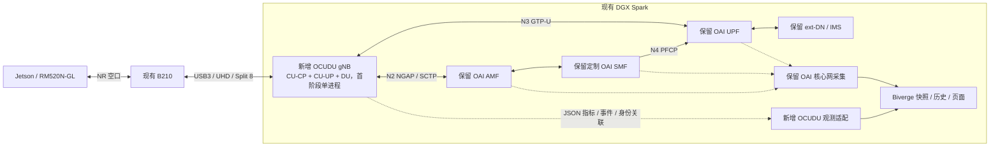

# OAI → OCUDU 迁移可行性调研

> 历史方案包含复用 Biverge 的路径；当前独立项目设计以仓库 README 和 docs/architecture.md 为准。

日期：2026-09-07。对象：Biverge（`oai-5g-operations-console`）及 DGX Spark `defaultuser@100.65.77.20`。

方法：复用[上一轮现场调研](project-research-2026-09-07.zh-CN.md)，补充远端只读检查，并下载 OCUDU 正式发布源码到本地临时目录审阅。没有在服务器安装、编译、启动 OCUDU，没有占用 B210、修改配置或停止任何 OAI 服务。

## 1. 判断

**替换 OAI gNB：技术上可行，值得进入受控验证。仅用 OCUDU 替换整套 OAI：不成立，因为 OCUDU 不提供 5GC。**

OCUDU 是 srsRAN Project 的后继项目，提供 CU-CP、CU-UP、DU 及所需基带软件。它可以接管当前 OAI gNB 的职责，但不能替代 AMF、SMF、UPF、认证/订阅库或 IMS。官方项目定义和迁移关系见 [OCUDU 文档](https://docs.ocudu.org/)及[迁移说明](https://docs.ocudu.org/migration/)。

| 方案 | 判断 | 工作范围 |
| --- | --- | --- |
| OCUDU gNB + 现有 OAI 5GC + B210 | **推荐首阶段；有明确实现路径，现场互通待测** | 新 RAN 配置/服务、ARM 构建、无线验证、Biverge RAN 采集适配 |
| OCUDU CU 与 DU 分进程 + 现有 OAI 5GC | **可行，建议在首阶段稳定后开展** | 额外 F1 配置、进程生命周期、多源监控；不必购买 7.2 O-RU |
| OCUDU + Open5GS，移除 OAI RAN 和核心网 | **可作为后续完整迁移方案，工作量明显扩大** | 订阅/SIM 对接、DNN/地址/QoS/IMS、核心网采集器全部重验 |
| 只安装 OCUDU，删除所有 OAI 服务 | **不可行** | 缺少核心网，UE 无法完成完整 5G SA 业务链路 |
| 保留 B210，同时改用 7.2x O-RAN 前传 | **当前硬件不能直接承担该角色** | B210 使用 USB/UHD；7.2x 需相应 O-RU、网络与同步方案 |

本结论是架构、源码和环境可行性判断，**不是已经完成编译/实机接入的验收结论**。更换协议栈也不保证消除上一轮发现的射频、USB IQ 或调度异常。

## 2. 推荐目标拓扑

初始运行形态可以是单个 `gnb`，功能上仍包含 CU/DU。后续再将 CU/DU 经 F1 分离，必要时进一步分离 CU-CP/CU-UP；**F1 的 CU/DU 拆分与 RU 的 Split 8/7.2 是两个独立维度**。OCUDU 官方 CU/DU 教程直接提供 B210/USB3 的 Split 8 方案：[CU/DU 分离教程](https://docs.ocudu.org/tutorials/cu_du_split/)。

## 3. 版本与硬件依据

### 3.1 固定正式版本

本次 `git ls-remote --tags` 确认正式标签 `release_26_04`，对应提交：

`050a2bb72e1d794cd60570d809987c1fcda3e54b`

已审阅此提交源码；不把 `main` 的功能直接算作正式发布版。官方首个发布为 26.04，按每年 4 月/10 月发布：[发布说明](https://docs.ocudu.org/releases/)。建议以该正式版本为首个可复现基线，若遇已知缺陷再按具体修复提交评估升级。

### 3.2 现场匹配度

| 项目 | 现场事实 | 判断/待验证项 |
| --- | --- | --- |
| 操作系统 | Ubuntu 24.04.4、ARM64 | 有 Linux/ARM 支持路径，不构成架构硬阻碍 |
| CPU | 20 核；`5-9,15-19` 最大频率 3.9 GHz；其余 2.808 GHz | 实时线程应按实际性能核和负载规划，不能把 20 核视为同等算力 |
| 内核 | `PREEMPT_DYNAMIC=y`、`PREEMPT_RT` 未启用、`HZ=1000` | 需要验证调度延迟；本次没有确认运行时动态抢占模式，不宣称已经满足低延迟验收 |
| B210 | `lsusb -t` 当前显示 5000M | 已满足 USB3 连接这一前提；持续吞吐和 IQ 时限仍需验证 |
| UHD | `4.8.0.HEAD-0-g308126a4`；头文件/库在 `/usr/local` | 应先尝试独立构建链接现有 UHD；不为迁移直接覆盖当前可工作的驱动 |
| 编译器 | GCC 13.3、CMake 3.28.3；未找到 Clang | 官方当前文档推荐 GCC 15.2+ 或 Clang 14+；26.04 根 CMake 未显式硬拒绝 GCC 13，实际能否构建须测试 |
| 依赖 | FFTW/SCTP/yaml-cpp 开发包存在；常规包/头文件路径未找到 mbedTLS、GTest | 不是现成的 OCUDU 构建环境；要由 CMake 正式检测补齐，不用单次包查询证明系统全局不存在 |
| 当前制式 | n78、30 kHz SCS、51 PRB、1Tx/1Rx | 与 OCUDU 随附 n78/20 MHz/30 kHz/Split 8 示例高度匹配 |

官方支持 ARM，26.04 CMake 有 `aarch64` 和 `-mcpu` 分支；随附配置 `configs/gnb_rf_b200_tdd_n78_20mhz.yml` 使用 UHD、23.04 Msps、20 MHz 和 30 kHz SCS。文档对 UHD 列出 4.6，另有官方教程输出使用 4.8，因此“必须降级 UHD”不是已有证据支持的结论。参考[安装说明](https://docs.ocudu.org/user_manual/installation/)与[固定版本 B200/B210 路径配置](https://gitlab.com/ocudu/ocudu/-/blob/050a2bb72e1d794cd60570d809987c1fcda3e54b/configs/gnb_rf_b200_tdd_n78_20mhz.yml)。

首阶段以 CPU 基带、单小区、20 MHz、1T1R 为目标。GB10 GPU 不应算作开箱即用的基带加速能力。2026 年 8 月已有 DeepSig 在 DGX Spark 上的 OCUDU CUDA 后端研究，但这是独立后端与初步性能结果，不能证明本次正式版本及其默认构建已包含对应部署能力：[研究原文](https://arxiv.org/abs/2608.04338)。

## 4. 保留 OAI 5GC 的互通可行性

协议边界正确：OCUDU 的 CU-CP 面向 AMF 的 N2/NGAP，CU-UP 面向 UPF 的 N3/GTP-U，与当前 OAI 核心网的职责匹配。

NI/Ettus 官方应用笔记已经描述 **srsRAN + OAI 5GC + B210** 的混合架构，包括同机部署和商用模组 UE。这比单纯“都符合标准所以一定能通”更有依据，但其软件版本并非本次组合，不能提升为现场认证：[Ettus AN-599](https://kb.ettus.com/5G_srsRAN_End-to-End_Reference_Architecture_with_USRP)。

OCUDU 当前官方教程常使用 Open5GS，集成目录也有其他核心网；本次未找到对 **OCUDU 26.04 + 现场定制 OAI 2.2.1 镜像 + RM520N-GL 固件** 的完整一致性证明。因此评估为“有较强可行依据，PDU/恢复/IMS 互通仍是验收门槛”。

| 配置项 | 当前现场 | 迁移处理 |
| --- | --- | --- |
| AMF | `192.168.70.132:38412` | 指向现有 AMF；不能沿用示例的 loopback 地址 |
| N2 本地地址 | `192.168.70.129` | 串行切换时可继续使用该可路由宿主机地址 |
| N3 本地/公告地址 | 当前 gNB 使用 `.129`，UPF 为 `.134` | 明确配置 OCUDU CU-UP 的 N3 socket；防止公布 loopback 或错误网卡地址 |
| PLMN / TAC / slice | `46003` / `1` / SST `1` | 同时对齐 OCUDU TA、cell、AMF 和订阅；SD 应按实际核心网读取确认 |
| PCI / NR band | `666` / n78 | 可保留作为初始兼容参数 |
| SSB / 频点 | OAI SSB ARFCN `643392`、Point A `642780` | OCUDU `dl_arfcn` 与 SSB ARFCN 语义不同；核对其生成的 SSB，再同步 Jetson 锁频/验收条件，不能直接机械赋值 |
| 小区身份 | OAI 独立 gNB ID 和 NR cell ID | 检查 OCUDU gNB ID 位长与 cell identity 组合规则，不机械复制两个整数 |
| TDD | 当前 7 个完整 DL slot、2 个完整 UL slot，特殊 slot 为 6 DL/4 UL symbol | 转换周期编码、slot/symbol 单位，验证保护间隔及收发时限；首阶段保持相近空口条件便于比较 |
| RF 功率 | OAI attenuation=0，另有最大增益设置 | OCUDU 使用 tx_gain/rx_gain 等参数；attenuation=0 不等于 gain=0，也不等于示例 gain=80 |
| 数据 DNN | `oai`，PDU `10.0.0.0/24`，5QI=9 | 保留现有订阅与 UE APN，减少同时变化的变量 |
| IMS DNN | `ims`，`10.0.9.0/24`，5QI=5 | 验证多 PDU/QoS，保留 IMS 系统；26.04 默认 CU-CP QoS 和 `configs/qos.yml` 含 5QI=5，不等于通话已验证 |

RM520N-GL 没有在本次查到的官方 COTS 清单中精确列出；清单包含其他 Quectel 模组和多种 n78 UE。这是固件/接入待测项，不是“不兼容”的证明：[COTS UE 清单](https://docs.ocudu.org/knowledge_base/cots_ues/)。

OAI 的 RRC 补丁不能应用到 OCUDU。保留核心网时，AMF/SMF 的定制镜像和补丁继续有效，但须重新验证跨厂商的上下文释放/重建路径，尤其不能假设其原来的恢复行为与 OCUDU 完全一致。

## 5. Biverge 适配是迁移的重要组成部分

### 可以复用的部分

保留 OAI 5GC 时，Docker 核心网清单/资源、AMF 日志、SMF 定制会话 API、UPF N3/N6 计数及 ext-DN 探测在机制上仍可复用。Jetson 串口、RNDIS、路由、测速也不依赖 gNB 品牌；需核对锁频/小区条件和实际恢复行为。

FastAPI、鉴权、SQLite、REST/SSE 及大部分 UI 可继续使用。Biverge 的观测契约应由适配器产生，不能把 OCUDU 文本日志伪装为 OAI 日志。

### 必须修改或重新定义的部分

| 模块 | 变化 |
| --- | --- |
| gNB 服务/启动/验收 | 新的可执行文件、YAML、日志位置、CPU/IRQ 分配；安装器和桌面启停入口要认识新服务 |
| 无线采集 | OAI `RRC_CONNECTED`、MAC/BLER/DTX 格式不可复用；改接 OCUDU JSON 和明确事件 |
| USRP 运行证据 | USB 枚举可复用，UHD/启动日志及 IQ 健康判断需适配 |
| 设备身份关联 | 需要 OCUDU 的 RNTI、CU/DU UE index、RAN/AMF NGAP ID 对应关系；禁止假设各层 UE index 相等 |
| connected 判定 | 现有规则强依赖 OAI `in-sync`；要定义 OCUDU 的新鲜无线证据、空闲/INACTIVE 状态和释放事件语义 |
| 历史数据 | 标记 RAN 实现/版本/指标语义，切换时清除临时关联；避免旧 RNTI 与新会话误合并 |
| 数据模型/页面 | 不能将不可获得的 OAI 指标填 0；用 unavailable，并区分重传率、误块率及计数周期 |

本地关键代码为 [gNB collector](/Users/zhaolin/Documents/GitHub/oai-5g-operations-console/apps/spark-platform/backend/oai_spark/collector/gnb.py:145)、[日志解析](/Users/zhaolin/Documents/GitHub/oai-5g-operations-console/apps/spark-platform/backend/oai_spark/collector/logs.py:51)、[连接判定](/Users/zhaolin/Documents/GitHub/oai-5g-operations-console/apps/spark-platform/backend/oai_spark/collector/__main__.py:63)、[身份关联](/Users/zhaolin/Documents/GitHub/oai-5g-operations-console/apps/spark-platform/backend/oai_spark/identity.py:10)。

### 源码检查发现的具体接入风险

1. **指标端口同时具备控制能力。** 26.04 的 WebSocket server 注册 `metrics_subscribe`，也无条件注册 `quit`；同一实现还可接入 SSB/RRM 控制命令。检查的服务代码没有看到鉴权步骤。建议仅 loopback 绑定，由最小权限遥测桥接进程订阅并发布规范快照，不将原始端口代理到浏览器或 Tailnet。现有 collector 禁止 AF_INET，直接添加 WebSocket 客户端会被 systemd 沙箱阻止；应明确新增桥接服务或修改权限设计。[固定版本 remote_server.cpp](https://gitlab.com/ocudu/ocudu/-/blob/050a2bb72e1d794cd60570d809987c1fcda3e54b/apps/services/remote_control/remote_server.cpp)
2. **吞吐单位要按发布源码转换。** 26.04 JSON 序列化把内部 `dl_brate_kbps/ul_brate_kbps` 乘以 1000 输出，因此对应 JSON 是 bit/s，转 Mbps 要除以 1e6。官网 Outputs 的字段说明出现 kbps；必须用真实样本和固定版本确认，不能据文档产生 1000 倍误差。[scheduler.cpp](https://gitlab.com/ocudu/ocudu/-/blob/050a2bb72e1d794cd60570d809987c1fcda3e54b/apps/helpers/metrics/json_generators/du_high/scheduler.cpp)
3. **公开 JSON 不足以直接完成现有身份闭环。** 该版本 scheduler JSON 有 UE index/PCI/RNTI；检查到的 CU-CP JSON 主要是 AMF connection 和 RRC/会话聚合计数，并未输出完整的逐 UE NGAP↔RNTI 关联。需要验证定向事件日志能否补足，或增加最小结构化关联输出；不能声称现有 metrics 天然替代全部 OAI 数据源。[cu_cp_json_helper.cpp](https://gitlab.com/ocudu/ocudu/-/blob/050a2bb72e1d794cd60570d809987c1fcda3e54b/apps/helpers/metrics/json_generators/cu_cp/cu_cp_json_helper.cpp)
4. **HARQ NOK 比例不能无说明地等同于原 OAI BLER。** 可按采样窗口的 `nok/(ok+nok)` 展示对应错误比例，但应明确层级/重传语义，分母为 0 时不伪造 0% 健康结果；OAI 的累计 DTX/错误量也不能用窗口计数直接替代。

这些适配主要在运维层，可以与 RAN 首次接入验证分开验收。仅“新 gNB 能发射”不表示原控制台仍能正确判断设备在线。

## 6. 实时性能与切换风险

- Spark 当前异构 CPU 的高频核集合为 `5-9,15-19`；原 OAI 将 IRQ 放到 19、gNB 放到 0-18，涉及大/小核混用。新线程布局应按 OCUDU worker 配置与 IRQ 实测设计；不能直接把原 affinity 字符串复制过去。[官方性能调优](https://docs.ocudu.org/tutorials/tuning/)
- 现有音视频/AI 服务共享机器资源。验证时记录并控制共机负载，先得到无外部高负载的基线，再测实际共存情况；不因初次出现 late/underflow 就直接归因 OCUDU。
- 同一 B210 不能让两个独立 gNB 同时占用。若复用 `.129:2152`，N3 端口也冲突；正式 RF 切换必有 UE 重新接入过程，不能承诺无中断替换。
- 只读阶段不运行 `uhd_usrp_probe`、radio benchmark 或 performance tuning 脚本，避免触碰当前设备/CPU 状态。本次仅使用 USB 枚举及版本查询。
- 上一轮发现的 ext-DN iperf3 监督脚本引号错误属于独立运维故障，换 RAN 不会自动解决。保留旧核心网时，需要在测速验收前单独处理。

## 7. 验证顺序与验收门槛

以下为后续建议，**本轮未执行**。先验证依赖最少的目标，再扩大服务范围。

| 阶段 | 动作 | 通过条件 |
| --- | --- | --- |
| 1. 独立构建 | 固定 tag，在隔离前缀/构建环境编译 ARM64 + UHD + Split 8；不覆盖系统 UHD/OAI | CMake 明确找到正确库；二进制及关键测试通过；记录编译器/库版本 |
| 2. 无 RF 验证 | 独立测试模式或 ZMQ；限制 CPU/内存，独立端口/命名空间 | 确认进程、配置解析、时序基本能力和指标格式；不把仿真通过当作 B210 通过 |
| 3. 维护窗口 RF 接入 | 停止旧 gNB 并阻止其自动重启抢占；启 OCUDU，保留核心网 | B210、NG Setup、UE 注册、`oai` PDU、双向 IP 数据全部通过 |
| 4. 会话与恢复 | 验证双 DNN、IMS PDU、断线/重连/释放、多个 UE | 无重复上下文、会话资源泄漏；IMS 通话作为独立验收项 |
| 5. 性能稳定性 | 与同条件 OAI 基线比较，分空闲与共机负载测试 | 建议至少 1 小时双向业务、20 次重连、随后 24 小时 soak；无进程崩溃及持续数据中断，吞吐/时延按预设目标验收 |
| 6. Biverge | 校验真实 metrics、设备关联、stale/离线、历史与权限 | 与实际 UE 状态一致，指标单位正确，原始控制端口不暴露给 Web |
| 7. 扩展 CU/DU | 需要时再分进程接入 F1 | 在前述验收基础上验证 F1 生命周期、多进程故障和关联 |

测试模式若要对齐现有 n78/TDD，不应直接拿 srsUE 的 FDD/15 kHz 限制方案充当等效测试。官方另有基于 OAI UE `2026.w25+` 与 ZMQ 的 TDD 教程；它使用 Open5GS，不能单独证明与现场 OAI 核心网互通。纯仿真需单独的测试订阅/隔离环境，不复用现网 SIM 上下文：[OAI UE 教程](https://docs.ocudu.org/tutorials/oaiue/)。

建议的回滚保留物是旧 gNB 二进制/配置/unit/环境和原有核心网。回滚顺序为退出 OCUDU、确认 B210/N3 释放、恢复旧服务和监控后端、等待 UE 重新注册；如果产生残留会话则按明确的 UE/会话恢复流程处理，不承诺仅切回进程就保留原连接。

## 8. 完全移除 OAI 的额外成本

若用户最终目标是服务器上不再运行任何 OAI，则需要将目标明确成 **OCUDU RAN + 新的 5GC（例如 Open5GS）**，而非“OCUDU 全栈”。

这会扩大至核心网订阅数据迁移、SIM 参数一致性、DNN/IP 池/路由/NAT、5QI、IMS 发现与业务，并需重写 Biverge 的 AMF/SMF 数据获取和 UPF 计数适配。OAI 定制 `/management/v1/pdu-sessions` 不是跨核心网通用接口，不能期待 Open5GS 提供相同响应。

因此推荐先完成 RAN 替换以验证 OCUDU 在这套硬件上的价值，再单独决定核心网迁移。构建接入、稳定性、监控适配是三个独立交付物；身份关联和弱信号恢复的验证结果将决定实际工作量，现阶段不提供未经实验支持的完成日期或性能提升百分比。

## 9. 调研覆盖与限制

已完成：正式标签核验与本地源码审阅、官方文档/厂商互通参考核查、远端 CPU/内核/UHD/USB/依赖只读查询、Biverge 改动面分析。

尚未完成：Spark 上 OCUDU 实际编译、B210 实时测试、与定制 OAI 5GC 的真实互通、RM520N-GL 固件级兼容性、认证快照和端到端性能验收。本次在 PATH、home/opt 顶层相关名称中未找到现成 OCUDU 运行安装，不能据此断言服务器所有目录均无副本。

**决策建议：批准进入“OCUDU 26.04 + 现有 OAI 5GC + B210”的隔离验证阶段；暂不删除 OAI，不做整栈替换，不把 GPU 加速或 CU/DU 分布式部署设为首个验收前提。**
