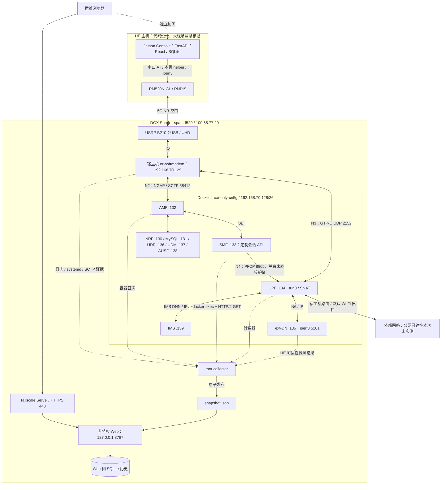

# Biverge 与 OAI：项目及 DGX Spark 实际部署调研

> 历史现场记录；当前独立项目设计以仓库 README 和 docs/architecture.md 为准。

调研日期：2026-09-07，现场采样约 11:54 至 12:01，Asia/Hong_Kong。

范围：用户确认的 `/Users/zhaolin/Documents/GitHub/oai-5g-operations-console`，以及 `defaultuser@100.65.77.20` 上与之协作的 OAI RAN/5GC。本文为内部现场记录，含部署路径与内网地址。未修改源项目代码、远端配置、服务或容器，未执行重启、安装、测速或恢复操作。

## 1. 核心结论

**Biverge 是 OAI 实验网的运维和可观测性平台；OAI 是承载真实 5G 接入、注册、会话及用户流量的通信系统。** 两者是运维层与通信层的协作关系，不是两套相互转发业务流量的通信协议栈。

- `oai-5g-operations-console` 的当前产品名为 **Biverge**，包含 Jetson UE Console 与 Spark BS Platform。前者管理本机模组和网络，后者观测 Spark 上的基站及核心网。
- Spark 当前部署由 **宿主机上的单体 OAI gNB + USB USRP B210 + Docker Compose 5GC + 宿主机上的 collector/Web** 构成。
- 两个控制台各自独立运行，没有发现 Jetson Console 调用 Spark Console 或通过 SSH 控制其 OAI 的运行路径。它们通过同一个 5G 网络形成业务协作。
- Spark collector 主动采集 OAI；OAI 没有反向调用 Biverge Web 的业务依赖。停止监控会丢失可观测性，OAI 通信不以监控 Web 在线为前提。
- Biverge 与 OAI 存在明确的部署耦合：本仓库维护 gNB/AMF 稳定性补丁、SMF 会话管理 API 和 IMS QoS 适配。
- 当前有两类现场异常：**无线链路退化**与 **ext-DN iperf3 监督服务持续崩溃**。平台健康端点正常不能证明 UE 业务健康。

OAI 上游分别提供 RAN 和核心网实现，参见 [OAI RAN](https://openairinterface.org/ran/) 与 [OAI Core Network](https://openairinterface.org/core-network/)。本文的具体路径、地址、版本和状态均以现场及本地代码为依据。

## 2. 项目定位与代码对应

| 对象 | 主要职责 | 主要实现/位置 | 不应混淆的边界 |
| --- | --- | --- | --- |
| Biverge Jetson UE Console | RM520N-GL AT 交互、注册/PDU 检查、RNDIS/路由、恢复、IMS PDU 恢复、iperf3 测试、历史 | `apps/jetson-console`；FastAPI、React、SQLite、串口及固定网络 helper | 负责 UE 本机；本次没有登录 Jetson 验证其实际部署 |
| Biverge Spark Platform | 主机/USRP/gNB/核心网监控、跨层设备关联、无线和流量指标、事件/历史 | `apps/spark-platform`；Python collector、FastAPI、React、SQLite | Web API 不提供 OAI 重启或配置修改 |
| OAI RAN | gNB 的 NR 接入及无线协议处理，经 UHD 驱动 B210 | Spark：`/home/defaultuser/openairinterface5g` | 当前为本地 L1/MAC/RRC 单体 gNB，并无已观测的独立 CU/DU 网络拆分 |
| OAI 5GC | AMF 注册/移动性，SMF 会话，UPF 转发；NRF/AUSF/UDM/UDR/MySQL 配套 | Spark：`/home/defaultuser/oai-only-cn5g` 的 Compose 栈 | 真实网络控制面/用户面，不属于 Biverge 的 Web 后端 |
| OAI 定制源代码 | AMF 上下文定时器保护、SMF 监控接口与状态一致性 | Spark：`/home/defaultuser/oai-cn5g-amf`、`/home/defaultuser/oai-cn5g-smf` | 源码目录与实际运行容器是构建产物关系 |

当前工作目录 `/Users/zhaolin/Documents/GitHub/Agentic-OCUDU` 在调研开始时仅含 `.git`，没有可分析的应用代码。本报告将调研产物放在此处；不把该目录名解释为已有的 Agentic CU/DU 实现。

### 本地与远端版本

| 项目 | 核验结果 |
| --- | --- |
| 本地 Biverge | HEAD `d680106`，2026-09-07 11:07:11 +08:00；提交说明为无效 BLER 隔离及监控进程韧性修复；工作树干净 |
| 平台版本 | 本地 README：Jetson `0.2.0`、Spark `0.1.31`；远端健康端点及已安装包均返回 Spark `0.1.31` |
| 运行目录 | `/opt/oai-spark-platform/backend`、`frontend`、`venv`、`tools`；并非直接运行 home 下的发布暂存目录 |
| 代码一致性 | 本地与 `/opt` 已安装的 `api.py`、`repository.py`、`contracts.py`、`collector/__main__.py`、`collector/docker.py`、`collector/gnb.py` 六个文件 SHA-256 全部一致。此项不等于对整个发布包逐文件验真 |
| 当前 gNB | `/home/defaultuser/openairinterface5g`，HEAD `0dab3bb6a1`，精确标签 `2026.w27`，有 RRC 本地修改 |
| 易混淆 gNB 仓库 | `/home/defaultuser/oai-only-openairinterface5g`，HEAD `b2bd486`；当前进程启动路径未引用它 |
| 当前核心网目录 | `/home/defaultuser/oai-only-cn5g`，HEAD `cf2a4ec`；Compose、网络配置等有本地修改，不能只用提交号复现现场 |
| AMF/SMF 源码 | 均为 `v2.2.1` 基线加本地补丁；AMF 镜像 `oai-amf:v2.2.1-context-guard.1`，SMF 镜像 `oai-smf:v2.2.1-session-api.2` |

## 3. 实际部署拓扑

说明：N4 的配置、SMF/UPF 容器及 UPF UDP 8805 监听已确认，但没有直接验证 PFCP association。图中 Jetson 为源码定义的目标 UE 侧部署，不表示已确认当前空口终端一定是该 Jetson。

### 宿主机与服务

现场主机为 Ubuntu `24.04.4 LTS`、Linux `6.17.0-1008-nvidia`、ARM64、20 个逻辑 CPU、约 121 GiB 可见内存，GPU 为 NVIDIA GB10。

| 实际服务 | 身份/运行位置 | 现场状态与依赖 |
| --- | --- | --- |
| `oai-cn5g.service` | `defaultuser`，工作目录 `~/oai-only-cn5g`，`docker compose up -d` | active/exited；这是 `Type=oneshot + RemainAfterExit` 的正常状态；依赖 Docker |
| `oai-gnb.service` | root，`/usr/local/sbin/oai-gnb-b210` 启动 `nr-softmodem` | active/running；Requires 核心网 unit，启动前等待 AMF healthy；当前启于 09:21:53 |
| `oai-spark-collector.service` | root，`python -m oai_spark.collector` | active/running；2026-09-06 21:45:55 起运行；After Docker/gNB，但不以 Requires/Wants 拉起 gNB |
| `oai-spark-web.service` | `oai-spark-platform`，Uvicorn/FastAPI | active/running；同上时间启动；Wants collector；仅监听 `127.0.0.1:8787` |
| Tailscale Serve | 反向代理 | Tailnet-only `https://spark-f529.tail5fe0ee.ts.net/` → `http://127.0.0.1:8787` |
| `oai-ext-dn-iperf3.service` | 宿主机监督脚本 → 容器内 iperf3 | activating/auto-restart，明确故障；详见第 7 节 |

gNB 使用 `gnb.sa.band78.fr151PRB.usrpb210.conf`，现场配置为 PLMN `460/03`、n78、PCI `666`、SSB ARFCN `643392`、上下行 51 PRB、1Tx/1Rx，TX/RX attenuation 均为 0。`MACRLCs` 为 `local_L1/local_RRC`，`L1s` 为 `local_mac`，`local_rf=yes`，支持当前单体部署判断。配置文件包含 rfsimulator 段不代表当前运行 RF 仿真；实际有 B210、UHD 启动证据。

启动日志显示 gNB CPU 集为 `0-18`、USB IRQ 固定到 CPU `19`，启用 `--continuous-tx`，`OAI_FORCE_RRC_SETUP_ON_REESTABLISHMENT=1`。这体现该部署对 CPU 调度和 USB IQ 链路的依赖，不能仅因宿主机有 GPU 就认定基带已采用 GPU 加速。

### 核心网容器

下列 10 个容器均位于 Compose project `oai-only-cn5g`，在采样时显示 running/healthy，已运行约 3 天。

| 容器 | 地址 | 镜像/职责 |
| --- | --- | --- |
| `oai-nrf` | `192.168.70.130` | OAI `v2.2.1`；网络功能注册发现 |
| `mysql` | `192.168.70.131` | `mysql:9.6`；持久化数据库 |
| `oai-amf` | `192.168.70.132` | 定制 `v2.2.1-context-guard.1`；注册与移动性 |
| `oai-smf` | `192.168.70.133` | 定制 `v2.2.1-session-api.2`；PDU 会话管理 |
| `oai-upf` | `192.168.70.134` | OAI `v2.2.1`；用户流量转发 |
| `oai-ext-dn` | `192.168.70.135` | `trf-gen-cn5g:latest`；外部数据网络和测速服务 |
| `oai-udr` | `192.168.70.136` | OAI `v2.2.1`；订阅数据仓库访问 |
| `oai-udm` | `192.168.70.137` | OAI `v2.2.1`；用户/订阅管理 |
| `oai-ausf` | `192.168.70.138` | OAI `v2.2.1`；认证 |
| `ims` | `192.168.70.139` | `ims:latest`；IMS 配套业务 |

Docker 网络名 `oai-cn5g-public-net`，宿主机 bridge `oai-cn5g` 地址为 `192.168.70.129/26`。名字中的 public-net 不意味着已公开发布到互联网；这里记录的是 Docker 内网。

AMF、SMF、UPF 均绑定挂载 `~/oai-only-cn5g/conf/config.yaml`。配置中存在 LMF 段，但当前运行容器清单没有 LMF，不能据此声称定位服务已部署。

## 4. 调用与依赖关系

| 调用方 → 被调用方 | 机制 | 取得的数据/执行的工作 |
| --- | --- | --- |
| 浏览器 → Spark Web | HTTP REST + SSE `/api/v1/stream`；登录 session cookie | 快照、组件/设备详情、历史指标、事件 |
| Spark Web → 快照及 SQLite | 本地文件读取、数据库读写 | 校验快照、时效性处理、设备身份历史关联、持久化和展示 |
| collector → 宿主机/gNB | systemd、进程/网络信息、USRP 信息、gNB 日志 | 主机指标、B210 状态、N2 SCTP、RNTI/NGAP 关系、BLER/goodput/DTX/PH |
| collector → Docker | `docker ps/stats/inspect/logs` | 按 Compose project 选择核心网、容器健康/资源、AMF 注册日志、SMF 事件 |
| collector → SMF | `docker exec oai-smf`，容器内 curl HTTP/2 prior knowledge | `GET http://<SMF-IP>:8080/management/v1/pdu-sessions`；返回 contexts/SUPI/sessions/DNN/IP/S-NSSAI/`up_cnx_state` |
| collector → UPF | `docker exec` 执行计数器读取及专用计数规则维护 | UDP 2152 N3 上下行字节计数；`tun0` N6 payload 计数 |
| collector → ext-DN → UE | 容器内 ICMP 探测 | 主 DNN `oai` 的 PDU IPv4 可达性，至少连续两次成功才确认 |
| Jetson Console → RM520N-GL/本机网络 | 串口白名单 AT、固定 sudo helper | 注册、APN/PDU、IMS PDU、RNDIS、路由和受控恢复 |
| Jetson Console → ext-DN | iperf3，默认目标 `192.168.70.135` | 经 UE 的 5G 用户面执行上下行测速 |
| 操作员 → `deploy/spark` → OAI | 明确的安装、构建、配置和服务操作脚本 | 应用补丁、构建产物、维护切换、备份、验证、回滚 |

**当前 AMF 监控证据来自日志，而 SMF 会话证据来自定制 HTTP API。** 不应将两者统一描述成直接读取标准 OAI 管理 API，也不应把该 HTTP API 当成标准 3GPP SBI 接口。

collector unit 限制直接 IP 网络访问，允许 AF_UNIX/AF_NETLINK；其容器内 HTTP/ICMP 通过 Docker daemon 的 `exec` 完成。Web 只能访问 localhost，无法直接连核心网容器；因此浏览器请求不是到 Docker/SMF 的透明代理。

### “只读”的准确含义

Web 的 OAI 业务接口是只读的，登录/退出与监控历史仍会写本机数据库。collector 也并非完全被动：它会在 UPF `mangle` 表创建 `OAI_SPARK_N3_UL/DL` 空计数链及跳转规则，退出清理；还会从 ext-DN 发送 ICMP。

现场已经确认这些规则存在。它们用于记账，不含主动 ACCEPT/DROP/NAT 策略变更，但仍属于网络状态修改和探测流量。未来新增自动化应明确区分监控采集、测量设施维护和 OAI 控制操作。

## 5. 三条数据流

### 5.1 5G 控制面

UE 注册/会话信令 → 空口/B210 → gNB → **N2 NGAP/SCTP** → AMF；AMF 与认证/订阅组件协同，再与 SMF 进行会话控制；SMF 经 **N4 PFCP** 配置 UPF。AMF/SMF 不承担 UE 普通业务 IP 数据包的逐包转发。

现场 `ss -A sctp` 确认 `192.168.70.129:42720` 到 `192.168.70.132:38412` 为 ESTAB。临时源端口会变化。UPF 在 `.134:8805` 监听，N4 association 的实际健康状态仍未直接取证。

### 5.2 用户面

上行：Jetson 应用 → RNDIS/模组 → 5G NR → B210/gNB → **N3 GTP-U/UDP 2152** → UPF 解封装/`tun0` → **N6 IP** → ext-DN、IMS 或其他外部目的地。下行沿相反方向返回。

- 主 DNN `oai` 使用 `10.0.0.0/24`，UPF `tun0` 地址 `10.0.0.1/24`。
- 其他实际配置 DNN：`openairinterface` → `10.0.1.0/24`，`ctnet` → `10.0.2.0/24`，`ims` → `10.0.9.0/24`，`default` → `10.0.255.0/24`；多个 DNN 还配置 IPv6。
- UPF 有这些子网的路由与向 `192.168.70.134` 的 SNAT 规则；ext-DN 有 `10.0.0.0/16 via 192.168.70.134` 的返回路由。
- UPF/ext-DN 默认网关为宿主机 `.129`；宿主机默认路由经 Wi-Fi `10.68.0.1`，本机地址 `10.68.138.186`。宿主机出口 NAT 规则及真实 UE 公网访问本次没有完整验证。
- Jetson 代码默认 RNDIS 网关 `192.168.225.1`。这是模组侧 USB 网络地址，不能与 PDU 地址或 UPF 地址混用。

流量计量必须分层：gNB MAC goodput 是无线层指标；N3 是包含隧道封装的链路计数；N6 是 `tun0` payload 计数；CN bridge 是共享诊断指标。四者不能简单求和，也不保证数值相等。

### 5.3 遥测与历史

gNB/AMF 日志 + SMF 会话 API + Docker/主机指标 + UPF 计数 + ext-DN 探测 → collector 合并观察 → schema v3 快照 → 原子写入 `snapshot.json` → Web repository 校验与时效性处理 → SQLite 历史 → REST/SSE → React 页面。

身份关联使用 SUPI/IMSI 作为稳定身份，RNTI、RAN UE NGAP ID、AMF UE NGAP ID 为跨层临时关联键。要判定 connected，代码要求 **AMF registered + 匹配无线上下文 in-sync + 主 DNN `oai` PDU 地址 + 两次成功可达性探测**；仅存在 SMF 会话、IMS 会话、RNTI 或历史记录均不足。

代码默认采集周期 2 秒、快照过期阈值 6 秒、历史指标持久化周期 15 秒；指标保留 7 天、事件/设备历史 30 天。默认快照路径 `/run/oai-spark-platform/snapshot.json`，数据库 `/var/lib/oai-spark-platform/platform.db`。**本次无权读取 root 保护的实际 TOML，以上可配置值属于代码默认值，不能冒充已核实的现场覆盖值。**

## 6. OAI 定制与发布耦合

| 适配 | 目的 | 现场证据 |
| --- | --- | --- |
| gNB RRC/PDU race 补丁 | 重建与 PDU 操作竞争时保留事务动作，避免断言及响应/清理丢失 | 对现场源码执行只读 `git apply --reverse --check` 通过 |
| gNB clean reestablishment fallback | 故障后可退回干净 RRC setup | 反向检查通过；启动日志显示开关为 1 |
| AMF stale-context timer guard | 阻止旧上下文定时器错误作用于当前 UE | 反向检查通过；定制镜像运行 |
| SMF session management API | 提供 collector 所需的结构化会话快照 | 实际 HTTP/2 GET 成功，返回 contexts 和 `up_cnx_state`；源码中存在接口及序列化实现 |
| SMF session state consistency | 修正激活状态更新，并明确输出 activated/activating/deactivated | 反向检查通过，现场源码含状态回写 |
| IMS QoS | IMS DNN 的 5QI 为 5 | 实际配置解析得到 IMS 5QI=5；其他列出的 DNN 为 9 |

SMF 初始 API 补丁之后又叠加了 state-consistency 补丁，直接对初始补丁逐个做反向检查会因同一区域已被后续补丁修改而失败。此次结合最终源码 diff、后续补丁反向检查和实际 API 响应确认，不把这一检查结果误判为“未安装 API”。源码补丁存在也不单独证明运行二进制精确包含所有修改；gNB 的完整构建溯源未验证。

平台自身升级与 OAI 适配升级具有不同维护影响。平台专用安装器不重启 OAI；完整安装器面向已有核心网应用补丁，构建后经维护确认切换 AMF/SMF，按原状态处理 gNB，并保留回滚资料。它不是一个从零创建核心网订阅和 SIM 数据的工具。

## 7. 现场排查发现

### A. 当前无线业务存在明确退化证据

12:00:44 左右，当前 gNB 日志尾部约 128 KiB 内出现 **16 条 `Detected UL Failure`、613 条 RLC max RETX 相关记录**，末尾还出现已有 PDU session 导致新资源建立请求被拒绝，并有密集 U/L 标记。

该片段没有完整的 `NR_MAC Frame.Slot` 报告，解析不到无线指标不能等同于“当前没有 UE”。这些数量是固定字节窗口内的记录数，不是每秒失败率，也不是不同终端数量。根因可能涉及射频、IQ 传输/调度、重建和上下文状态，需要对齐时间线进一步确认，不能仅凭此断定某个硬件或补丁失效。

同期 gNB 进程仍在，N2 ESTAB，10 个核心网容器 healthy。这个现场例子直接说明三个层次必须分开：进程存活、控制面连接、用户无线业务可用。

### B. ext-DN 测速监督脚本确定性崩溃

`oai-ext-dn-iperf3.service` 的 `NRestarts` 在 11:56 左右超过 **80,826** 并继续增长；journal 重复报 `/usr/local/libexec/oai-ext-dn-iperf3-server: line 14: $2: unbound variable`。

原因是 `stop_iperf3()` 用单引号包裹容器 shell 程序，内部 `awk '$2 == "iperf3" {print $1}'` 又使用未正确转义的单引号，导致外层 Bash 提前展开 `$2`，触发 `set -u`。错误发生于构造命令时，容器内即使存在 `pkill` 也无法避开。**本地对应脚本也有相同问题。**

同时 `docker exec oai-ext-dn ss ...` 确认容器内 `*:5201` 仍在监听，进程来自容器启动命令的 `iperf3 -s -D`。因此是监督机制故障，不能写成“所有测速服务都不可用”；现有 daemon 的可用性也不能代替可靠监督。宿主机另有独立 iperf3 5201 listener，不应与 ext-DN 容器的 listener 混淆。

### C. 监控正常不代表通信正常

两次健康接口检查均返回 `{"status":"ok","version":"0.1.31","collector":"available"}`，未认证 `/api/v1/snapshot` 返回 401。该 health 实现报告 API/collector 可用性，不返回网络整体业务健康结论。

SMF 实际 API 采样包含 3 个 contexts、6 个 sessions：`oai:activated` 1、`ims:activated` 1、`oai:deactivated` 2、`ims:deactivated` 1，另有空 DNN 的 deactivated 记录 1。这里只发布匿名聚合。**3 个 contexts 不是 3 台在线 UE，activated 会话也不直接等于端到端可达。**

### D. 状态和自启动需分别理解

collector 历史 `NRestarts=263`、gNB `NRestarts=7`；多次采样未继续增长，不能据累计计数认定它们当前仍在重启。Web `NRestarts=0`，collector/Web 的当前运行起点均为 9 月 6 日 21:45:55。

journal 进一步确认 gNB 于 9 月 7 日 09:21:23 发生 `code=dumped, status=6/ABRT`，09:21:38 首次恢复尝试退出，09:21:53 再次启动后进入本次观察到的运行状态。历史崩溃是已证实事实，具体断言/堆栈根因尚未检查；不能将其与当前无线退化未经验证地归为同一个问题。

`oai-gnb.service` 当前 active，但 unit 为 **disabled**；核心网、collector、Web 为 enabled。collector 的 After 依赖只规定顺序，不会自动拉起 gNB。因此不能默认“开机后启用监控便会启动基站”；需结合桌面入口或其他启动流程确认预期。

### E. 多 DNN 支持存在明确的观察范围

现场核心网提供多个 DNN，但 collector 的 `PRIMARY_DNN` 固定为 `oai`，其主动可达性判定也针对 IPv4。只使用 `ctnet`、其他 DNN 或 IPv6 的终端，不能直接沿用当前 connected 规则推断全业务健康。IMS PDU 存在也不证明 IMS SIP 注册或通话完成。

### F. 同机环境与历史目录

`mt-oai-*`、`mt-ims`、`mt-mysql` 是另一套已停止约 3 天的实验容器，其 `oai-mt-cn5g` bridge 为 `192.168.72.129/26`、DOWN。它们不属于当前活动核心网。

同机还运行 AI-RAN Ops `5904`、vehicle `5910`，以及 DCVC/Mimi/Moss 媒体容器 `8780-8783/8790/8792/8793`。这些服务可能共享计算和网络资源，但本次核心调用链没有证明 Biverge 依赖它们，不能仅因同机部署就画出直接调用关系。

`OpenAirTwin` 为另一本地数字孪生/无线仿真仓库；本次确认主项目后未继续深入审计它。home 下的 release/install/update 目录也不能替代 `/opt` 的实际运行路径。

## 8. 证据与源码入口

### 现场取证

| 编号 | 只读命令/读取对象 | 支撑内容 |
| --- | --- | --- |
| E1 | `hostname`、`uname -a`、`/etc/os-release`、`nproc`、`free -h`、`nvidia-smi` | 主机身份、架构及资源 |
| E2 | `systemctl show/cat/list-unit-files` | 服务实际身份、启动路径、依赖、重启数及 enabled 状态 |
| E3 | `docker ps -a`、选择字段的 `docker inspect` | 活动/停止栈、镜像、Compose labels、IP、配置挂载 |
| E4 | `ip -br address`、`ip route`、`ss -A sctp -an`、`lsusb` | 内外网络、N2 established、B210 |
| E5 | `curl /api/v1/health`、未认证 `/snapshot`、`tailscale serve status` | 平台版本、采集可用性、鉴权与入口 |
| E6 | 本地 `shasum -a 256` 与远端 `sha256sum` | 六个关键后端文件一致 |
| E7 | 各源码 `git describe/status/diff`、补丁 `git apply --reverse --check` | OAI 基线、现场修改、适配存在性 |
| E8 | 容器内 SMF HTTP/2 GET、YAML 结构化解析后仅输出非敏感字段 | 活跃管理接口、匿名会话统计、DNN/QoS、NF 地址及 Compose 依赖 |
| E9 | UPF/ext-DN 内 `ip route`、`ss`、`iptables-save -c -t mangle`、`iptables -t nat -S` | N3/N6 计数实现、路由/SNAT、监听状态 |
| E10 | 监督服务 journal 和带行号的已部署脚本；gNB 日志尾部脱敏统计 | 确定性脚本错误与当前无线退化证据 |

未读取 SIM 密钥、订阅数据库、密码哈希或会话令牌；未绕过 Spark Web 鉴权。`sudo -n true` 返回需要密码，因此未读取受保护的实际 TOML、snapshot 文件和 SQLite 内容，也没有完整的认证页面/UE 状态验证。Jetson 主机没有提供 SSH 目标，本次仅做源码与配置默认值分析。

### 本地源码入口

- [产品与双平台定位](/Users/zhaolin/Documents/GitHub/oai-5g-operations-console/README.md:10)
- [仓库架构说明](/Users/zhaolin/Documents/GitHub/oai-5g-operations-console/docs/architecture.zh-CN.md:5)
- [Spark 服务组装与生命周期](/Users/zhaolin/Documents/GitHub/oai-5g-operations-console/apps/spark-platform/backend/oai_spark/main.py:17)
- [collector 采集、设备关联及快照发布](/Users/zhaolin/Documents/GitHub/oai-5g-operations-console/apps/spark-platform/backend/oai_spark/collector/__main__.py:187)
- [Docker 采集、SMF API、UPF 计数与探测](/Users/zhaolin/Documents/GitHub/oai-5g-operations-console/apps/spark-platform/backend/oai_spark/collector/docker.py:218)
- [SMF 响应契约](/Users/zhaolin/Documents/GitHub/oai-5g-operations-console/apps/spark-platform/backend/oai_spark/collector/smf.py:12)
- [gNB 指标及 AMF 日志解析](/Users/zhaolin/Documents/GitHub/oai-5g-operations-console/apps/spark-platform/backend/oai_spark/collector/logs.py:51)
- [快照时效性与历史持久化](/Users/zhaolin/Documents/GitHub/oai-5g-operations-console/apps/spark-platform/backend/oai_spark/repository.py:87)
- [稳定/临时身份关联](/Users/zhaolin/Documents/GitHub/oai-5g-operations-console/apps/spark-platform/backend/oai_spark/identity.py:10)
- [REST/SSE 和 health 语义](/Users/zhaolin/Documents/GitHub/oai-5g-operations-console/apps/spark-platform/backend/oai_spark/api.py:26)
- [Jetson 本机能力组装](/Users/zhaolin/Documents/GitHub/oai-5g-operations-console/apps/jetson-console/backend/oai_console/main.py:30)
- [Jetson DNN、探测、测速默认配置](/Users/zhaolin/Documents/GitHub/oai-5g-operations-console/apps/jetson-console/backend/oai_console/config.py:14)
- [测速监督脚本引号缺陷](/Users/zhaolin/Documents/GitHub/oai-5g-operations-console/deploy/spark/operations/core/oai-ext-dn-iperf3-server.sh:14)
- [Spark/OAI 安装及维护边界](/Users/zhaolin/Documents/GitHub/oai-5g-operations-console/docs/setup-bs-spark.zh-CN.md:5)

## 9. 后续工作建议

1. 优先沿当前 gNB 日志的时间线核对空口质量、IQ underflow/late、CPU/IRQ 和 PDU 重建上下文，复核真实 UE 的业务可达性；目前尚不能给出单一根因。
2. 修复本地及已部署测速监督脚本的引号问题，经维护流程验证服务连续运行、容器内只有预期 listener，再验收 UE 测速。
3. 补充 Jetson 现场检查和认证快照核验，确认实际 UE 型号/版本、DNN、RNDIS/路由以及跨层 connected 证据；不要以 SMF contexts 数代替在线数。
4. 为现场建立运行清单：OAI 基线、补丁集合、配置摘要、实际二进制/镜像摘要、平台产物校验值。尤其明确 `openairinterface5g` 与 `oai-only-openairinterface5g` 的用途。
5. 若后续在 Agentic-OCUDU 中建设自动化，先接入 Biverge 的结构化观测和事件；涉及 OAI 写操作时另建可审计、有限动作、可回滚的维护接口，保留现有 Web 与 collector 权限边界。
