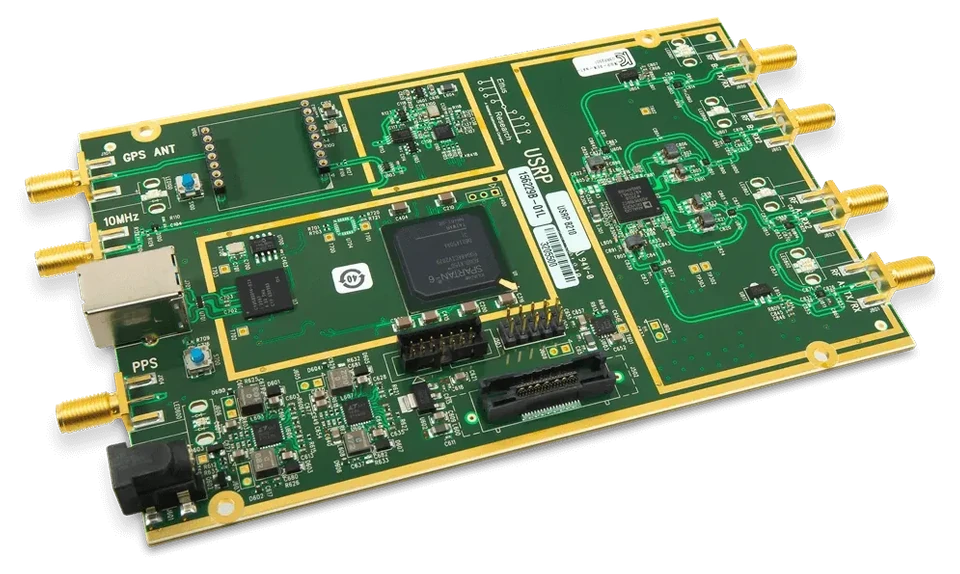

# Spark Setup

[简体中文](setup-bs-spark.zh-CN.md)

This guide covers installing **Spark Console** and the **OCUDU + Open5GS**
base-station protocol stack on **DGX Spark**. Hardware BOM items, port
allocations, and kernel compatibility notes reside in
[Hardware & Topology](hardware-and-topology.md) and
[Ports & Runtime](reference/ports-and-runtime.md).

## Prerequisites

<table>
  <tr>
    <td align="center" valign="bottom" width="50%"><br/><sub><b>DGX Spark (ARM64 Host)</b></sub></td>
    <td align="center" valign="bottom" width="50%"><br/><sub><b>Ettus USRP B210 (USB 3.0)</b></sub></td>
  </tr>
</table>

- **Host**: DGX Spark (ARM64, Ubuntu 24.04, Python 3.12, `systemd`, Docker Engine with Compose).
- **SDR**: Ettus **USRP B210** attached directly to a native USB 3.0 host port.
- **Ports**: Confirm loopback ports `8877` (Spark Console) and `8879` (OCUDU JSON metrics) are free; ports `8000–8002` remain reserved inference ports unallocated by the 5G stack.
- **Locked build inputs**: Verify Open5GS digests (`stacks/open5gs/artifacts.lock.json`), Open5GS source revisions (`stacks/open5gs/sources.lock.json`), OCUDU revision (`config/upstreams.json`), and site contract (`config/network-contract.json`). Retain subscriber secrets in protected deployment storage outside Git.

## 1. Install Spark Console

Generate the ARM64 release archive via `make build-spark-release`, transfer and
unpack it on Spark, and execute archive verification, host compatibility checks,
and installation (initial installation prompts for a Web Console password of at
least 12 characters, stored hashed in `/etc/aoc-monitor/auth.json`):

```sh
python3 -I -B install.py verify --path .
python3 -I -B install.py check-host --path .
sudo python3 -I -B install.py install --path .
```

The installer places files under `/opt/agentic-ocudu/monitor` with
`aoc-control.service`, `aoc-observe.service`, and `aoc-monitor-web.service`
disabled at boot. Installing the management platform does not disturb any
already-running RAN or core stack.

## 2. Install the 5G SA Protocol Stack

Follow [Spark Stack Deployment](../deploy/spark/stack/README.md) to compile
OCUDU and prepare Open5GS images, render and initialize a private authenticated
N6 core deployment bundle, and perform a clean install of
`aoc-v2-core.service`, `aoc-v2-radio.service`, `aoc-v2-cpu-latency.service`, and
`/usr/local/bin/aoc-v2ctl`.

To enable guarded gNB telemetry and isolate real-time scheduling from co-located
AI inference workloads:

1. Execute `sudo python3 scripts/spark/enable_radio_json_metrics.py` to activate root-only loopback telemetry on `127.0.0.1:8879` (`aoc-v2-metrics-guard.service`).
2. Keep `aoc-v2-cpu-latency.service` enabled alongside `aoc-v2-radio.service`, and configure `realtime.conf` (`CPUAffinity`, `LimitRTPRIO=99`) when sharing Spark with compute-intensive GPU/CPU workloads (see [Ports & Runtime](reference/ports-and-runtime.md)).

## 3. Optional Operator Wrappers & Verification

- To enable passwordless `~/aoc-ops/spark/` wrappers, configure `/usr/local/sbin/aoc-maintain` per [Maintenance Helper](../deploy/maintenance/README.md) and deploy the lifecycle scripts described in [Spark Operations](spark-operations.md).
- Forward `127.0.0.1:8877` over SSH and confirm all 12 core containers, active gNB process generation ID, N2 NG Setup, `8879` WebSocket metrics, and bridge counters report healthy. Complete end-to-end user-plane validation from a connected UE on Jetson.
