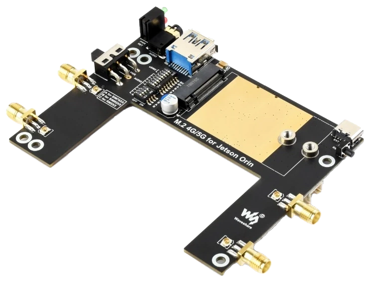

# Jetson Console 安装指南

[English](setup-ue-jetson.md)

本指南说明如何在 **Jetson Orin** 上安装并初始化 **Jetson Console**，并可选开启针对
**Waveshare SIM8262E-M2 5G for Jetson Orin** 扩展载板与 **Quectel RM520N-GL** 模组的
无人值守冷重启自连功能。

## 前置条件

<table>
  <tr>
    <td align="center" valign="bottom" width="33%"><br/><sub><b>Jetson Orin Nano</b></sub></td>
    <td align="center" valign="bottom" width="33%"><br/><sub><b>Waveshare M.2 载板（拨码 C for RM5XX）</b></sub></td>
    <td align="center" valign="bottom" width="33%"><br/><sub><b>Quectel RM520N-GL</b></sub></td>
  </tr>
</table>

- **主机与系统**：Jetson Orin（ARM64、Ubuntu 22.04、Python 3.10、`systemd`、`NetworkManager`）。
- **模组与 USB**：Quectel RM520N-GL 装入 Waveshare 载板并接入 USB 3.0；停用并屏蔽 `ModemManager.service`；确保回环端口 `127.0.0.1:8878` 空闲。参照[硬件与 TB01 附录](reference/hardware-notes.zh-CN.md)核对 `/etc/aoc-v2-jetson/device.json` 中的 `device.at_interface_number` 与当前 RNDIS/ECM 接口布局一致。
- **带外管理网络**：Wi-Fi 具备独立 IPv4 备用默认网关，且 `tailscale0` 可路由到达 Spark 管理地址。外部或管理员创建的默认路由 metric 须严格大于 `10`，使 Jetson Console 的协议 `186` 路由策略（Wi-Fi `metric 5` / 蜂窝 `metric 10`）正常运行而不修改外部 NetworkManager 配置。

## 1. 安装与初始化（Commissioning）

通过 `make build-jetson-release` 构建 ARM64 离线发布包并传输解压至 Jetson Orin，依次
执行包校验、主机预检与安装（首次安装将交互提示设置新的控制台密码）：

```sh
python3 -I -B deploy/manage.py verify
python3 -I -B deploy/manage.py preflight
sudo bash deploy/install-jetson.sh
```

程序安装于 `/opt/agentic-ocudu/jetson`，仅拉起回环 Web 服务，两个 systemd 服务单元默认
不开启开机自启。

随后停止 Jetson Console，将下例中的 `192.0.2.20` 替换为 Spark 的实际 Tailscale IPv4 地址，执行 `commission` 并启动服务：

```sh
sudo /usr/bin/python3 -I -B /opt/agentic-ocudu/jetson/current/deploy/manage.py stop
sudo /usr/bin/python3 -I -B /opt/agentic-ocudu/jetson/current/deploy/manage.py commission \
  --spark-address 192.0.2.20 --wifi-interface auto
sudo /usr/bin/python3 -I -B /opt/agentic-ocudu/jetson/current/deploy/manage.py start
sudo /usr/bin/python3 -I -B /opt/agentic-ocudu/jetson/current/deploy/manage.py status
```

`commission` 将依托已安装的应用环境，把当前实例绑定至在插 SIM 卡指纹与带外管理接口。

## 2. 通过 Web 控制台验收

1. 建立指向 `127.0.0.1:8878` 的 SSH 隧道并登录 **Overview** / **Device Setup** 页面。
2. 触发 **Device Setup**，核验 SIM 就绪、NR SA 注册成功、已获取活动 IPv4 PDU、绑定数据探测通过、`management_protected = true`，且连续通过有效探测后自动切换为蜂窝优先默认路由。
3. 投入常规使用前，建议完整执行一次 `manage.py stop` 与 `manage.py start` 启停周期，核验路由清理与重建正常。

如需配置受限免密运维脚本（`~/aoc-ops/jetson/start.sh`），请先按[维护助手指南](../deploy/maintenance/README.zh-CN.md)部署对应批准包，并参阅[Jetson Console 运维指南](jetson-operations.zh-CN.md)。

## 3. 可选的开机协调

如需开启无人值守冷重启自连（将 `deploy/jetson/boot_connect.py` 安装至 `/opt/agentic-ocudu/jetson/boot_connect.py`）：

1. **在 `aoc-v2-jetson-device.service` 停止状态下完成只读 AT 预检**：对照[硬件与 TB01 附录](reference/hardware-notes.zh-CN.md#rm520n-gl-qmap-与-mpdn-固件核查)逐项核实 AT 查询与 USB 速率检查均正常返回。
2. **完成应用安装后再生成 `/etc/aoc-v2-jetson/boot.json`（`0600`，root 持有）**：确保 `device_sha256`、`manifest_sha256`、`sim_sha256`、`usb_speed_mbps` 与 `modem_configuration` 与现役运行版本一致，并创建 `/var/lib/aoc-v2-jetson-boot/private`（`0700`）与 `public`（`0755`）。
3. **部署 systemd drop-in 与开机一次性单元**：
   - `/etc/systemd/system/aoc-v2-jetson-device.service.d/boot-ready.conf`：配置 `TimeoutStartSec=360`，以 `ExecStartPre=` 重置后串联 `boot_connect.py ready` -> `site_guard.py` -> `network_entry.py --config /etc/aoc-v2-jetson/device.json --action fallback`，待 USB 枚举、模组 DHCP、Wi-Fi 与 `tailscale0` 全部就绪后再拉起 `device_entry.py`。
   - `/etc/systemd/system/aoc-v2-jetson-boot.service`（`Type=oneshot`、`After=aoc-v2-jetson-device.service aoc-v2-jetson-web.service`）：最长等待 `30 s` 直至 `/run/aoc-v2-jetson/device.sock` 就绪，随后运行 `/usr/bin/python3 -I -B /opt/agentic-ocudu/jetson/boot_connect.py connect`（`TimeoutStartSec=1200`）完成标准入网编排并激活带自愈的蜂窝数据通道。
4. **冷重启实机验收**：冷启动后核查 systemd 服务状态、`boot_id`、`/var/lib/aoc-v2-jetson-boot/public/status.json`、蜂窝默认路由以及带外 Wi-Fi/`tailscale0` 管理可达性。多台 UE 场景下请逐台完成配置与冷重启验证。
