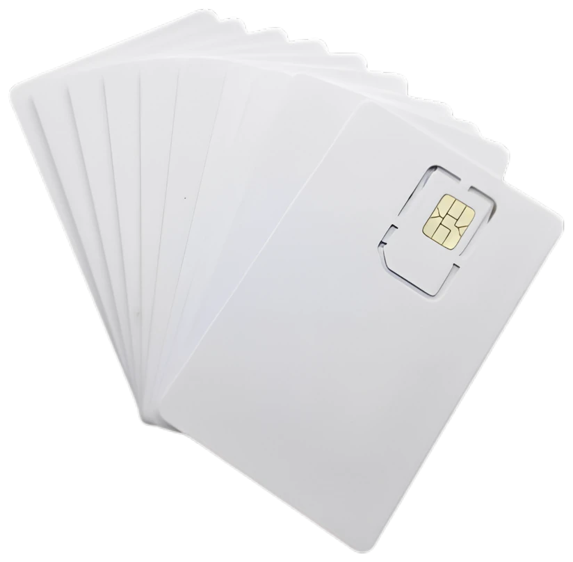
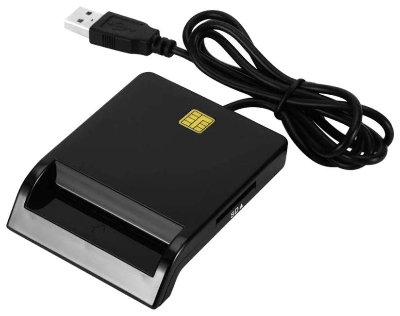

# Subscriber Provisioning and USIM Setup

[简体中文](sim-provisioning.zh-CN.md)

This procedure covers registering a UE subscriber identity in **Open5GS** and
programming a matching **programmable 5G USIM** card for **Jetson Orin +
Quectel RM520N-GL** attachment.

## Requirements

<table>
  <tr>
    <td align="center" valign="bottom" width="50%"><br/><sub><b>Programmable 5G USIM</b></sub></td>
    <td align="center" valign="bottom" width="50%"><br/><sub><b>USB CCID / PC/SC Reader</b></sub></td>
  </tr>
</table>

- Any standard **Milenage-capable programmable 5G USIM** (for instance, cards
  supported by upstream [Osmocom pySim](https://downloads.osmocom.org/docs/pysim/master/html/)).
- A standard USB CCID/PC/SC smartcard reader connected to your provisioning workstation.
- Subscriber credentials (`IMSI`, `Ki`, `OPc`) aligned with the 5G network
  contract defined in [Network & RF Profile](reference/network-and-rf-profile.md).

## 1. Provision an Independent Subscriber in Open5GS

Assign each UE a distinct `IMSI`, `Ki`, and `OPc` (initial `sqn=0`). On
**DGX Spark**, register the subscriber entry with `stacks/open5gs/subscriber.py`:

```sh
python3 stacks/open5gs/subscriber.py --help
```

Configure a single IPv4 data PDU aligned with the
[Network & RF Profile](reference/network-and-rf-profile.md) (`PLMN`, `DNN`,
`SST`, `5QI`). Never share one subscriber identity across multiple USIM cards or
UE hosts.

## 2. Program and Verify the 5G USIM

1. Retain exported subscriber manifests (`sim.json`, identity records, and
   backups) strictly in an access-restricted local directory outside Git
   (`chmod 0700` directories, `chmod 0600` files).
2. Program `EF.IMSI`, `Ki`, `OPc`, and the **Milenage** authentication algorithm
   via your PC/SC reader (`pySim` or your card vendor's utility). Supply `OPc`
   verbatim without re-deriving it from `OP`.
3. Verify persistent `IMSI` readback and execute a local Milenage AKA test
   vector (`AUTS` check) before inserting the Nano-SIM into the **Waveshare
   M.2 5G Carrier** on Jetson Orin.

> [!NOTE]
> When programming **TB01** unprovisioned 5G USIM test cards, follow the verified
> PC/SC `T=0` transport rules and APDU command table in
> [Hardware & TB01 Notes](reference/hardware-notes.md#tb01-programmable-usim-apdu-reference).
